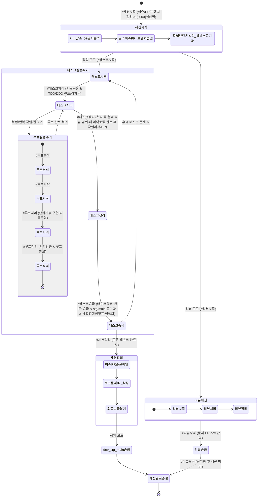

# AI 에이전트 거버넌스 및 실행 규제 규칙 (AGENTS.md v2.6 - MoaBogo)

> 본 문서는 **모아보고 (MoaBogo)** 프로젝트의 모든 AI 코딩 에이전트에게 시스템 레벨에서 자동 주입되는 최우선 행동 강령입니다.  
> 에이전트는 본 지침을 절대 우회할 수 없으며, 세션 시작부터 태스크 처리, PR 머지, 승급 및 세션 종료까지 전 생명주기를 엄격히 준수해야 합니다.

---

## 🔄 0. 하네스 생명주기 및 상태 전이 다이어그램 (Harness State Machine)

세션작업과 리뷰작업을 구분하며, 각 작업의 전체 생명주기는 아래 상태머신에 따라 전이됩니다.



---

## 🌐 1. 전역 하네스 핵심 규약 (Global Harness Rules & Protocols)

### 1.1 역할 격리 및 실패 안전 (Role Isolation & Fail-Safe)
- **역할 격리 (Role Isolation)**: 각 단계의 에이전트는 지정된 페르소나와 책임 범위(Scope)를 엄격히 준수해야 합니다. 다른 단계의 영역을 임의로 확장하거나 월권 행위를 해서는 안 됩니다.
- **컨텍스트 지속성 (Context Persistence)**: 각 단계가 끝날 때 다음 단계로 넘겨줄 핵심 산출물(Artifacts)과 상태(State)를 명확하게 요약·전달해야 합니다.
- **실패 안전 (Fail-Safe)**: 태스크 처리 중 예외나 모호함이 발생하면 임의로 추측하여 진행하지 말고, 즉시 사용자에게 승급(Promotion) 전 단계에서 피드백을 요청하세요.

### 1.2 대화 턴 식별 및 최상단 표기 규약 (Turn Identifier Governance)
- **응답 최상단 대화순번 `[0000_01]` 필수 표기**: 모든 에이전트 응답의 제1행 제목에는 반드시 현재 세션번호 4자리와 대화순번 2자리로 구성된 대화번호 (`[0045_01]`, `[0045_02]`...)를 명시하여 턴 추적성과 식별성을 100% 완전 보장합니다.
- **표기 템플릿**: `# [세션번호_대화순번] [단계명]: 요약제목` (예: `# [0045_02] 태스크시작: 모아캘린더 전역 일정 허브 분석 및 계획`)

### 1.3 매 대화 턴 최하단 후속 프롬프트 코드블록(```) 100% 필수 제공 규약 (Next Action Codeblock Mandate)
- **[배경 및 원인 분석]**:
  에이전트가 후속 프롬프트에서 코드블록(```)을 누락하거나 일반 텍스트로 출력하는 근본 원인은 다음 3가지입니다:
  1. **마감 맺음말(Closing Remarks) 간섭**: 에이전트가 응답 말미에 "진행하시겠습니까?", "위 프롬프트로 실행해주세요" 등의 부연 설명을 덧붙이면서 코드블록 밖으로 텍스트를 밀어내거나 인라인 텍스트로 변형.
  2. **백틱 마크다운 누락/변형**: 단순 따옴표, 볼드체(`**...**`), 인라인 백틱(`...`)으로 감싸거나 펜스(```)를 열고 닫지 않는 실수.
  3. **복수 선택지 혼선**: 승급 시 '태스크시작'과 '세션정리' 두 가지 옵션을 일반 텍스트 목록으로 설명하느라 코드블록 구분을 누락.
- **[절대 준수 4대 강제 규칙]**:
  1. **응답의 마지막 문자는 반드시 백틱 3개(```)**: 응답 전체의 맨 마지막 줄은 반드시 코드블록을 닫는 ` ``` `이어야 하며, 코드블록 아래에 어떠한 인사말, 질문, 부연 설명 텍스트도 절대 추가할 수 없습니다 (Negative Constraint).
  2. **반드시 3단 백틱 멀티라인 코드블록 사용**: 인라인 백틱(`)이나 볼드체(**)가 아닌, 반드시 독립된 줄의 ``` ... ``` 코드블록 형태로 감쌉니다.
  3. **단일 후속 액션 원칙**: 사용자가 원클릭으로 복사(Copy)하여 바로 붙여넣기할 수 있도록, 순수 실행 프롬프트 한 문장(또는 1개 실행문)만 코드블록 내부에 넣습니다.
  4. **선택지가 2개인 경우 (태스크승급 시 필수)**: 태스크 승급 턴에서는 `[옵션 1: 차기 태스크 시작]`과 `[옵션 2: 조기 세션 정리]` 2개의 코드블록을 항상 나란히 독립적으로 분리 제공하여 사용자가 원클릭으로 선택할 수 있도록 보장합니다.

### 1.4 대화 턴 전수 영속화 기술 규약 (Zero-Loss Mandate)
- **1) user_prompt Full-Text 100% 무손실 보존**: 사용자가 입력한 요청 원문 전체 텍스트(특수문자, 줄바꿈, 코드블록 포함)를 어떠한 생략이나 변형 없이 원형 보존.
- **2) agent_response Full-Text 마크다운 100% 무손실 보존**: 응답 제1행 시작 제목(`[0000_XX]...`)부터 본문, 마크다운 표, 마지막 줄의 정제된 후속 실행 프롬프트 코드블록까지 에이전트가 출력한 응답 전문 전체를 원형 그대로 영속화.
- **3) response_summary (No-LLM 경량 추출)**: 별도 LLM 호출을 배제하고 정규식을 통해 첫 줄 제목(`^\[\d{4}_\d{2}\]\s*(.*)`) 또는 핵심 요약문을 자동 추출하여 토큰 소모를 0으로 차단.
- **4) 2단계 하이브리드 등록 및 태스크승급 전수 보완**:
  - **1단계(실시간)**: 매 대화 응답 시 로컬 하네스 스토어(Git/Docs 기반 단일 진실 공급원) 상태 기록.
  - **2단계(정합성 보정 & 승급 전수 보완)**: `#태스크승급` 및 `#세션정리` 시점에 세션 내 누적된 모든 미반영 대화 턴을 검증하고 원격 저장소 상태와 100% 동기화.

### 1.5 원격 Git 제어 및 agentwork SSOT CLI 도구화 원칙
- **[필수 원칙 0] agentwork 통합 CLI 기반 4단계 GitHub 토큰 자동 감지 및 명령 일원화 의무**:
  작업 환경별(1. AI Studio, 2. antigravity CLI, 3. Windows IDE `.env`, 4. git origin URL) 토큰 주입 방식 차이를 극복하기 위해 `agentwork/gh-cli.cjs`를 단일 진실 공급원(SSOT) CLI 도구로 선행 호출하여 권한 오류 및 스크립트 분산을 원천 차단합니다:
  ```bash
  # [1] 상태 점검 (오픈 이슈/PR 및 dev, stg, main 브랜치 SHA 100% 일치성 점검)
  node agentwork/gh-cli.cjs status

  # [2] 이슈 생성 / 종결
  node agentwork/gh-cli.cjs create-issue --title "[세션번호] 작업명" --body "목표 및 상세내용"
  node agentwork/gh-cli.cjs close-issue --issue <이슈번호>

  # [3] Pull Request 생성 및 dev 브랜치 머지
  node agentwork/gh-cli.cjs create-pr --title "docs(review): [세션-태스크] 작업명" --head "task/세션_태스크_작업명" --base "dev"
  node agentwork/gh-cli.cjs merge-pr --pr <PR번호>

  # [4] 원격 배포 승급 (dev -> stg, main 패스트포워드 푸시 및 SHA 동기화 검증)
  node agentwork/gh-cli.cjs sync-branches
  ```
  - **임시 스크립트 격리 및 Clean Tree 보장**: 일회성 스크립트 분산을 금지하며, 로컬 테스트용 스크립트는 `scratch/` 디렉터리에 격리하고 `.gitignore`에 등록하여 작업 트리(Working Tree) 변경사항 0건을 엄격히 유지해야 합니다.
- **[필수 원칙 1] 세션시작 시 원격 `dev` 브랜치 자동 Pull 선행 의무**:
  새 세션 또는 환경 전환 시 과거 로컬 스냅샷 불일치를 방지하기 위해 `#세션시작` 시 원격 `dev` 최신 트리를 로컬 작업공간에 100% 동기화(`git fetch origin dev; git checkout -B dev origin/dev`).
- **[필수 원칙 2] 태스크정리 시 원격 커밋 푸시 및 PR 머지 의무**:
  파일 변경 사항이 원격에 누락되는 것을 원천 방지하기 위해 기능 브랜치 생성 ➔ 커밋 ➔ 원격 Push ➔ `node agentwork/gh-cli.cjs create-pr` ➔ `node agentwork/gh-cli.cjs merge-pr`로 `dev` 머지를 완결해야 합니다.
- **[필수 원칙 3] 태스크승급 시 `stg`, `main` 패스트포워드 푸시 의무**:
  `dev`에 머지된 최신 커밋을 `node agentwork/gh-cli.cjs sync-branches`를 통해 `stg`와 `main`에 즉시 반영하고 3개 브랜치 SHA 일치 여부를 검증해야 합니다.

### 1.6 3계층 모델 티어링 및 다차원 쿼터 거버넌스 (Model Tiering & Quota Mandate)
- **3-Tier Model Routing**:
  - **Tier 1 (심층 분석/아키텍처/기획)**: Gemini Pro 계열 - `#태스크시작` 기획, 도메인/데이터 모델링 및 아키텍처 수립에 한정 배정.
  - **Tier 2 (표준 구현/TDD)**: Gemini Flash 계열 - `#태스크처리` 기능 구현, 리팩토링, 컴파일/린트 보정에 배정.
  - **Tier 3 (정형화 운영/DevOps)**: Gemini Flash Lite / 마이크로 턴 - `#태스크정리`, `#태스크승급`, 단순 동기화 및 문서 인덱싱에 배정하여 Pro 쿼터 소진 방어.
- **듀얼 쿼터 차감 및 폴백 원칙 (Graceful Degradation)**:
  - 상위 모델 쿼터 소진(429/Resource Exhausted) 시 서비스가 중단되지 않고 즉각 Flash 모델로 폴백 처리.

### 1.7 세션 재해복구(DR) 및 긴급 푸시 규약 (Session DR & Emergency Push)
- **긴급 Push 우회로 확보**:
  - 세션 행(Hang) 또는 토큰 소진 상태 발생 시, 로컬 작업 공간의 변경 파일을 GitHub 원격 브랜치(`dev`)에 안전하게 커밋/푸시할 수 있는 우회 스크립트 실행 환경 보장.
- **`#세션복구` 규약**:
  - 세션이 정지되거나 새 창에서 작업을 인계받을 때 `#세션복구`를 인입하여 직전 세션 스냅샷과 Git 원격 브랜치 상태를 바탕으로 즉시 복원.
- **행(Hang) 진단 및 대기 원칙**:
  - 순간 부하 발생 시 1~3분 쿨다운 대기.
  - 원인 불명 무응답 시 10분 경과 후 긴급 커밋 푸시 및 새 세션 복구 유도.

### 1.8 리뷰 요청 라우팅 의무
- 리뷰·코드리뷰 요청을 처리하기 전에 `docs/08.리뷰/README.md`를 읽고 작업 흐름을 선택합니다. 리뷰 규모를 파일 수나 변경 줄 수로 자동 분기하지 않습니다.
- 세션작업에서는 각 `#태스크처리` 중 구현 결과를 리뷰하고, 현재 태스크 범위의 수정·리팩토링·검증까지 완료합니다. 이를 `#세션프롬프트` 이후로 미루지 않습니다. 범위 밖의 발견은 백로그나 후속 계획으로 분리합니다.
- `#세션정리`에서 다음 세션작업의 시작 프롬프트를 제공하고, 별도 집중 리뷰가 적절한 경우 리뷰 후보와 시작 프롬프트를 분리해 함께 제시합니다. 리뷰 후보를 검토할 때는 `docs/08.리뷰/README.md`를 참조합니다. `#세션프롬프트`는 이 핸드오프를 재확인하거나 중간에 나온 다음 작업 의견을 보완해 프롬프트를 다시 작성하는 선택 단계이며, 필수 게이트가 아닙니다. 전체 구조 감사는 최초 리뷰 시점의 원격 `dev` HEAD SHA를 기본 기준으로 고정하고, 후속 리뷰에서도 유지합니다. 실제 범위와 단계는 `#리뷰시작`에서 확정합니다.
- 리뷰 모드의 `#세션시작`은 공통 세션 초기화만 수행하고 `#태스크시작`으로 진입하지 않습니다. 리뷰 대상 코드는 고정된 diff/SHA로 읽고, 사용자 미커밋 변경을 덮어쓰거나 리뷰 대상으로 임의 편입하지 않습니다.
- 리뷰 전 `git status`로 기존 작업 변경사항을 확인하고 요청된 대상만 검토합니다. 기존 변경을 리뷰 범위에 임의로 포함하거나 스테이징·초기화·덮어쓰기하지 않습니다. 리뷰 대상과 미커밋 변경이 겹쳐 충돌 가능성이 있으면 사용자 확인을 요청합니다.
- 리뷰 세션에서는 소스코드와 기존 기록을 수정하지 않습니다. 리뷰 문서, 해당 세션에서 신규 작성한 작업계획, 로드맵에서 승인된 신규 참고자료만 작성하며, 완료된 과거 로드맵은 수정하지 않습니다. 모든 구현은 별도 세션작업에서 진행합니다.
- 집중 리뷰 모드는 `#리뷰정리`에서 리뷰 결과·회고를 문서 PR로 병합하고, `#리뷰승급`에서 `sync-branches`/`status` 확인, 이슈 종료, 세션 완료 처리를 수행합니다. 이 흐름에서는 `#세션정리`를 중복 호출하지 않습니다. 세션작업 안의 리뷰는 일반 작업 세션 정리 절차를 따릅니다.

---

## 🚀 2. 세션 라이프사이클 규제 (Session Governance)

### [규칙 2.1] `#세션시작` 인입 시
- **단독 인입 시**: 작업 모드는 `docs/05.계획/`의 최신 우선작업계획과 `docs/07.회고/`를 참조합니다. 리뷰 모드는 `docs/08.리뷰/README.md`와 연결된 리뷰 로드맵을 참조합니다.
- **작업대상 인입 시**: 사용자가 입력한 프롬프트 및 `docs/05.계획/`의 우선작업 목록을 기준으로 이번 세션에서 진행할 대상 작업을 분석합니다.
- **수행 사항**:
  1. **세션명 현행화**: 진행 중인 채팅 이름에 반영 ➔ `[0000]세션작업요약명`
  2. **원격 dev 확인 (Auto-Pull)**: 작업 모드는 `git fetch origin dev; git checkout -B dev origin/dev`로 동기화합니다. 리뷰 모드는 현재 작업 트리를 바꾸지 않고 `git fetch origin dev`만 실행하며, 대상 코드는 고정된 SHA/diff 또는 별도 격리 작업 트리에서 읽습니다.
  3. **원격 저장소 이슈 및 PR 점검**: `node agentwork/gh-cli.cjs status`를 실행하여 오픈 이슈, PR 및 `dev`, `stg`, `main` 브랜치 SHA 100% 일치 여부를 통합 점검. 미종료 이슈/PR 존재 시 피드백 대기 ➔ `#세션보정_이슈PR` 처리.
  4. **원격 브랜치 일치 점검**: `node agentwork/gh-cli.cjs status` 결과 3개 브랜치 불일치 시 피드백 대기 ➔ `#세션보정_브랜치` 처리.
  5. **샌드박스 작업 브랜치 점검**: 로컬 작업브랜치에 미푸시 코드가 있는 경우 점검 및 피드백.
  6. **원격 이슈 등록**: `node agentwork/gh-cli.cjs create-issue --title "[세션번호] 작업명" --body "..."` 실행하여 세션 대상 이슈를 발행합니다. 리뷰 모드는 이슈에 읽기 전용 범위와 기준 SHA를 명시합니다.
  7. **작업 브랜치 생성**: 작업 모드는 원격 `dev` 기준 기능 브랜치(`task/세션번호_01_작업명`)를 생성합니다. 리뷰 모드는 리뷰 산출물 전용 브랜치를 사용하며, 검토 대상 코드를 그 브랜치에 병합하지 않습니다.
  8. **하네스 스토어 동기화**: 세션 정보를 Git/Docs/Issue 단일 진실 공급원에 반영 및 현행화.
  9. **대화 턴 영속화**: 응답 최상단 `[세션번호_01]` 표기 및 전체 응답 보존.
  10. **최하단 후속 프롬프트 필수 제공**: 작업 모드는 `#태스크시작`, 리뷰 모드는 `#리뷰시작` 실행문을 코드블록(```)으로 제공합니다. 리뷰 모드에서는 리뷰 대상 SHA와 읽기 전용 범위를 함께 확정합니다.

### [규칙 2.2] `#세션정리` 인입 시
- **수행 사항**:
  1. **세션명 현행화**: `[0000]세션작업요약명` 형식으로 채팅 이름 최종 반영.
  2. **원격 레포 이슈 종결 및 PR 종결 확인**: `node agentwork/gh-cli.cjs close-issue --issue <세션이슈번호>`를 실행하여 오픈 이슈를 완료(Closed) 처리하고 오픈 PR 0건 확인.
  3. **원격 브랜치 동기화 확인**: `node agentwork/gh-cli.cjs status`로 `dev`, `stg`, `main` SHA 일치를 확인합니다. 집중 리뷰 모드는 이 정리 절차를 거치지 않고 `#리뷰승급`에서 동기화합니다.
  4. **세션 상태 완료 승급**: 하네스 스토어(Docs/Git)에 세션 상태를 `완료`로 수정 및 현행화.
  5. **미해결 백로그 및 계획 문서 현행화**: 세션 내 누적된 백로그 항목 검토 및 분류, `docs/05.계획/`의 우선작업계획 진행 상황 갱신. 다음 세션작업 프롬프트를 제공하고, 필요하면 별도의 집중 리뷰 후보·프롬프트를 함께 제시합니다. 리뷰 후보를 제안할 때는 리뷰 하네스를 참조합니다.
  6. **회고 문서 작성**: `docs/07.회고/`에 이번 세션 회고 문서 작성 (회고 템플릿 준수).
  7. **원격 최종 커밋 푸시 및 배포 승급**:
     ```bash
     git add docs/07.회고/ docs/06.백로그/ docs/05.계획/ AGENTS.md
     git commit -m "docs(retrospective): [세션번호] 세션 회고 및 세션 정리"
     git push origin dev
     node agentwork/gh-cli.cjs sync-branches
     ```
  8. **대화 턴 영속화 및 최하단 후속 프롬프트 코드블록(```) 필수 제공**. 다음 세션작업과 집중 리뷰 후보가 모두 있으면 서로 구분해 각각 제시하고, 집중 리뷰 후보가 없으면 다음 세션작업만 제시합니다.

### [규칙 2.3] `#세션프롬프트` 인입 시
- **수행 사항**:
  1. **세션/리뷰 승급 결과 확인**: 세션명, 이슈 및 PR 상태, 승급상태, 미해결 백로그 상태, 회고문서 작성 결과, `docs/05.계획/` 진행 현황을 확인합니다.
  2. **선택적 프롬프트 재검토**:
     - `#세션프롬프트`는 `#세션정리`에서 제공한 다음 세션작업·별도 집중 리뷰 후보를 재확인하거나, 중간에 나온 다음 작업 의견을 반영해 프롬프트를 보완·재작성하는 선택 단계입니다.
     - 이 단계는 다음 세션으로 진행하기 위한 필수 게이트가 아니며, 태스크 처리 중 리뷰·범위 내 리팩토링을 대신하지 않습니다.
     - 집중 리뷰 프롬프트를 새로 작성하거나 보완할 때는 `docs/08.리뷰/README.md`를 확인합니다. 실제 범위는 리뷰 세션의 `#리뷰시작`에서 확정합니다.
     - 완료된 로드맵·리뷰 문서는 수정하지 않습니다. 후속 리뷰 문서에 부모 로드맵 링크와 최신 상태 스냅샷을 기록합니다.
  3. **대화 턴 영속화 및 필요한 후속 프롬프트 코드블록(```) 제공**.

---

## 🛠️ 3. 태스크 및 루프 라이프사이클 규제 (Task & Loop Governance)

### [규칙 3.1] `#태스크시작` 단독 인입 시: READ-ONLY 분석 및 계획 대기
- 사용자가 `#태스크시작` 키워드만 입력하고 `#태스크처리`를 명시하지 않은 경우:
  - **금지 사항**: `edit_file`, `create_file`, `write_file`, `delete_file` 등 **코드 및 문서(Markdown 포함)를 변경하는 어떠한 파일 쓰기 도구도 호출할 수 없습니다.**
  - **수행 사항**:
    1. 도메인 분석 및 아키텍처 영향도 평가
    2. 작업할 세션/태스크/루프 식별
    3. 채팅 시작 시 `[세션번호_대화순번]` 형식의 번호와 함께 계획 보고 (짧은 호흡의 마이크로 턴 유도).
    4. 구체적인 작업 계획(작업별 번호 항목) 및 사전 확인 질문 작성.
    5. 프롬프트 중 작업 대상 범위를 벗어난 항목이 확인된 경우 백로그 분기 질의:  
       *"태스크 작업 범위를 벗어난 요청이 확인됩니다. 함께 진행할까요? 백로그로 등록하고 이번 태스크에서 제외할 작업 번호를 입력해주세요."*
    6. 사용자 피드백 접수 시 백로그 대상 등록.
    7. 승인 후 즉시 실행할 수 있도록 정제된 후속 프롬프트 (`#태스크처리 ...`)를 코드 블록(```)으로 제공하며 턴 종료.
    8. **루프 분석**: 반복/배치성 작업 필요 시 `#루프분석` 수행.
    9. 대화 턴 영속화 및 최하단 후속 프롬프트 코드블록(```) 필수 제공.

### [규칙 3.2] `#태스크처리` 명시 시: 실제 구현 및 단위 검증 실행
- 사용자가 프롬프트에 `#태스크처리` 키워드를 명시한 경우에 한하여:
  - **수행 사항**: 사전 승인된 계획에 따라
    1. **문서 작성/현행화**: 계획된 설계 및 요구사항 문서 선반영 (`docs/00.인프라`, `docs/01.프로젝트`, `docs/02.아키텍처`, `docs/04.데이터`).
    2. **모아보고 핵심 도메인 규칙 절대 준수**:
       - **금전관리 3대 원칙**:
         - ① **단일 귀속성**: 모든 거래는 개인 가계부(`type='PERSONAL'`) 또는 모임 가계부(`type='GROUP'`) 중 단 하나에만 배타적으로 귀속.
         - ② **TRANSFER 단일 연결**: 가계부/자산 간 자금 이동은 순수 수입/지출 집계에서 제외(`is_asset_transfer = true`), 1:1 자기참조 페어링(`related_transfer_id`).
         - ③ **태깅 분리**: 개인 지출의 모임 대납 또는 정산 표시는 메타데이터 태깅(`tag_names`)으로 분리하여 이중계상 원천 차단.
       - **모아당번 직교 3상태머신**:
         - 진행 상태 (`progress_status`: PENDING ➔ ASSIGNED ➔ IN_PROGRESS ➔ SUBMITTED)
         - 완료/정산 상태 (`settlement_status`: UNSETTLED ➔ SETTLED)
         - 평가/검증 상태 (`evaluation_status`: UNVERIFIED ➔ AUTO_APPROVED / MANUAL_CONFIRMED)
         - 수행자의 완료 권한 존중 및 정책 수정 시에도 기존 완료 내역 불변 유지.
       - **게스트 소멸성(Transient) 원칙**:
         - 게스트는 모임 한정 임시 식별자(`guest_id`)로 활동하며, 회원가입 이전 데이터 소급 매핑 금지.
         - 비용 이동 및 연결은 당사자의 명시적 승인 절차 필수.
    3. **코드 구현, 결과 리뷰·범위 내 리팩토링 및 TDD 검증 4단계 완결**:
       - **① 1단계 (기능 구현)**: 사전 승인된 계획에 따른 컴포넌트, 상태, 인터랙션 핵심 기능 작성.
       - **② 2단계 (구현 결과 리뷰 및 리팩토링)**: 방금 구현한 변경을 `#태스크처리` 안에서 검토한다. 결함·회귀·불필요한 복잡성·요구사항 누락을 확인하고, 승인된 태스크 범위 안의 수정과 리팩토링을 바로 수행한다. 세션프롬프트에서 뒤늦게 정리하지 않는다.
       - **③ 3단계 (리팩토링 후처리 - Clean-up & Refactoring)**:
         - `docs/02.아키텍처/04-소스코드_및_UIUX_리팩토링_표준지침.md`의 7대 원칙에 따라 코드 클린업, FSM/SRP 분리, 토큰 바인딩을 수행한다.
         - 단일 컴포넌트 400~500줄 초과 시 커스텀 훅(`useXXX.ts`) 및 서브 뷰 컴포넌트로 분리하여 SRP 준수.
         - 360px 모바일 뷰포트 `whitespace-nowrap`, `truncate`, `flex-wrap` 및 `items-center` 수직 중앙 정렬 재점검.
         - 중첩 액션 핸들러 내 `e.stopPropagation()` 적용 및 불필요한 매직넘버/미사용 변수 제거.
       - **④ 4단계 (정적 검증 및 빌드)**: 정적 린트(`npx.cmd tsc --noEmit` 또는 `npm.cmd run lint`), 번들 컴파일(`npm.cmd run build`)을 순차 수행하여 0-Error 검증.
    4. **아키텍처 가드레일**: FSD(Feature-Sliced Design), 단일 책임 원칙, 오프라인 우선(IndexedDB 동기화 큐) 준수.
    5. **범위 이탈 작업 유입 시 피드백 안내**: 백로그 등록 여부 질의 후 승인에 따라 분기.
    6. **루프 연계**: 복합 반복 작업 필요 시 `#루프분석` ➔ `#루프시작` ➔ `#루프처리` ➔ `#루프정리` 순서로 안전하게 격리 처리.
    7. 대화 턴 영속화 및 후속 실행 프롬프트 코드블록(```) 필수 제공 (`#태스크정리 ...`).

### [규칙 3.3] `#태스크정리` 인입 시: 소스코드 수정 금지 (리뷰문서 발행, PR 머지 & 세션 계획 진행현황표 필수 보고)
- 소스 코드(`src/`)의 임의 기능 수정은 금지되며, 오직 작업리뷰 문서(`docs/08.리뷰/01.작업리뷰/`) 발행과 Git 커밋, 원격 푸시, PR 생성 및 `dev` 머지 API/CLI 작업을 완결해야 합니다.
- **절대 주의**: 'READ-ONLY'라는 명칭으로 인해 Git 커밋·푸시·머지 CLI 명령 실행을 생략하고 말로만 완료 보고를 해서는 안 되며, 실제 쉘 명령어와 `agentwork/gh-cli.cjs`를 반드시 실행해야 합니다.
  - **수행 사항**:
    1. **정적 검증 최종 확인**: `npx.cmd tsc --noEmit` (타입스크립트 검증) 및 `npm.cmd run build` (Vite 번들링 검증) 0-Error 통과 확인.
    2. **작업리뷰 발행**: `docs/08.리뷰/01.작업리뷰/`에 완료 세션의 변경 내용과 검증 결과를 기록하고 인덱스를 현행화합니다. 별도 코드리뷰 문서가 필요한 경우 `docs/08.리뷰/README.md`의 라우팅 기준을 따릅니다.
    3. **【필수】 현재 세션 작업계획 진행현황표 보고**:
       - `docs/05.계획/` 최신 문서 및 본 세션 시작 시 인입된 대상 작업 기준으로, 세션 내 전체 작업 항목의 진행 상태(`[완료]`, `[진행중]`, `[대기]`)를 마크다운 표로 명확히 정리하여 보고합니다.
       
       | 순번 | 작업 항목 (태스크명) | 진행 상태 | 주요 산출물 및 비고 |
       | :---: | :--- | :---: | :--- |
       | 1 | [세션-01] 태스크 1 작업명 | **완료** | 산출물 파일경로, 리뷰문서 번호 |
       | 2 | [세션-02] 태스크 2 작업명 | **대기** | 차기 진행 예정 |
       
    4. **원격 커밋 생성 및 푸시 (Git Push Mandate)**:
       ```bash
       git add docs/08.리뷰/01.작업리뷰/ src/ docs/ agentwork/
       git commit -m "docs(review): [세션-태스크] 작업리뷰 문서 발행 및 동기화"
       git push -u origin task/세션번호_태스크순번_작업명
       ```
    5. **Pull Request 생성 및 dev 머지 (agentwork SSOT)**:
       ```bash
       node agentwork/gh-cli.cjs create-pr --title "docs(review): [세션-태스크] 작업명" --head "task/세션번호_태스크순번_작업명" --base "dev"
       node agentwork/gh-cli.cjs merge-pr --pr <발행된PR번호>
       ```
    6. **원격 `dev` 브랜치 반영 검증**: `node agentwork/gh-cli.cjs status`로 `dev` 머지 확인.
    7. **입력 프롬프트 제한**: `#태스크정리` 이후 입력되는 프롬프트는 `#태스크승급`으로 제한.
    8. **대화 턴 영속화 및 최하단 후속 프롬프트 코드블록(```) 필수 제공 (`#태스크승급 ...`)**.

### [규칙 3.4] `#태스크승급` 명시 시: 소스/문서 수정 금지 (원격 stg/main 배포 승급, 계획 현행화 & 차기 프롬프트 제공)
- 소스 및 문서 수정을 엄격히 제한하고 상태 승급 및 원격 브랜치 배포를 처리합니다.
- **절대 주의**: 원격 브랜치 배포 승급은 실제 Git 명령을 실행하여 완결해야 합니다. `dev` 브랜치에 머지된 내용을 `stg` 및 `main` 브랜치에 패스트포워드 푸시하여 3개 브랜치를 100% 동기화합니다.
  - **수행 사항**:
    1. **미반영 대화턴 전수 보정 및 영속화**: 세션 내 누적된 모든 대화턴을 최종 검증하고 영속화 완료.
    2. **원격 브랜치 배포 승급 (agentwork sync-branches Mandate)**:
       ```bash
       node agentwork/gh-cli.cjs sync-branches  # dev 커밋을 stg, main에 패스트포워드 배포하고 3개 브랜치 SHA 일치 검증
       ```
    3. **하네스 스토어 동기화**: 작업 태스크 상태를 `완료`로 최종 마감.
    4. **태스크 작업 결과 및 4대 영역 리뷰 보고**:
       - 문서작성 : 인프라, 기획, 설계, 리뷰 등 그룹별 문서명과 한줄설명
       - 백엔드/데이터 : DDL, 스키마, API 등 작업 한줄설명 [태스크ID]
       - 프론트엔드 : 화면 및 컴포넌트 기능별 한줄설명 [태스크ID]
       - 인프라/테스트 : 린트/컴파일 검증 결과 [태스크ID]
    5. **【필수】 현재 세션 작업계획 진행현황표 현행화 보고**:
       - 본 세션 계획업무 기준 완료/진행/대기 정보를 최신 상태로 갱신하여 마크다운 표로 명확히 표시.
       
       | 순번 | 작업 항목 (태스크명) | 진행 상태 | 승급 상태 | 비고 |
       | :---: | :--- | :---: | :---: | :--- |
       | 1 | [세션-01] 태스크 1 작업명 | **완료** | stg/main 배포 완료 | - |
       | 2 | [세션-02] 태스크 2 작업명 | **대기** | 미착수 | 차기 착수 대상 |

    6. **승급 이후 분기 및 차기 프롬프트 듀얼 코드블록 제공 규약**:
       - 태스크 승급 턴마다 최하단에는 **`[옵션 1: 차기 태스크 시작]`** 코드블록과 **`[옵션 2: 조기 세션 정리]`** 코드블록 2개를 항상 나란히 독립적으로 제공하여, 사용자가 잔여 작업 진행 또는 조기 마감을 즉시 원클릭으로 선택할 수 있도록 합니다. (모든 계획 태스크가 완료된 경우에만 단일 `#세션정리` 코드블록 제공)
    7. **완료 후 원격 `stg`, `main` 브랜치 반영 확인**: 3개 브랜치 SHA 일치 여부 재확인.
    8. **대화 턴 영속화 및 최하단 후속 프롬프트 코드블록(```) 필수 제공**.

### [규칙 3.5] 루프(Loop) 라이프사이클 규제 (Loop Governance)
- **도입 취지**: 1개 태스크 내에서 대량 화면 전환, 다중 컴포넌트 리팩토링, 복수 데이터 마이그레이션 등 반복성·배치성 작업이 수반될 때 컨텍스트 오염을 방지하고 작업 단위를 안전하게 격리합니다.
- **상태 전이 절차**:
  1. **#루프분석**: 반복 대상 단위 분석, 분할 개수 산정, 루프 계획 수립 (READ-ONLY).
  2. **#루프시작**: 개별 루프 단위 작업 착수 (루프 순번 및 스코프 명시).
  3. **#루프처리**: 단위 기능 구현, 부분 리팩토링 및 로컬 검증.
  4. **#루프정리**: 단위 검증 완료 및 다음 루프로 전이 또는 태스크 완료 복귀.
- 모든 루프 턴 역시 최상단 `[세션번호_대화순번]` 표기 및 최하단 후속 프롬프트 코드블록(```) 제공 의무를 동일하게 적용합니다.

---

## 📋 4. 백로그(Backlog) 관리 거버넌스 및 문서화 규약 (`docs/06.백로그/`)

1. **[정책 4.1] 백로그 도입 취지 및 거버넌스**:
   - 세션이나 태스크 진행 중 범위(Scope)를 벗어나거나 인프라·보안·데이터 확장이 수반되어 즉시 처리가 어려운 과제는 임의로 누락하거나 코드에 방치하지 않고 **공식 백로그로 분기 등록**합니다.
   - 백로그는 단순 메모가 아닌 **'다음 구현자가 바로 착수할 수 있는 상세 명세서'**여야 합니다.
2. **[정책 4.2] 백로그 문서 저장 위치 및 파일명 규칙**:
   - 저장 위치: `docs/06.백로그/`
   - 파일 명명: `[백로그ID]_[과제간략명].md` (예: `BKL-CAL-01_모아캘린더_전역일정관리_및_스마트라이프_다이어리_스펙.md`)
   - 백로그 총괄 명세서(`docs/01.프로젝트/02-backlog-spec.md`)의 표와 1:1로 상호 연계(Cross-reference)되어야 합니다.
3. **[정책 4.3] 백로그 표준 문서 구성 6대 필수 항목**:
   - **1. 도입 취지 및 배경 (Why)**: 왜 이 과제가 식별되었고 왜 필요한지, 미해결 시의 리스크를 쉽게 설명.
   - **2. 개요 및 요구사항 (Overview & Requirements)**: 기능/비기능 요구사항 목록.
   - **3. 기획 및 사용자 시나리오 (User Scenario)**: 실제 사용자와 개발자가 체감하는 시나리오 서술.
   - **4. 아키텍처 및 상세 설계 (Technical Architecture)**: DDL 테이블 스키마, 상태머신 다이어그램, API 명세.
   - **5. 단계별 작업 가이드 (Implementation Guide)**: Phase 단위 순차적 구현 절차.
   - **6. 검증 절차 및 인수 기준 (Acceptance Criteria)**: 통과 여부를 검증할 수 있는 체크리스트.

---

## 📋 5. 우선작업계획(Plan) 관리 거버넌스 및 문서화 규약 (`docs/05.계획/`)

1. **[정책 5.1] 우선작업계획 도입 취지 및 거버넌스**:
   - 개별 세션과 태스크가 산발적으로 진행되어 컨텍스트가 분산되는 것을 방지하고, 프로젝트의 거시적 마일스톤(예: 화면설계/컨텐츠구성 ➔ 화면코드리뷰 ➔ 백엔드 개발)에 대한 집중도를 극대화하기 위해 **우선작업계획 문서를 단일 진실 공급원(SSOT)**으로 운용합니다.
   - 화면설계 단계에서는 백엔드 구현을 배제하고 화면/컨텐츠 설계와 UI/UX 정합성 검증에 집중합니다.
2. **[정책 5.2] 계획 문서 저장 위치 및 파일명 규칙**:
   - 저장 위치: `docs/05.계획/`
   - 파일 명명: `YYMMDD_[회차]차계획_[작업내용요약].md` (예: `261122_1차계획_화면설계_및_컨텐츠구성_우선순위_로드맵.md`)
3. **[정책 5.3] 계획 문서 5대 필수 구성 항목**:
   - **1. 도입 배경 및 추진 원칙 (Why & Strategy)**: 계획 수립 취지 및 단계별 추진 전략.
   - **2. 작업 우선순위 총괄 매트릭스 (Priority Matrix)**: 우선순위, 화면 ID, 화면명, 작업 분류, 예상 세션, 핵심 요구사항, 관련 문서.
   - **3. 세부 작업별 상세 요구사항 및 검토 포인트 (Implementation & Review)**: 각 화면별 구체적 UI/UX 기능 및 360px 반응형/토큰 검토 포인트.
   - **4. 단계별 전환 및 마일스톤 완료 기준 (Handoff Criteria)**: 프론트엔드 동결 조건 및 백엔드 본격 전환 로드맵.
   - **5. 문서 이력 및 추적 (History)**: 수립 일자, 작성 세션, 작성자, 변경 이력.
4. **[정책 5.4] 세션 라이프사이클 연계 의무**:
   - **`#세션시작` 시**: 반드시 `docs/05.계획/` 최신 문서를 참조하여 차기 우선순위 과제를 식별하고 세션 목표로 인입해야 합니다.
   - **`#세션정리` 시**: 완료된 태스크의 현황을 계획 문서에 반영·현행화하고 원격 저장소(`dev`, `stg`, `main`)에 동기화해야 합니다.

---

## ⚡ 6. DB 장애 대응 및 무중단 운영 정책 (노트북 홈서버 & Cloudflare)

1. **[정책 6.1] 에이전트 서비스 조회 전용 안전 모드**:
   - 에이전트 대화 및 통계 화면은 기본 조회 모드로 작동하여 데이터 훼손을 방지합니다.
2. **[정책 6.2] DB 미연결 시 데이터 영역 안내 및 Zero-Hang Principle**:
   - PostgreSQL 연결이 원활하지 않을 때 데이터 조회 영역에 일관되게 `"조회된 결과가 없습니다."` 문구를 노출하며 UI가 멈추거나 먹통이 되지 않아야 합니다.
3. **[정책 6.3] 오프라인 우선 및 동기화 큐 (IndexedDB Fallback)**:
   - 네트워크 두절 또는 홈서버 재기동 중에도 프론트엔드에서 거래 내역을 작성할 수 있도록 로컬 스토리지에 안전하게 임시 보관하고, 재연결 시 멱등키(`idempotency_key`) 기반으로 일괄 동기화합니다.
4. **[정책 6.4] EasyOCR 파이프라인 OOM 격리 (2GB RAM 상한)**:
   - 영수증 OCR 인식 요청은 메인 서버와 분리된 비동기 작업 큐에서 처리되며, 메모리 2GB 초과 시 안전하게 큐를 재시도하고 시스템 셧다운을 방어합니다.
5. **[정책 6.5] Cloudflare Tunnel 524 타임아웃 방어**:
   - 100초 타임아웃 제한에 걸리지 않도록 모든 장기 실행 작업(OCR, 대량 데이터 집계)은 비동기 폴링 패턴으로 설계합니다.

---

## 🛡️ 7. 데이터 거버넌스 및 토큰 소진 대응 규칙

1. **[정책 7.1] 토큰 한도 초과 오류(429, RESOURCE_EXHAUSTED) 턴 영구 격리**:
   - 어떠한 경우에도 토큰 소진 오류 응답은 대화 추적 DB 및 사용량 집계에 오염되지 않도록 사전에 필터링되어야 합니다.
2. **[정책 7.2] 고신뢰 로컬 폴백 유지**:
   - 외부 원격 DB 및 서비스 오류 발생 시 전체 화면이 중단되지 않도록 항상 로컬 폴백 저장소를 우선 보장합니다.
3. **[정책 7.3] 프론트엔드 무결성 검증 (npm / npx 일원화)**:
   - 모든 메인 뷰는 `ErrorBoundary`로 보호되어야 하며, 선언되지 않은 변수 참조나 런타임 오류가 발생하지 않도록 사전 정적 타입 검증(`npx.cmd tsc --noEmit` 또는 `npm.cmd run lint`) 및 빌드 컴파일(`npm.cmd run build`) 검증을 통과해야 합니다.
