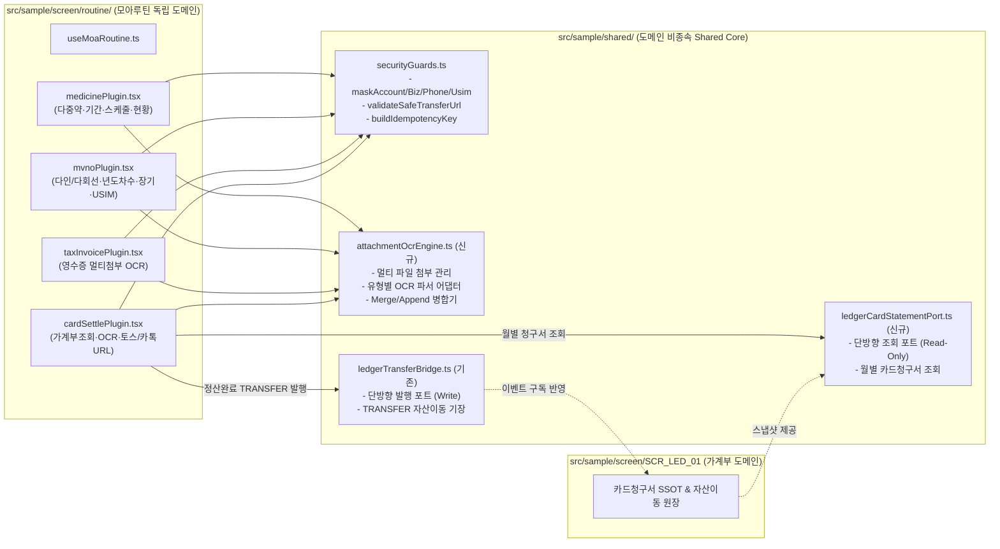

# 모아루틴 (SCR-ROU-01) 유형별 상세정의: 기획 · 아키텍처 설계 · 화면설계서

> **문서 버전**: `v2.0` (2026-11-23)  
> **작성 세션**: `[0046]` 모아루틴 고도화 분석  
> **상위/연계 문서**:
> - `docs/06.백로그/BKL-ROU-01_모아루틴_4대_라이프케어_금융재무_루틴_및_가계부_연동_스펙.md`
> - `docs/02.아키텍처/05-라이프도메인_서비스독립성_플러그인_및_보안설계서.md`
> - `docs/03.디자인/02-UI디자인정책-이미지.md` (§2.3 타이틀·컨텐츠 DIV 분리, `ELM-SLD-03`)
> - `docs/03.디자인/01-design-api-spec.md` (3대 빅테크 딥링크 규격)

---

## 1. 현황(As-Is) 진단 및 개선점 분석 (Gap Analysis)

현재 1차 구축된 `SCR_ROU_01_모아루틴` 프로토타입은 4대 플러그인 아키텍처(`plugins/*`)의 골격을 갖추었으나, 실생활 운영 관점에서 다음 **5대 구조적 공백**이 식별되었습니다.

| 영역 | 현재 구현 (As-Is) | 실사용 요구사항 및 개선 포인트 (To-Be) |
| :--- | :--- | :--- |
| **0. 공통 첨부·OCR** | 알뜰폰/약복용 일부에만 단일/모의 OCR 버튼 존재 | **전 루틴 공통 멀티 파일첨부** + 이미지 OCR 자동입력 + **기작성 내용 존재 시 덮어쓰기 금지(Append/Merge)** + **`[✨ OCR]` 자동입력 아이콘 표시** |
| **1. 약복용** | 단일 약품 1개 + 고정 2~3개 슬롯 + 단순 수량 차감 | **다중 약품 조합**(아침·점심·저녁·취침전 자유 매핑), **보유수량 기반 복용기간 자동 산정**, **기간·주기(일간/주간/월간) 복용계획**, **일자×시점 스케줄**, **복약률·소진일 현황조회** |
| **2. 알뜰폰 번호이동** | 단일 회선 단위 카드, 4단계 캡처 버튼, USIM 번호 입력 누락 | **다인·다회선(1인 다번호)** 관리, **`년도-차수`별 관리(Max 정원 + 생략 허용)**, **장기약정(24개월 등) 점검용 유지 회선**, **첨부파일 기반 OCR 자동 설정/수정 + 아이콘 표시**, **실물 USIM 번호(ICCID/유심번호) 전용 관리** |
| **3. 세금계산서** | 거래처명·공급가 수동 입력 및 발급 체크 | **발급영수증(홈택스 발급확인서·명세서) 멀티 첨부 → OCR 자동입력/거래처 자동매칭·추가** |
| **4. 급여·카드정산** | 수동 카드 목록 + 이체 체크 (가계부 조회/딥링크 미연결) | **정산 년월 선택 → 가계부 기등록 명세서 자동 조회·매핑**, **미등록 시 카드명세서 멀티 첨부 OCR → 카드사별 항목 추가**, **결제계좌별 카카오페이·토스 이체 URL 생성** + `TRANSFER` 자동 기장 |

> **참고 (Notion 외부 링크 접근성)**: 급여카드정산 참고로 공유된 Notion 링크(`2611-13-417a9328...`)는 로그인 인증이 필요한 비공개 문서여서 원문 직접 열람이 불가했습니다. 본 설계서는 요청 주신 5대 요구사항과 기존 가계부(`SCR_LED_01`) 6대 카드사 청구서 SSOT 스키마, `securityGuards`/`ledgerTransferBridge` 표준을 결합하여 구성했으며, 해당 노션 문서의 고유 컬럼이나 계산 규칙이 있다면 추후 항목만 추가 매핑하면 즉시 확장되도록 설계했습니다.

---

## 2. 서비스 기획 (Functional Specification)

### 2.0 공통 기능: 멀티 파일첨부 & 지능형 OCR 자동등록/병합 엔진

#### 1) 멀티 파일첨부 정책
- 모든 루틴 등록 모달, 상세 모달, 그리고 세부 레코드(회선/거래처/카드사/약봉투)에서 **다중 파일(`multiple`)** 첨부 지원.
- 허용 확장자: 이미지(`image/png`, `image/jpeg`, `image/webp`, `image/heic`), 문서(`application/pdf`), 최대 파일 크기/개수 가드레일(개당 10MB, 루틴당 최대 20개).
- 파일 유형 판별:
  - **이미지/PDF 명세서**: 첨부 즉시 OCR 파이프라인(`analyzeAttachmentOcr`) 트리거 (단건/일괄 파싱 지원).
  - **일반 문서**: 증빙 첨부 보관 전용(원본 미리보기·다운로드 제공).

#### 2) OCR 자동입력 및 기작성 내용 보호(Merge/Append) 규칙
| 대상 필드 유형 | 기작성 값이 비어 있는 경우 | 기작성 값이 이미 존재하는 경우 (덮어쓰기 금지) |
| :--- | :--- | :--- |
| **스칼라 입력필드** (통신사, 요금제, 금액, 유심번호 등) | OCR 추출값 즉시 입력 + **`[✨ OCR]` 아이콘** 부착 | 기본은 **기존값 유지** + 하단에 `OCR 제안값 적용 / 추가` 인라인 칩 노출 (알뜰폰 수정 모드에서는 Diff 확인 후 선택 반영) |
| **메모/서술형 필드** (복약 주의사항, 사은품 메모, 비고) | OCR 요약 텍스트 입력 + **`[✨ OCR]` 아이콘** | 기존 텍스트 뒤에 줄바꿈으로 **내용 추가(Append)**: `<기존 내용>\n[OCR 추가 · 파일명] <추출 내용>` |
| **목록형 엔티티** (약품 목록, 알뜰폰 회선, 세금계산서 거래처, 카드사 청구 항목) | 신규 행 자동 생성 | 기존 목록 유지 + **신규 행 추가(Append)**. 단, 동일 식별키(전화번호·사업자번호·카드사+정산월)가 존재하면 **병합 업데이트 배지**로 변경 항목만 하이라이트 |

#### 3) OCR 자동입력 시각화 및 상태 전이 (`OcrFieldMeta`)
- OCR로 값이 채워진 모든 입력필드에는 우측 상단 또는 라벨 옆에 **`[✨ OCR]`** 컴팩트 아이콘 배지를 표시.
- 배지 상태 3단계:
  1. `AUTO_FILLED` (`✨ OCR 자동입력`, Sky/Indigo 톤): OCR 추출 원문이 그대로 반영된 상태.
  2. `APPENDED` (`+✨ OCR 추가됨`, Emerald 톤): 기존 작성 내용 뒤에 OCR 내용이 병합 추가된 상태.
  3. `USER_EDITED` (`✎ OCR 보정됨`, Slate 톤): OCR 자동입력 후 사용자가 직접 값을 수정한 상태.

---

### 2.1 약복용 루틴 (`HEALTH_MEDICINE`) 상세기획

1. **다중 약품 및 복용 시점 자유 조합 (2.1)**
   - 1개 복약 루틴(예: `만성질환·영양제 통합 복약`) 안에 **N종의 약/영양제**를 독립 엔티티(`MedicineDrugItem`)로 등록.
   - 약품별 복용 시점 태그 다중 선택: `아침`, `점심`, `저녁`, `취침전`, `공복`, `식전 30분`, `식후 30분`, `필요시`.
   - 약품별 시점 투여량 지정 가능 (예: 혈압약 `아침 1정`, 위장약 `아침 1정 · 저녁 1정`, 마그네슘 `취침전 2정`).
   - 처방전/약봉투 멀티 첨부 시 OCR이 여러 약품명·1회 투여량·일수·식전/식후를 파싱해 기존 약품 리스트에 **자동 추가(Append)**.
2. **보유수량 기반 복용기간 자동 산정 및 체크 (2.2)**
   - 약품별 `현재 보유수량(remainingQty)`과 `복용계획(주기 × 1일 총 투여량)`을 결합해 **예상 복용 가능 일수**와 **예상 소진 예정일**을 실시간 계산:
     - `일일 평균 소비량 = (1회 투여량 × 활성 시점 수) × 주기 계수` (일간=`1/intervalDays`, 주간=`선택요일수/7`, 월간=`선택일자수/30`)
     - `예상 잔여 일수 = floor(보유수량 / 일일 평균 소비량)`
     - `예상 소진일 = 기준일 + 예상 잔여 일수`
   - 사용자가 복용을 체크하면 보유수량이 즉시 차감되고 예상 소진일이 재계산됨 (`D-5` 이하 도달 시 `URGENT` 뱃지 + 재처방 보충 CTA 활성화).
3. **복용계획 수립 (2.3)**
   - **기간**: `시작일(startDate)` ~ `종료일(endDate)` (체크옵션: `보유수량 소진일까지 자동 산정`).
   - **주기 유형 3종**:
     - **일간 (`DAILY`)**: 매일 또는 `N일마다` 반복.
     - **주간 (`WEEKLY`)**: 요일 멀티 선택 (`월/화/수/목/금/토/일`).
     - **월간 (`MONTHLY`)**: 매월 특정 일자 멀티 선택 (`1일, 15일` 등).
4. **복용 스케줄 수립 (2.4)**
   - 수립된 복용계획을 기반으로 **일자(`YYYY-MM-DD`) × 시점(`아침/점심/저녁/취침전`)** 매트릭스 스케줄 자동 전개.
   - 동일 시점에 여러 약이 겹치는 경우(예: `아침 08:30` = 혈압약 1정 + 비타민D 1정) **시점 묶음 1-Click 일괄 복용 체크**와 **개별 약 체크**를 모두 제공.
5. **현황조회 (2.5)**
   - **오늘 복약 현황**: 시점별(아침/점심/저녁/취침전) 완료/미완료 진행률 바.
   - **기간별 복약률 조회**: 주간 7일 도트 매트릭스 / 월간 캘린더 복약률(%) / 연속 달성 스트릭.
   - **약품별 재고·소진일 테이블**: 약품명, 현재 보유수량, 예상 소진일(D-Day), 최근 7일 순응도(%).

---

### 2.2 알뜰폰 번호이동 루틴 (`LIFE_PHONE`) 상세기획

1. **다인 · 다회선 계층 구조 (1인 다번호 지원)**
   - 가족/구성원(`MvnoPerson`: 본인, 배우자, 어머니, 아버지 등) 아래 **복수의 회선(`MvnoLine`)**을 등록 가능 (예: 본인 2회선 — 메인폰 + 업무/태블릿폰).
   - 각 회선은 고유한 전화번호(마스킹 표기), 회선 별칭, 회선 성격(`MNP_PROMO` 단기 프로모션 환승형 / `LONG_TERM_CONTRACT` 장기 약정 점검형)을 보유.
2. **`년도-차수` 기반 회선 배치 관리 (`MvnoRound`, 예: `2026-1차`, `2026-2차`)**
   - 회선별 실제 개통일·만료일이 서로 달라도(예: 본인 5월, 배우자 6월), 운영 관리 단위를 **`년도-차수 (year-roundNo)`**로 그룹화.
   - **최대 회선 정원(`maxLineCount`) 관리 + 차수 생략(`SKIPPED`) 지원**:
     - 예: 차수 정원 `maxLineCount = 5`로 설정하고 가족 전체 5회선을 기준 슬롯으로 유지.
     - 특정 회선이 이번 차수에서 번호이동을 건너뛰는 경우 상태를 **`SKIPPED (차수 생략)`**으로 전환하고 사유(예: `기존 특가 잔여`, `일시정지`)를 기록 → 전체 슬롯 정합성 유지 (`대상 5회선 = 환승진행 3 · 장기유지 1 · 생략 1`).
3. **장기회선(점검용) 관리 및 차수 자동 이월**
   - 예: 기기변경으로 통신사 24개월 약정이 걸린 회선(`lineMode = 'LONG_TERM_CONTRACT'`)은 번호이동 대상에서 제외되더라도 **신규 차수 생성 시 자동으로 `MAINTAINED (장기유지)` 상태로 이월**되어 매 차수 통신비 총액 및 약정 만료일 점검 대상에 포함.
   - 필수 표시 항목: 통신사, 약정 유형(`선택약정 25%` / `공시지원금`), 약정 기간(`24개월`), 약정 시작일~종료일, 남은 개월수(D-Day), 결합할인 메모.
4. **번호이동 화면 캡처 멀티 첨부 OCR 자동 설정·수정 + `[✨ OCR]` 아이콘**
   - 회선 상세/등록 폼에서 번호이동 화면 캡처(요금제·신청·유심·개통완료)를 멀티 첨부하면 OCR 분석으로 해당 회선의 `통신망`, `통신사`, `요금제명`, `데이터/통화 스펙`, `특가/정상 요금`, `프로모션 개월수`, `개통일`, `90일 제한 해제일`, `만료일`, `유심유형`, `실물 유심번호`, `자동납부`, `사은품 메모`를 **자동 설정 또는 수정 반영**.
   - OCR이 설정한 모든 입력폼 필드 옆에 **`[✨ OCR]` 자동입력 아이콘**을 배치하여 시각적 검증 편의성 확보.
5. **실물 USIM 유심번호(ICCID/유심일련번호) 전용 관리**
   - `usimType === 'USIM'` 선택 시 **`실물 유심번호 (USIM Serial)`** 입력/조회 필드 필수 노출 (OCR 유심봉투/바코드 캡처 자동 추출 지원).
   - 보안 원칙: 화면 기본 표기 및 `localStorage` 저장 시 `maskUsimSerial()`로 중간 대역 마스킹(`8982-****-****-4410`) 처리하고, 개통·CS 확인 필요 시 상세 화면에서 일시적 마스킹 해제/복사 제공.
   - `usimType === 'eSIM'` 선택 시 `eSIM QR 발급일 / EID(마스킹)` 입력 필드로 동적 전환.

---

### 2.3 세금계산서 발급 루틴 (`BIZ_TAX`) 상세기획

1. **발급영수증(전자세금계산서/홈택스 확인서) 멀티 첨부 OCR 자동입력**
   - 매월 귀속 루틴(예: `2026-11 귀속 · 12/10 마감`)에서 **발급영수증 이미지·PDF를 여러 장 한 번에 첨부** 가능.
   - OCR 추출 표준 항목:
     - `공급받는자 상호(companyName)`, `사업자등록번호(bizNo)`, `작성일자/발급일자(issuedDate)`, `국세청 승인번호(approvalNo)`, `공급가액(supplyAmount)`, `세액(vatAmount)`, `합계금액`, `품목명(itemName)`.
2. **기존 거래처 자동 매칭 및 미등록 거래처 자동 추가**
   - 첨부 영수증의 사업자번호/상호명이 기존 루틴 거래처와 일치하면 → 금액 대조 후 승인번호/발급일자 자동 기입 및 **`ISSUED (발급완료)`** 상태 자동 전환 (OCR 배지 표시).
   - 일치하는 거래처가 없으면 → 거래처 목록에 **신규 거래처 행 자동 추가(Append)** 및 발급영수증 파일 1:1 링크 연결.

---

### 2.4 급여·카드정산 루틴 (`FINANCE_CARD_SETTLE`) 상세기획

1. **정산 년월 선택 → 가계부 기등록 정산정보 자동 조회 및 매핑**
   - 사용자가 정산 년월(`settlementYearMonth`, 예: `2026-10`, `2026-11`)을 선택하면, 단방향 포트 `ledgerCardStatementPort.queryStatementsByMonth(yearMonth)`를 호출해 가계부(`SCR_LED_01`)에 기등록된 카드사별 확정 명세서(`CardStatementSummary`)를 조회.
   - **기등록 명세서 존재 시 (`syncSource = 'LEDGER_MATCHED'`)**:
     - 카드사명, 결제예정일, 결제은행/결제계좌, 당월 결산금액(총 청구액), 일시불/할부/청구할인 요약을 자동 매핑하여 정산 리스트 즉시 구성.
     - 카드사별 `[가계부 연동됨]` 뱃지 표시.
2. **미등록 정산 시 → 카드명세서 멀티 첨부 OCR → 카드사별 항목 자동 추가**
   - 선택한 정산 년월에 가계부 기등록 데이터가 없거나(`UNREGISTERED`), 일부 카드사만 누락된 경우:
     - 사용자가 카드사별 명세서 이미지/PDF를 **멀티 첨부** (`신한카드_11월명세서.png`, `현대카드_11월명세서.pdf` 등).
     - OCR 분석 결과에서 **`카드사명`, `정산년월`, `결제일`, `결제은행`, `결제계좌번호`, `당월 결산금액`**을 추출하여 **첨부파일 기준으로 카드사 정산 항목을 자동 추가(Append)** (`syncSource = 'OCR_ATTACHED'`, `[✨ OCR]` 배지 표시).
     - 기존 카드사 항목이 이미 있는 경우 덮어쓰지 않고 차액 확인 배지 또는 신규 카드사 행 추가로 처리.
3. **결제계좌별 카카오페이 · 토스 이체 URL 자동 생성 및 송금 실행**
   - 급여계좌(`sourceBankName / sourceAccountNo`)에서 각 카드사 결제계좌(`targetBank / targetAccountNo`)로 입금할 수 있도록 **2대 송금 URL/공유 액션**을 자동 생성:
     - **토스(Toss) 이체 URL**:
       - `supertoss://send?bank={encodedBank}&accountNo={cleanAccountNo}&amount={amount}`
       - 실행 전 반드시 `validateSafeTransferUrl()` 화이트리스트 검증 통과.
     - **카카오페이(KakaoPay) / 카카오톡 이체 URL & 공유 카드**:
       - `kakaopay://` 송금 딥링크 + `[카톡 이체정보 복사]` (`[2026-11 카드정산] 신한카드 · 카카오뱅크 3333-****-8876 · 842,000원`) 원클릭 복사 및 공유.
   - **계좌 기준 합산(Grouping) 토글 지원**:
     - 서로 다른 카드(예: 신한카드 + 삼성카드)가 **동일한 결제계좌(예: 카카오뱅크)**로 연결된 경우, **[카드별 개별 송금]**과 **[결제계좌별 합산 1회 송금]** 모드를 전환해 합산 금액 기준 토스/카톡 URL을 즉시 생성.
4. **정산 완료 시 가계부 자산이동(`TRANSFER`) 단방향 자동 기장**
   - 각 카드(또는 합산 계좌) 송금 완료 체크 후 **[정산 확정 · 가계부 TRANSFER 기장]** 실행 시 `ledgerTransferBridge.publishLedgerTransfer()` 호출.
   - **금전관리 3대 원칙 절대 준수**: `isAssetTransfer: true`, 1:1 자기참조 페어링(`transferId ↔ relatedTransferId`), 멱등키(`buildIdempotencyKey`) 기반 중복 기장 원천 차단.

---

## 3. 아키텍처 · 데이터 모델 · 보안 설계 (Technical Design)

### 3.1 서비스 독립성 및 단방향 포트 아키텍처



> **핵심 아키텍처 원칙**: 모아루틴 플러그인은 가계부(`SCR_LED_01`)를 직접 `import`하지 않으며, 오직 `shared/`의 `ledgerCardStatementPort`(조회)와 `ledgerTransferBridge`(발행) 포트를 통해서만 단방향 통신합니다.

---

### 3.2 핵심 TypeScript 도메인 계약 (요약)

```ts
// 1. 공통 멀티 첨부파일 & OCR 자동입력 메타
export interface RoutineAttachment {
  attachmentId: string;
  fileName: string;
  mimeType: string;
  sizeBytes: number;
  previewUrl?: string; // 이미지 썸네일 (로컬 저장 시 용량 제한/제외)
  uploadedAt: string;
  ocrStatus: 'NONE' | 'PENDING' | 'PARSED' | 'FAILED';
  ocrParsedFields?: Record<string, string | number>;
  ocrSummary?: string;
}

export interface OcrFieldTrace {
  sourceAttachmentId: string;
  sourceFileName: string;
  mode: 'AUTO_FILLED' | 'APPENDED' | 'USER_EDITED';
  confidence?: number;
  appliedAt: string;
}

// 2. 약복용 확장 모델
export type MedicinePeriodUnit = 'DAILY' | 'WEEKLY' | 'MONTHLY';
export type MedicineTimeSlotType = 'MORNING' | 'LUNCH' | 'DINNER' | 'BEDTIME' | 'CUSTOM';

export interface MedicineDrugItem {
  drugId: string;
  drugName: string;
  hospitalOrBrand?: string;
  totalQty: number;          // 최초 보유수량
  remainingQty: number;      // 현재 보유수량
  unitLabel: '정' | '포' | '캡슐' | 'ml';
  timeSlots: Array<{
    slotType: MedicineTimeSlotType;
    label: string;           // 아침/점심/저녁/취침전
    scheduledTime: string;   // "08:30"
    timingRule: string;      // 식전/식후 30분/공복
    doseQty: number;
  }>;
  plan: {
    startDate: string;
    endDate?: string;        // 미지정 시 보유수량 기반 자동 산정
    periodUnit: MedicinePeriodUnit;
    intervalDays?: number;   // DAILY용 (기본 1)
    weekdays?: number[];     // WEEKLY용 (0=일~6=토)
    monthDays?: number[];    // MONTHLY용 (1~31)
  };
  estimatedDaysLeft: number; // 보유수량 기반 자동 산정 잔여일수
  estimatedDepletionDate: string;
  ocrFields?: Record<string, OcrFieldTrace>;
}

export interface MedicineScheduleEntry {
  scheduleId: string;
  dateIso: string;           // "2026-11-23"
  slotType: MedicineTimeSlotType;
  scheduledTime: string;
  items: Array<{
    drugId: string;
    drugName: string;
    doseQty: number;
    taken: boolean;
    takenAt?: string;
  }>;
}

// 3. 알뜰폰 다인/다회선 · 년도-차수 · 장기회선 · USIM 확장 모델
export type MvnoLineMode = 'MNP_PROMO' | 'LONG_TERM_CONTRACT';
export type MvnoRoundLineStatus = 'PLANNED' | 'IN_PROGRESS' | 'COMPLETED' | 'SKIPPED' | 'MAINTAINED';

export interface MvnoRoundLineEntry {
  lineId: string;
  ownerName: string;         // 본인, 배우자, 어머니 등 (1인 다번호 허용)
  lineAlias: string;         // 예: "본인 메인", "본인 업무용"
  phoneNumberMasked: string;
  lineMode: MvnoLineMode;    // 단기 번호이동 vs 장기 약정 점검용
  roundStatus: MvnoRoundLineStatus;
  skipReason?: string;       // 차수 생략 시 사유
  networkType: 'SKT망' | 'KT망' | 'LGU+망';
  carrierName: string;
  planName: string;
  dataCallSpec: string;
  promoMonthlyFee: number;
  normalMonthlyFee: number;
  promoMonths: number;
  openedDate: string;
  mnpRestrictionEndDate: string;
  promoEndDate: string;
  // 장기 약정 정보 (lineMode === 'LONG_TERM_CONTRACT')
  contractInfo?: {
    contractType: 'SELECTIVE_DISCOUNT' | 'DEVICE_SUBSIDY';
    contractMonths: number;  // 예: 24
    contractStartDate: string;
    contractEndDate: string;
    bundleMemo?: string;
  };
  // USIM / eSIM 관리
  usimType: 'USIM' | 'eSIM';
  usimSerialMasked?: string; // 실물 USIM 유심번호 (마스킹 저장)
  autoPayMethod: string;
  benefitMemo?: string;
  attachments: RoutineAttachment[];
  ocrFields?: Record<string, OcrFieldTrace>;
}

export interface MvnoRoundGroup {
  roundId: string;           // "2026-R2"
  year: number;              // 2026
  roundNo: number;           // 2 (표시: "2026-2차")
  maxLineCount: number;      // 차수 관리 최대 회선 정원
  lines: MvnoRoundLineEntry[];
}

// 4. 세금계산서 영수증 첨부 확장
export interface TaxClientInvoiceItem {
  clientId: string;
  companyName: string;
  bizNo: string;             // 마스킹 저장
  approvalNo?: string;       // 국세청 승인번호
  supplyAmount: number;
  vatAmount: number;
  status: 'PENDING' | 'ISSUED';
  issuedAt?: string;
  receiptAttachmentId?: string;
  ocrFields?: Record<string, OcrFieldTrace>;
}

// 5. 급여·카드정산 가계부 매핑 + 명세서 OCR + 이체 URL 확장
export interface CardSettlementLine {
  cardId: string;
  cardName: string;
  targetBank: string;
  targetAccountNo: string;   // 저장 시 마스킹, URL 생성 시 안전 파라미터화
  paymentDay: number;
  amount: number;
  syncSource: 'LEDGER_MATCHED' | 'OCR_ATTACHED' | 'MANUAL';
  statementAttachmentId?: string;
  tossTransferUrl?: string;
  kakaoTransferUrl?: string;
  status: 'PENDING' | 'TRANSFERRED';
  transferredAt?: string;
  ocrFields?: Record<string, OcrFieldTrace>;
}
```

---

### 3.3 데이터베이스 스키마 확장 (PostgreSQL DDL 초안)

```sql
-- 1. 루틴 공통 멀티 첨부파일 및 OCR 결과 테이블
CREATE TABLE IF NOT EXISTS routine_attachments (
    attachment_id VARCHAR(64) PRIMARY KEY,
    routine_id VARCHAR(64) NOT NULL REFERENCES member_routines(routine_id) ON DELETE CASCADE,
    sub_entity_id VARCHAR(64),               -- 약품ID / 회선ID / 거래처ID / 카드ID
    file_name VARCHAR(255) NOT NULL,
    mime_type VARCHAR(100) NOT NULL,
    file_size_bytes BIGINT NOT NULL,
    storage_key TEXT NOT NULL,
    ocr_status VARCHAR(20) NOT NULL DEFAULT 'NONE',
    ocr_extracted_json JSONB NOT NULL DEFAULT '{}',
    created_at TIMESTAMP WITH TIME ZONE DEFAULT CURRENT_TIMESTAMP
);

-- 2. 약복용 약품 마스터 및 복용계획 테이블
CREATE TABLE IF NOT EXISTS routine_medicine_drugs (
    drug_id VARCHAR(64) PRIMARY KEY,
    routine_id VARCHAR(64) NOT NULL REFERENCES member_routines(routine_id) ON DELETE CASCADE,
    drug_name VARCHAR(120) NOT NULL,
    total_qty NUMERIC(10, 2) NOT NULL,
    remaining_qty NUMERIC(10, 2) NOT NULL,
    unit_label VARCHAR(16) NOT NULL DEFAULT '정',
    time_slots_json JSONB NOT NULL DEFAULT '[]',
    plan_config_json JSONB NOT NULL DEFAULT '{}',  -- startDate, endDate, periodUnit, weekdays/monthDays
    ocr_field_traces JSONB NOT NULL DEFAULT '{}',
    created_at TIMESTAMP WITH TIME ZONE DEFAULT CURRENT_TIMESTAMP
);

-- 3. 약복용 일자×시점 실행 로그 테이블
CREATE TABLE IF NOT EXISTS routine_medicine_logs (
    log_id VARCHAR(64) PRIMARY KEY,
    drug_id VARCHAR(64) NOT NULL REFERENCES routine_medicine_drugs(drug_id) ON DELETE CASCADE,
    schedule_date DATE NOT NULL,
    slot_type VARCHAR(20) NOT NULL,
    dose_qty NUMERIC(10, 2) NOT NULL DEFAULT 1,
    is_taken BOOLEAN NOT NULL DEFAULT false,
    taken_at TIMESTAMP WITH TIME ZONE,
    UNIQUE (drug_id, schedule_date, slot_type)
);

-- 4. 알뜰폰 년도-차수 및 다인·다회선 관리 테이블
CREATE TABLE IF NOT EXISTS routine_mvno_rounds (
    round_id VARCHAR(64) PRIMARY KEY,
    routine_id VARCHAR(64) NOT NULL REFERENCES member_routines(routine_id) ON DELETE CASCADE,
    round_year INTEGER NOT NULL,
    round_no INTEGER NOT NULL,
    max_line_count INTEGER NOT NULL DEFAULT 4,
    UNIQUE (routine_id, round_year, round_no)
);

CREATE TABLE IF NOT EXISTS routine_mvno_lines (
    line_id VARCHAR(64) PRIMARY KEY,
    round_id VARCHAR(64) NOT NULL REFERENCES routine_mvno_rounds(round_id) ON DELETE CASCADE,
    owner_name VARCHAR(60) NOT NULL,
    line_alias VARCHAR(80),
    phone_number_masked VARCHAR(32) NOT NULL,
    line_mode VARCHAR(24) NOT NULL DEFAULT 'MNP_PROMO', -- 'MNP_PROMO' | 'LONG_TERM_CONTRACT'
    round_status VARCHAR(24) NOT NULL DEFAULT 'PLANNED', -- 'PLANNED'|'IN_PROGRESS'|'COMPLETED'|'SKIPPED'|'MAINTAINED'
    skip_reason VARCHAR(200),
    network_type VARCHAR(16) NOT NULL,
    carrier_name VARCHAR(60) NOT NULL,
    plan_name VARCHAR(120) NOT NULL,
    promo_monthly_fee INTEGER NOT NULL DEFAULT 0,
    normal_monthly_fee INTEGER NOT NULL DEFAULT 0,
    opened_date DATE,
    mnp_restriction_end_date DATE,
    promo_end_date DATE,
    contract_info_json JSONB,
    usim_type VARCHAR(16) NOT NULL DEFAULT 'USIM',
    usim_serial_encrypted TEXT,              -- 실물 USIM 번호 (저장 시 암호화, UI 노출 시 마스킹)
    auto_pay_method VARCHAR(80),
    benefit_memo TEXT,
    ocr_field_traces JSONB NOT NULL DEFAULT '{}',
    updated_at TIMESTAMP WITH TIME ZONE DEFAULT CURRENT_TIMESTAMP
);
```

### 3.4 보안 가드레일 확장 체크리스트
1. **유심번호 마스킹 (`maskUsimSerial`)**: `securityGuards.ts`에 `usimSerial` 키 자동 마스킹 규칙 추가하여 브라우저 저장소 평문 잔존 차단.
2. **멀티 첨부파일 검증**: 허용 MIME 화이트리스트 검증, 이미지 DataURL의 `localStorage` 과적재 방지(메타정보만 영속화하고 바이너리 미리보기는 세션 메모리 ObjectURL로 격리).
3. **송금 딥링크 안전성**: 토스(`supertoss://send?...`) 및 카카오페이(`kakaopay://...`) URL 생성 시 `validateSafeTransferUrl()` 필수 통과, 금액 정수 양수 검증, 계좌번호 숫자 정규화 후 URL 인코딩 적용.

---

## 4. 화면설계 (UI/UX & Wireframe Specification)

> 모든 신규/수정 UI 블록은 **`02-UI디자인정책-이미지.md §2.3`**(타이틀 `<div>` / 컨텐츠 `<div>` 물리적 분리) 및 **`ELM-SLD-03`**(가로 슬라이드드래그휠), 360px 모바일 `whitespace-nowrap`/`flex-wrap`/`min-h-[44px]` 규격을 준수합니다.

### 4.0 공통 컴포넌트: 멀티 첨부 & OCR 바 (`RoutineAttachmentBar`) + `[✨ OCR]` 필드 배지

```text
+----------------------------------------------------------------------+
| [타이틀 DIV] 증빙 · 캡처 파일 첨부 (3건)      [+ 파일 멀티첨부] [✨ 일괄 OCR] |
+----------------------------------------------------------------------+
| [컨텐츠 DIV - ElmSld03 가로 슬라이드]                                   |
|  [📄 명세서_신한.png ✨완료 ×]  [📄 명세서_현대.pdf ✨완료 ×]  [📷 유심.jpg] |
+----------------------------------------------------------------------+
| 💡 기존 작성 내용이 있는 항목은 덮어쓰지 않고 안전하게 추가(Merge)됩니다.     |
+----------------------------------------------------------------------+

[OCR 자동입력 필드 표기 규격]
  실물 유심번호 (USIM)                       [✨ OCR 자동입력]  <-- 툴팁: "유심.jpg에서 추출"
  [ 8982-****-****-4410                              ✕ ]
```

### 4.1 약복용 루틴 화면설계 (카드 + 상세 모달 3탭)
- **허브 카드 (`SCR-ROU-01`)**:
  - 상단: 약품 총 종수(`4종`) · 오늘 시점별 진행률(`아침 2/2 · 점심 1/1 · 저녁 0/2 · 취침전 0/1`)
  - 중단 (`ElmSld03` 시점 슬라이드): `[아침 08:30 (2종)] [점심 13:00 (1종)] [저녁 19:30 (2종)] [취침전 22:30 (1종)]` → 클릭 시 해당 시점 약 일괄 체크
  - 하단: 최단 소진 예정 약품 경고 (`위장약 잔여 4일 · 11/27 소진예정`)
- **상세 모달 (`ElmBsh01`) 내부 3단 탭 (`ElmSld03` 탭 바)**:
  1. **`오늘 스케줄`**: 일자 선택기(`◀ 2026-11-23 ▶`) + 시점별 아코디언(아침/점심/저녁/취침전) + 개별/시점 일괄 복용 체크.
  2. **`약품·복용계획`**: 등록된 다중 약품 목록, 약품별 보유수량 ↔ 예상 복용일수/소진일 자동 계산 배지, 주기(`일간/주간/월간`) 및 `시작일~종료일` 편집, 처방전 멀티 첨부 OCR 추가 버튼.
  3. **`복약 현황`**: 주간/월간 복약 달성률 매트릭스, 약품별 잔여량 게이지 & 예상 소진일 타임라인.

### 4.2 알뜰폰 번호이동 루틴 화면설계 (`년도-차수` + 다인/다회선 + 장기회선 + USIM)
- **허브 카드 (`SCR-ROU-01`)**:
  - 상단: 현재 활성 차수 뱃지 **`2026-2차`** · 정원 현황 **`관리 4/5회선 (환승 2 · 장기 1 · 생략 1)`** · 가장 임박한 회선 D-Day FSM.
  - 중단: 회선 미니 리스트(사람명·회선별칭·통신망·유심유형·상태 뱃지: `진행중`/`완료`/`장기유지 24M`/`차수생략`).
  - 하단: 가족 합산 월 통신비(`54,800원`) 및 월 절감액 요약.
- **상세 모달 (`ElmBsh01`)**:
  - **차수 선택 바 (타이틀 DIV / 컨텐츠 DIV 분리 + `ElmSld03`)**: `[2025-2차] [2026-1차] [2026-2차 (현재)] [+ 새 차수 생성]` + 차수 최대 정원(`Max N회선`) 설정.
  - **회선별 카드/편집 폼**:
    - 회선 구분 토글: `[단기 번호이동]` vs `[장기약정 점검용 (24개월 등)]`
    - 상태 전환: `[진행]` / `[완료]` / `[이번 차수 생략]` (장기회선은 자동 `장기유지`)
    - **실물 USIM 선택 시**: `실물 유심번호(ICCID)` 필드 노출 (`[✨ OCR]` 아이콘 + 마스킹 보기/복사)
    - **장기회선 선택 시**: `약정유형 · 24개월 · 약정기간(시작~종료) · 잔여개월` 블록 노출
    - **번호이동 캡처 멀티 첨부 바**: 이미지 업로드 시 해당 회선 폼 필드를 OCR로 자동 설정/수정하고 적용된 필드에 **`[✨ OCR]` 아이콘** 표시.

### 4.3 세금계산서 발급 루틴 화면설계
- **허브 카드 (`SCR-ROU-01`)**: 기존 10일 마감 D-Day 및 거래처 체크리스트 유지 + 우측 상단 **`[📷 영수증 OCR 추가]`** 퀵 버튼 배치.
- **상세 모달 (`ElmBsh01`)**:
  - 상단 `RoutineAttachmentBar`: 홈택스 전자세금계산서 발급영수증 이미지·PDF 멀티 업로드.
  - OCR 분석 완료 시 **[매칭/신규 추가 결과 미리보기]**:
    - 기존 거래처 매칭 건: `"(주)모아테크 — 승인번호 반영 & 발급완료 자동 전환"`
    - 신규 거래처 발견 건: `"(주)블루클라우드 — 신규 거래처 행 자동 추가"` (모든 추출값에 `[✨ OCR]` 아이콘 표기).

### 4.4 급여·카드정산 루틴 화면설계 (가계부 조회 매핑 + 명세서 OCR + 토스/카톡 이체 URL)
- **상세/등록 모달 워크플로우**:
  1. **Step 1. 정산 년월 선택 (`YYYY-MM`) + 가계부 조회 버튼**:
     - 년월 변경 시 즉시 `ledgerCardStatementPort` 조회 실행.
     - 결과 배너 분기:
       - **기등록 발견**: `✓ 가계부(SCR-LED-01)에서 2026-10 카드 청구서 6건(총 6,029,000원)을 불러와 매핑했습니다.`
       - **미등록/일부 누락**: `⚠ 가계부에 2026-11 정산정보가 없습니다. 아래에서 카드사별 명세서를 첨부하면 OCR로 카드사 항목을 자동 추가합니다.`
  2. **Step 2. 미등록 카드명세서 멀티 첨부 & OCR 항목 추가**:
     - `RoutineAttachmentBar`로 카드명세서 이미지/PDF 다중 첨부 → 파일별로 카드사 항목 자동 추가 (`[✨ OCR]` 뱃지 + 수동 금액/계좌 수정 가능).
  3. **Step 3. 결제계좌별 송금 URL 생성 & 실행 영역**:
     - 상단 모드 스위처: **`[카드사별 보기]`** vs **`[결제계좌별 합산 보기]`**
     - 각 행 우측 액션 버튼 (최소 높이 36~44px, `whitespace-nowrap`):
       - **`[토스 송금]`**: `supertoss://send?bank=...&accountNo=...&amount=...` 안전 검증 실행
       - **`[카톡 송금/복사]`**: `kakaopay://` 실행 및 결제계좌·금액 카톡 공유 텍스트 복사
       - **`[이체완료 체크]`**: 개별 송금 완료 토글
  4. **Step 4. 정산 확정 → 가계부 자산이동(`TRANSFER`) 자동 기장**:
     - 하단 고정 푸터 CTA: **`[정산 완료 · 가계부 TRANSFER 자동 기장]`** (`isAssetTransfer: true`, 멱등키 중복 차단).

---

## 5. 단계별 구현 로드맵 및 인수 기준

| 단계 | 대상 태스크 | 주요 구현 산출물 |
| :---: | :--- | :--- |
| **Phase 1** | `[0046-02]` 공통 첨부·OCR 엔진 + 급여카드정산 가계부 연동·이체 URL | `shared/attachmentOcrEngine.ts`, `shared/ledgerCardStatementPort.ts`, `shared/securityGuards.ts` (`maskUsimSerial` 추가), `cardSettlePlugin.tsx` 고도화 및 `TRANSFER` 자동 기장 완결 |
| **Phase 2** | `[0046-03]` 약복용 다중약품·계획·스케줄·현황 + 알뜰폰 년도-차수·다인/다회선·장기·USIM + 세금계산서 영수증 OCR | `medicinePlugin.tsx`, `mvnoPlugin.tsx`, `taxInvoicePlugin.tsx` 전면 고도화, 공통 `RoutineAttachmentBar` & `[✨ OCR]` 배지 컴포넌트 적용 |
| **Phase 3** | `[0046-04]` 360px 모바일 검증, 스트릭 잔디·D-Day 폴리싱 및 최종 코드리뷰 | 전 플러그인 500줄 이하 SRP 검증, `tsc --noEmit` & `vite build` 0-Error, 리뷰 문서 발행 |

### 핵심 인수 기준 (Acceptance Criteria)
1. [ ] 4대 루틴 모두에서 멀티 파일첨부 및 이미지 OCR 자동입력이 동작하며, 기존 작성 내용이 있을 때 덮어쓰지 않고 안전하게 **추가(Append/Merge)**되는가?
2. [ ] OCR로 자동 설정된 모든 입력필드에 **`[✨ OCR]` 자동입력 아이콘**이 시각적으로 표시되는가?
3. [ ] 약복용에서 복수 약품 × 복수 시점(아침/점심/저녁/취침전) 조합, 보유수량 기반 복용기간 자동 산정, 일간/주간/월간 계획, 일자×시점 스케줄 및 현황조회가 정상 동작하는가?
4. [ ] 알뜰폰에서 다인·다회선(1인 다번호), `년도-차수` 정원 관리 및 차수 생략(`SKIPPED`), 장기약정(24개월 등) 점검용 유지 회선, 실물 USIM 유심번호 관리가 정상 동작하는가?
5. [ ] 세금계산서에서 발급영수증 첨부 시 OCR로 거래처·금액·승인번호가 자동 입력/추가되는가?
6. [ ] 급여카드정산에서 정산 년월 선택 시 가계부 기등록 명세서를 자동 매핑하고, 미등록 시 명세서 멀티 첨부 OCR로 카드사 항목을 추가한 뒤 토스/카톡 이체 URL 생성 및 가계부 `TRANSFER` 기장이 완결되는가?
