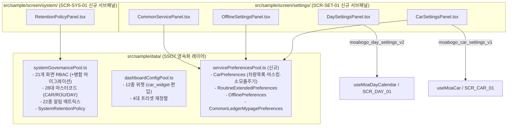

# 모아부릉 및 전 서비스 사용자관리(SCR-SET-01)·시스템운영관리(SCR-SYS-01) 보완 기획 · 설계 · 화면설계서

> **문서 ID**: `010004` (`docs/01.프로젝트/04-전서비스_사용자관리_시스템운영관리_보완_기획_설계_화면설계서.md`)  
> **문서 버전**: `v1.0` (2026-11-26)  
> **작성 세션**: `[0051-01]` 2차 우선작업계획 2순위 완결  
> **상위/연계 문서**:
> - [261125_2차계획_백엔드착수전_데이터모델링_및_아키텍처정비_로드맵.md](file:///d:/dev/workspace/git.jkoogit/moabogo/docs/05.계획/261125_2차계획_백엔드착수전_데이터모델링_및_아키텍처정비_로드맵.md) (`050002`, v1.2)
> - [01.데이터설계.md](file:///d:/dev/workspace/git.jkoogit/moabogo/docs/04.데이터/01.데이터설계.md) (`040001`, v3.2 — 53개 정규 테이블)
> - [02-화면_DB_1대1_대사검증서.md](file:///d:/dev/workspace/git.jkoogit/moabogo/docs/04.데이터/02-화면_DB_1대1_대사검증서.md) (`040003`)
> - [init_schema.sql](file:///d:/dev/workspace/git.jkoogit/moabogo/docs/04.데이터/init_schema.sql) (`040004`)
> - [03-화면목록정의서.md](file:///d:/dev/workspace/git.jkoogit/moabogo/docs/03.디자인/03-화면목록정의서.md) (`030003`)
> - [02-UI디자인정책-이미지.md](file:///d:/dev/workspace/git.jkoogit/moabogo/docs/03.디자인/02-UI디자인정책-이미지.md) (`030002`)

---

## 1. 현황(As-Is) 진단 및 보완 갭 분석 (Gap Analysis)

세션 `[0050]`에서 53개 테이블과 21개 화면의 1:1 DB 대사를 완결한 결과, 코어 비즈니스 화면(`SCR-CAR-01`, `SCR-DAY-01`, `SCR-ROU-01`, `SCR-OFF-01`, `SCR-MYP-01`)의 기능이 고도화된 것에 비해 이를 중앙에서 제어하는 **사용자 맞춤 환경설정(`SCR-SET-01`)**과 **시스템 운영관리 백오피스(`SCR-SYS-01`)**에 아래의 구조적 공백이 식별되었습니다.

### 1.1 `SCR-SET-01` (사용자 맞춤 환경설정) 갭 분석

| 영역 | 현재 구현 (As-Is) | 보완 목표 (To-Be) | DB 매핑 테이블 |
| :--- | :--- | :--- | :--- |
| **1. 모아부릉 (`CAR`)** | 로컬 `useState`에 `sync_to_day_targets` 4종 체크박스와 `중복지출 정리 센터` 모달 버튼만 존재 (영속화 미비) | • 다중 차량 목록 조회·등록·대표차량 지정·공유 가계부 매핑·활성/비활성<br>• 번호판 PII 마스킹 기본값(`privacy_mask_plate_number`) & 중복 자동대사 토글(`auto_reconcile_duplicates`)<br>• 소모품 교체 주기 기본 프리셋(엔진오일/필터/타이어/검사/보험/주차권)<br>• `dashboardConfigPool.ts` 내 **`car_widget` 편입** (11➔12모듈) | `vehicles`, `vehicle_maintenance_rules`, `user_service_preferences('CAR')`, `user_settings.dashboard_layout_json` |
| **2. 모아데이 (`DAY`)** | `SCR-DAY-01` 내부 모달(`MoaDayDisplaySettingsModal`)에서만 `moabogo_day_settings_v2` 편집 가능 | • `SCR-SET-01` 내 **모아데이 통합 설정 탭(`DAY`)** 신설<br>• 과거의 오늘(0~5년), PWA 수집(사진/오디오/문서), 2계층 캘린더 투영(가계부·당번·목표·루틴·일기+차량) 실시간 SSOT 양방향 동기화 | `user_service_preferences('DAY')` |
| **3. 모아루틴 (`ROUTINE`)** | 4대 플러그인(`medicine`, `mvno`, `taxInvoice`, `cardSettle`) ON/OFF 토글만 제공 | • 루틴 기본 브리핑 시각, 스트릭 초기화 유예 일수, 알뜰폰 차수 기본 최대 정원(`maxLineCount`), 세금계산서 마감 리마인더(매월 10일 기준 D-N일) 확장 설정 | `user_service_preferences('ROUTINE')` |
| **4. 오프라인·세션 (`OFFLINE`)** | `offlineSessionStore.ts`, `offlineQueueStore.ts` 유틸만 존재하고 사용자 설정 제어 UI 부재 | • **오프라인·세션 탭(`OFFLINE`)** 신설<br>• 자동 동기화 주기, LWW 충돌 기본 정책(수동 확인 vs 자동 덮어쓰기), 기기별 IndexedDB 오프라인 세션 현황 조회 및 원격/로컬 폐기 | `user_service_preferences('OFFLINE')`, `offline_auth_sessions`, `offline_sync_queue` |
| **5. 전 서비스 공통 (`COMMON`, `NOTIFY`)** | `NOTIFY` 탭에 3종(목표·당번·상환)만 노출, 가계부·마이페이지 연동 설정 부재 | • 가계부 기본 귀속 장부/지출 카테고리 순서 프리셋 & 마이페이지 프로필 공개·대표계좌 퀵복사 노출 토글<br>• `NOTIFY` 탭 내 모아부릉·모아데이·모아루틴 개인 알림 토글 통합 및 `SystemNotificationMatrix` 연동 | `user_settings.notify_preferences_json`, `user_service_preferences('LEDGER'/'MYP')` |

### 1.2 `SCR-SYS-01` (시스템 운영관리 백오피스) 갭 분석

| 영역 | 현재 구현 (As-Is) | 보완 목표 (To-Be) | DB 매핑 테이블 |
| :--- | :--- | :--- | :--- |
| **1. 21개 화면 RBAC 매트릭스** | `DEFAULT_SCREENS` 8개, `DEFAULT_MENUS` 9개만 등록 (신규 13개 화면 누락) | • 실제 구현된 **21개 전체 화면**(`SCR-AUT-01`~`SCR-SMP-01`) 및 메뉴·4대 권한그룹(`ROLE_SYSTEM_ADMIN`, `ROLE_OWNER`, `ROLE_MEMBER`, `ROLE_GUEST`) 매핑 전수 현행화<br>• 구버전 `localStorage` 자동 병합 마이그레이션 | `system_governance_configs('RBAC_MATRIX')` |
| **2. 마스터 코드 확장** | 20대 그룹코드(장부·금융·지출이동·모아당번·모아목표·정산)만 존재 | • `init_schema.sql` 시드와 1:1 일치하는 **모아부릉(`CAR` 5종)·모아루틴(`ROU` 2종)·모아데이(`DAY` 1종)** 8대 그룹코드 및 상세 코드 풀 추가 | `sys_code_groups`, `sys_code_details` |
| **3. 전역 알림 매트릭스** | 4대 서비스 13개 토글(UI 12종 표기)만 제어 가능 | • **전 서비스 22종 알림 매트릭스**로 확장 (`CAR` 3종, `DAY` 2종, `ROU` 4종 신설) | `system_governance_configs('NOTIFY_MATRIX')` |
| **4. 수명주기(`retention_policies`) 관제** | `INFRA` 탭에 PostgreSQL·Cloudflare·RAM·EasyOCR 카드만 존재 | • 미아데이터 TTL(기본 90일), tarball 아카이브 전환 일수(기본 30일), 자동 GC 토글, 스트림 캐시 정책(`INSTANT`/`1_DAY`/`30_DAYS`) 관제 패널 신설 | `retention_policies` |

---

## 2. `SCR-SET-01` (사용자 맞춤 환경설정) 보완 상세 기획 및 설계

### 2.1 탭 네비게이션 체계 개편 (`ElmSld03`)

기존 10개 탭에 **`모아데이(일정)`(`DAY`)**와 **`오프라인·세션`(`OFFLINE`)**을 독립 탭으로 신설하여 총 **12개 탭**으로 구성하고, 가계부·마이페이지 공통 설정은 **`화면배치`(`LAYOUT`)** 및 **`알림설정`(`NOTIFY`)**·**`송금계좌`(`ACCOUNT`)**와 유기적으로 연계(또는 `모아공통` 섹션 내장)하여 탭 과밀을 방지합니다.

| 순번 | 탭 ID | 탭 라벨 | 주요 책임 및 연계 도메인 |
| :---: | :--- | :--- | :--- |
| 1 | `THEME` | 화면 테마 | 주간 / 야간 / 여명 / OS 시스템 연동 테마 |
| 2 | `CAR` | **모아부릉(차량)** *(보완)* | 다중 차량 관리, 번호판 마스킹·자동대사, 소모품 기본 주기, 모아데이 투영, 중복지출 정리 |
| 3 | `DAY` | **모아데이(일정)** *(신규)* | `moabogo_day_settings_v2` 양방향 연동 (과거의 오늘, PWA 수집, 2계층 투영) |
| 4 | `ROUTINE` | **모아루틴** *(보완)* | 4대 플러그인 ON/OFF + 브리핑 시각·스트릭 유예·알뜰폰 정원·세금계산서 마감 |
| 5 | `OFFLINE` | **오프라인·세션** *(신규)* | 자동 동기화 주기, LWW 충돌 기본 정책, 기기별 오프라인 세션 조회/폐기 |
| 6 | `LAYOUT` | **화면배치·공통** *(보완)* | 대시보드 12종 위젯(`car_widget` 포함) 배치/프리셋 + 가계부·마이페이지 공통 기본값 |
| 7 | `NOTIFY` | **알림설정** *(보완)* | 7대 서비스 개인 알림 토글 + 일일 브리핑 시각 (`SystemNotificationMatrix` 연동) |
| 8 | `STORE` | 게임프리셋 | 단골매장 · 사다리 · 룰렛 개인화 프리셋 |
| 9 | `EXT_ACCOUNT` | 거래계좌 | 외부 거래처 계좌 트리(`ELM-TRE-02`) |
| 10 | `PRIORITY` | 우선순위 | 빠른수행 위젯 노출 정책 (`TOP_ONE` / `ALL`) |
| 11 | `ACCOUNT` | 송금계좌(내 계좌) | 본인 수신 대표계좌 및 서비스 목적 매핑 + 마이페이지 퀵복사 노출 연동 |
| 12 | `OCR` | OCR 키 | 개인 2차 Vision/LLM API 키 및 엔진 선택 |

---

### 2.2 모아부릉(`CAR` 탭) 및 대시보드 `car_widget` 상세 설계

1. **다중 차량 관리 패널 (`vehicles` 연동)**:
   - 등록 차량 카드 리스트: 차량 별칭(`nickname`), 제조사·모델·연식(`manufacturer`, `model_name`, `model_year`), 유종 배지(`fuel_type`), 주행거리(`current_odometer_km`), 번호판(`plate_number` — PII 마스킹 토글 실시간 반영: `12가 34**` ↔ `12가 3456`).
   - 차량별 빠른 액션: **[대표차량 지정 (`is_primary`)]**, **[공유 가계부 매핑 (`shared_ledger_id`)]** (`선택 안함 / 가족 생활비 / 모임 장부`), **[활성/비활성 (`is_active`)]**, **[신규 차량 등록 / 삭제]**.
2. **프라이버시 & 대사 정책 토글 (`CarUserSettings`)**:
   - `privacy_mask_plate_number` (번호판 PII 마스킹 기본 적용, 기본 `true`)
   - `auto_reconcile_duplicates` (지출일자·결제수단·금액 3키 일치 시 자동 후보 감지, 기본 `true`)
   - `sync_to_day_targets` 4종 (`INSURANCE`, `LEGAL_INSPECTION`, `CONSUMABLES`, `PARKING_PASS`) — `SCR-CAR-01` `useMoaCar`와 `localStorage` SSOT(`moabogo_car_settings_v1`)로 실시간 동기화.
3. **소모품 교체 주기 기본 프리셋 (`CarMaintenanceDefaultPreset`)**:
   - 신규 차량 등록 또는 규칙 생성 시 초기값으로 사용되는 6종 기본 주기 편집:
     - 엔진오일 & 필터(`ENGINE_OIL`): `6개월` / `10,000km`
     - 에어컨/캐빈 필터(`AIR_FILTER`): `6개월` / `10,000km`
     - 타이어 위치교환(`TIRE_ROTATION`): `12개월` / `15,000km`
     - 정기종합검사(`LEGAL_INSPECTION`): `24개월` / `D-30 알림`
     - 자동차보험 갱신(`INSURANCE_RENEWAL`): `12개월` / `D-30 알림`
     - 월 정기주차권(`PARKING_PASS`): `1개월` / `D-3 알림`
4. **대시보드 `car_widget` 편입 (`dashboardConfigPool.ts`)**:
   - `DashboardModuleId`에 `'car_widget'` 추가 (11개 ➔ **12개 모듈**).
   - 메타데이터: `id: 'car_widget'`, `title: '모아부릉 내 차 관리'`, `category: '라이프'`, `description: '대표 차량 Odometer · 보험/소모품 D-Day · 당월 유지비 요약'`, `detailFeatures: ['대표차량 주행거리 요약', '소모품·보험 D-Day 경보', 'SCR-CAR-01 원클릭 이동']`.
   - `PRESET_ORDER_MAP` 4대 프리셋(`DEFAULT`, `FINANCE_FIRST`, `LIFE_FIRST`, `QUICK_GAME`)에 모두 `car_widget` 배치 반영 및 `loadDashboardModules()`의 자동 신규 모듈 병합 로직으로 기존 사용자 `localStorage`에도 무중단 추가.

---

### 2.3 모아데이(`DAY`) · 모아루틴(`ROUTINE`) · 오프라인(`OFFLINE`) · 공통(`LAYOUT`/`NOTIFY`) 설계

1. **모아데이 (`DAY` 탭) ↔ `moabogo_day_settings_v2` 양방향 동기화**:
   - [day/types.ts](file:///d:/dev/workspace/git.jkoogit/moabogo/src/sample/screen/day/types.ts#L108-L136)의 `DisplaySettings`를 직접 로드·저장하고 `window.dispatchEvent(new Event('moabogo_day_settings_updated'))`를 브로드캐스트하여 `SCR-DAY-01`과 실시간 동기화합니다.
   - 제어 항목:
     - **과거의 오늘 회고 년수 (`pastYearsCount`)**: `0년(끄기)` ~ `5년` 슬라이더/버튼 선택
     - **PWA 모바일 리소스 수집**: 사진/EXIF(`collectImages`), 통화녹음/오디오(`collectAudio`), 다운로드 문서(`collectDocs`)
     - **2계층 캘린더 투영**: 1계층 5대 마스터(`masterLedger`, `masterDuty`, `masterGoal`, `masterRoutine`, `masterDiary`) + 2계층 10대 상세(`itemBilling` ~ `itemRoutineTax`) 일괄/개별 ON·OFF + 모아부릉 투영(`carSettings.sync_to_day_targets`) 바로가기 배지 연동.
2. **모아루틴 (`ROUTINE` 탭 확장)**:
   - 기존 4대 플러그인(`HEALTH_MEDICINE`, `LIFE_PHONE`, `BIZ_TAX`, `FINANCE_CARD_SETTLE`) ON/OFF 하단에 **`루틴 운영 세부 기본값`** 카드 추가:
     - `defaultBriefingTime`: `'08:30'` (일일 루틴 리마인더 기본 시각)
     - `streakGraceDays`: `0 | 1 | 2` (연속 스트릭 초기화 유예 일수)
     - `mvnoDefaultMaxLines`: `2 ~ 10` (알뜰폰 년도-차수 기본 최대 정원, 기본 `5`회선)
     - `taxReminderDaysBefore`: `1 | 3 | 5 | 7` (세금계산서 매월 10일 마감 사전 알림 일수, 기본 `3`일 전)
3. **오프라인·세션 (`OFFLINE` 탭 신설)**:
   - **동기화 기본 정책**:
     - `autoSyncIntervalSec`: `0(즉시)` / `30` / `60` / `300`초
     - `defaultConflictPolicy`: `'MANUAL_CONFIRM'` (충돌 시 사용자 모달 확인 — 권장) vs `'AUTO_OVERWRITE'` (로컬 우선 덮어쓰기)
     - 현재 대기 큐 요약 배지 (`PENDING N건`, `STALE_CONFLICT N건` — `getOfflineQueue()` 실시간 조회 및 `SCR-OFF-01` 이동 링크)
   - **기기별 오프라인 세션 원장 (`OfflineAuthSession`)**:
     - [offlineSessionStore.ts](file:///d:/dev/workspace/git.jkoogit/moabogo/src/sample/data/offlineSessionStore.ts) 연동으로 현재 활성 IndexedDB 오프라인 세션(`provider`, `maskedToken`, `issuedAt`, `expiresAt`, `isActive`) 조회 및 **[현재 기기 세션 즉시 폐기]** 버튼 제공.
4. **전 서비스 공통 (`LAYOUT` 탭 공통 섹션 & `NOTIFY` 탭 확장)**:
   - **가계부(`LED`)·마이페이지(`MYP`) 공통 기본값** (`LAYOUT` 탭 하단 독립 카드):
     - `defaultLedgerId`: 빠른등록(`SCR-QCK-01`) 및 기본 대시보드 귀속 가계부 빠른선택 (`개인 가계부`, `가족 공유 가계부` 등)
     - `expenseCategoryOrder`: 지출 카테고리 노출 순서 상하 이동/초기화 (`식비`, `카페`, `교통/차량`, `주거/통신`, `쇼핑`, `문화/여가`)
     - `mypageQuickAccountCopy`: 마이페이지(`SCR-MYP-01`)·대시보드 위젯 내 대표계좌 원클릭 퀵복사 노출 여부
     - `mypageProfileVisibility`: 모임 구성원에게 프로필 활동 요약 공개 범위 (`PUBLIC_GROUP` / `SUMMARY_ONLY` / `PRIVATE`)
   - **개인 알림 (`NOTIFY` 탭 확장)**:
     - 기존 3종(목표·당번·모아머니)에 **모아부릉(보험·검사·소모품 임박)**, **모아데이(전역 일정·과거의 오늘 회고)**, **모아루틴(복약·알뜰폰·세금계산서·카드정산)** 토글 추가 (각 항목은 `SCR-SYS-01` `SystemNotificationMatrix` 정책이 꺼져 있으면 잠금 안내 표시).

---

## 3. `SCR-SYS-01` (시스템 운영관리 백오피스) 보완 상세 기획 및 설계

### 3.1 21개 전체 화면 RBAC 매트릭스 전수 현행화 (`systemGovernancePool.ts`)

`src/App.tsx`의 실제 구현 기준 **21개 전체 화면**을 `DEFAULT_SCREENS`에 100% 등록하고, `DEFAULT_MENUS` 및 `DEFAULT_ROLE_GROUPS`의 `mappedScreenIds`를 일괄 동기화합니다. (`SCR-EVT-01`은 `03-화면목록정의서.md` 상 독립 정산/게임 개념 화면으로, 실제 구현은 `SCR-GNT-01` 비로그인 및 `SCR-GAM-01` 회원 허브에 통합되어 있으므로 `SCR-GNT-01`/`SCR-GAM-01` 설명에 명시합니다.)

| 순번 | 화면 ID | 화면명 | 라우트 | 분류 | 기본 필요권한 | 허용 권한그룹 (`mappedRoleIds`) |
| :---: | :--- | :--- | :--- | :--- | :--- | :--- |
| 1 | `SCR-GNT-01` | 비로그인 게스트 홈 | `/guest` | 게스트 | `ROLE_GUEST` | `GUEST`, `MEMBER`, `OWNER`, `ADMIN` |
| 2 | `SCR-AUT-01` | 회원가입 | `/signup` | 인증·세션 | `ROLE_GUEST` | `GUEST`, `MEMBER`, `OWNER`, `ADMIN` |
| 3 | `SCR-AUT-02` | 로그인 & 오프라인 세션 | `/login` | 인증·세션 | `ROLE_GUEST` | `GUEST`, `MEMBER`, `OWNER`, `ADMIN` |
| 4 | `SCR-DSH-01` | 로그인 메인 대시보드 | `/dashboard` | 금융서비스 | `ROLE_MEMBER` | `MEMBER`, `OWNER`, `ADMIN` |
| 5 | `SCR-LED-01` | 그룹/개인 가계부 관리 상세 | `/ledger` | 금융서비스 | `ROLE_MEMBER` | `MEMBER`, `OWNER`, `ADMIN` |
| 6 | `SCR-MON-01` | 모아머니 이동관리 | `/money` | 금융서비스 | `ROLE_MEMBER` | `MEMBER`, `OWNER`, `ADMIN` |
| 7 | `SCR-DAY-01` | 모아데이 전역 일정·다이어리 | `/day` | 라이프허브 | `ROLE_MEMBER` | `MEMBER`, `OWNER`, `ADMIN` |
| 8 | `SCR-ROU-01` | 모아루틴 4대 루틴 허브 | `/routine` | 라이프허브 | `ROLE_MEMBER` | `MEMBER`, `OWNER`, `ADMIN` |
| 9 | `SCR-CAR-01` | 모아부릉 자동차 6대 관리 | `/car` | 라이프허브 | `ROLE_MEMBER` | `MEMBER`, `OWNER`, `ADMIN` |
| 10 | `SCR-DUT-01` | 모아당번 관리 | `/duty` | 라이프협업 | `ROLE_MEMBER` | `MEMBER`, `OWNER`, `ADMIN` |
| 11 | `SCR-DUT-02` | 모아당번 상세 | `/duty/:id` | 라이프협업 | `ROLE_MEMBER` | `MEMBER`, `OWNER`, `ADMIN` |
| 12 | `SCR-GOL-01` | 모아목표 관리 | `/goal` | 라이프협업 | `ROLE_MEMBER` | `MEMBER`, `OWNER`, `ADMIN` |
| 13 | `SCR-GOL-02` | 모아목표 상세 | `/goal/:id` | 라이프협업 | `ROLE_MEMBER` | `MEMBER`, `OWNER`, `ADMIN` |
| 14 | `SCR-GAM-01` | 모아게임 허브 | `/game` | 라이프협업 | `ROLE_MEMBER` | `MEMBER`, `OWNER`, `ADMIN` |
| 15 | `SCR-QCK-01` | 빠른 머니등록 | `/quick/money` | 빠른입력 | `ROLE_MEMBER` | `MEMBER`, `OWNER`, `ADMIN` |
| 16 | `SCR-QCK-02` | 빠른 수행등록 | `/quick/task` | 빠른입력 | `ROLE_MEMBER` | `MEMBER`, `OWNER`, `ADMIN` |
| 17 | `SCR-MYP-01` | 마이페이지 & 프로필 허브 | `/mypage` | 개인화 | `ROLE_MEMBER` | `MEMBER`, `OWNER`, `ADMIN` |
| 18 | `SCR-SET-01` | 사용자 맞춤 환경설정 | `/settings` | 시스템운영 | `ROLE_MEMBER` | `MEMBER`, `OWNER`, `ADMIN` |
| 19 | `SCR-OFF-01` | 오프라인 동기화 & Stale | `/offline` | 시스템운영 | `ROLE_GUEST` | `GUEST`, `MEMBER`, `OWNER`, `ADMIN` |
| 20 | `SCR-SYS-01` | 시스템 운영관리 백오피스 | `/system` | 시스템운영 | `ROLE_SYSTEM_ADMIN` | `ADMIN` |
| 21 | `SCR-SMP-01` | 공통 컴포넌트 쇼케이스 | `/showcase` | 디자인표준 | `ROLE_GUEST` | `GUEST`, `MEMBER`, `OWNER`, `ADMIN` |

- **기존 `localStorage` 안전 병합(Migration) 규칙**: `loadManagedMenus()`, `loadManagedScreens()`, `loadManagedRoles()` 호출 시 기저장된 배열에 신규 기본 항목(`DEFAULT_*`)의 ID가 누락되어 있으면 기존 사용자 커스텀 항목을 보존한 채 누락된 신규 ID만 자동 병합(`mergeMissingDefaults`)합니다.

---

### 3.2 마스터 코드 체계 확장 (`MASTER_GROUP_CODES` 20종 ➔ 28종)

`MasterGroupCode.category` 유니온에 `'모아데이' | '모아루틴' | '모아부릉'`을 추가하고, [init_schema.sql](file:///d:/dev/workspace/git.jkoogit/moabogo/docs/04.데이터/init_schema.sql#L1473-L1479) 시드와 정합성을 맞추어 아래 8개 그룹코드 및 상세 코드 풀을 편입합니다.

| 그룹코드 (`groupCode`) | 그룹명 | 분류 | 시스템 읽기전용 | 주요 상세코드 예시 |
| :--- | :--- | :---: | :---: | :--- |
| `DAY_SOURCE_TYPE` | 모아데이.출처서비스 | 모아데이 | Y | `LEDGER`, `DUTY`, `GOAL`, `ROUTINE`, `CAR`, `PERSONAL`, `DIARY` |
| `ROUTINE_CATEGORY` | 모아루틴.4대카테고리 | 모아루틴 | Y | `HEALTH_MEDICINE`, `LIFE_PHONE`, `BIZ_TAX`, `FINANCE_CARD_SETTLE` |
| `MVNO_NETWORK` | 모아루틴.알뜰폰통신망 | 모아루틴 | Y | `SKT`(SKT망), `KT`(KT망), `LGU`(LGU+망) |
| `CAR_FUEL_TYPE` | 모아부릉.유종구분 | 모아부릉 | Y | `GASOLINE`, `DIESEL`, `HYBRID`, `EV`, `LPG` |
| `CAR_LOG_TYPE` | 모아부릉.6대관리포인트 | 모아부릉 | Y | `FUEL`, `INSPECTION`, `REPAIR`, `WASH`, `INSURANCE`, `PARKING` |
| `CAR_MAINTENANCE_TYPE` | 모아부릉.소모품규칙 | 모아부릉 | N | `ENGINE_OIL`, `AIR_FILTER`, `TIRE_ROTATION`, `LEGAL_INSPECTION`, `INSURANCE_RENEWAL`, `PARKING_PASS` |
| `CAR_INSURANCE_CO` | 모아부릉.보험사 | 모아부릉 | N | `SAMSUNG`(삼성화재), `DB`(DB손해보험), `HYUNDAI`(현대해상), `KB`(KB손해보험), `AXA`, `CARROT` |
| `CAR_INSPECT_CAT` | 모아부릉.점검항목분류 | 모아부릉 | N | `POWERTRAIN`(동력·오일), `BRAKE_TIRE`(제동·타이어), `ELECTRICAL`(배터리·등화), `BODY_EXTERIOR`(외관·와이퍼) |

---

### 3.3 전역 알림 매트릭스 확장 (`SystemNotificationMatrix`, 13종 ➔ 22종)

기존 가계부(2)·당번(4)·목표(4)·모아머니(3)에 신규 3대 라이프 도메인 9종을 추가합니다.

1. **모아부릉 알림 (3종)**:
   - `carInsuranceExpiry`: 자동차보험 만기 갱신 D-Day 알림 (`D-30`, `D-7`)
   - `carLegalInspection`: 한국교통안전공단 정기종합검사 도래 알림
   - `carConsumableDue`: 소모품(엔진오일·필터 등) 교체 임박 알림
2. **모아데이 알림 (2종)**:
   - `dayScheduleReminder`: 등록 일정 사전 리마인더 알림
   - `dayPastYearBriefing`: N년 전 오늘 다이어리 회고 브리핑 알림
3. **모아루틴 알림 (4종)**:
   - `routineMedicineReminder`: 약복용 시점(아침/점심/저녁/취침전) 및 소진 임박 알림
   - `routineMvnoDue`: 알뜰폰 번호이동·약정 만기 D-Day 알림
   - `routineTaxDeadline`: 세금계산서 매월 10일 발행 마감 알림
   - `routineCardSettlement`: 급여·카드 일괄 정산 실행 리마인더 알림

---

### 3.4 스토리지·미아데이터 수명주기(`retention_policies`) 전역 관제

`SCR-SYS-01` **`INFRA` 탭** 하단에 [01.데이터설계.md](file:///d:/dev/workspace/git.jkoogit/moabogo/docs/04.데이터/01.데이터설계.md#L201-L212) `retention_policies` 테이블과 1:1 대응하는 **`스토리지 및 미아데이터 수명주기(Retention) 정책 관제`** 섹션을 신설합니다.

- `orphanTtlDays`: `UNALLOCATED` 미아 지출·고아 첨부파일 보존 유예 일수 (기본 `90`일, 범위 `7~365`일)
- `archiveTierDays`: `ACTIVE` 물리 파일의 암호화 tarball(`.tar.gz.enc`) Cold Tier 전환 일수 (기본 `30`일, 범위 `7~180`일)
- `autoPurgeOrphan`: 만료 미아 데이터 야간 배치 자동 GC(Soft/Hard Purge) 활성 토글 (기본 `true`)
- `streamCachePolicy`: 온디맨드 스트리밍 미디어 임시 캐시 파기 정책 (`INSTANT` 즉시 파기 / `1_DAY` 24시간 / `30_DAYS` 30일)

---

## 4. `[0051-02]` 구현 아키텍처 및 데이터 계약 (SSOT Blueprint)

`2차 우선작업계획` 3순위(`BKL-ARCH-01`, `[0052]`)의 전면 리팩토링과 충돌을 방지하기 위해, `[0051-02]`에서 추가되는 상태·UI는 **기존 거대 파일에 인라인 팽창시키지 않고** 아래의 독립 데이터 풀 및 서브 컴포넌트로 분리하여 연동합니다.



### 4.1 신규 SSOT 인터페이스 (`src/sample/data/servicePreferencesPool.ts`)

```ts
export interface CarMaintenanceDefaultPreset {
  ruleType: 'ENGINE_OIL' | 'AIR_FILTER' | 'TIRE_ROTATION' | 'LEGAL_INSPECTION' | 'INSURANCE_RENEWAL' | 'PARKING_PASS';
  label: string;
  intervalMonths?: number;
  intervalKm?: number;
  alertDaysBefore: number;
}

export interface RoutineExtendedPreferences {
  defaultBriefingTime: string;     // '08:30'
  streakGraceDays: 0 | 1 | 2;      // 기본 0일
  mvnoDefaultMaxLines: number;     // 기본 5회선
  taxReminderDaysBefore: number;   // 기본 3일
}

export interface OfflineSyncPreferences {
  autoSyncIntervalSec: 0 | 30 | 60 | 300;
  defaultConflictPolicy: 'MANUAL_CONFIRM' | 'AUTO_OVERWRITE';
}

export interface CommonServicePreferences {
  defaultLedgerId: string;
  expenseCategoryOrder: string[];
  mypageQuickAccountCopy: boolean;
  mypageProfileVisibility: 'PUBLIC_GROUP' | 'SUMMARY_ONLY' | 'PRIVATE';
  notifyCar: boolean;
  notifyDay: boolean;
  notifyRoutine: boolean;
}
```

---

## 5. 화면설계 (UI/UX & 360px Wireframe Specification)

> 모든 보완 컴포넌트는 [02-UI디자인정책-이미지.md](file:///d:/dev/workspace/git.jkoogit/moabogo/docs/03.디자인/02-UI디자인정책-이미지.md)의 **Flat Peer Sections**, **44px 이상 터치 타겟(`min-h-[44px]`)**, **`whitespace-nowrap` / `flex-wrap` 360px 반응형**, **다크·여명·주간 테마 토큰**을 100% 준수합니다.

### 5.1 `SCR-SET-01` 보완 탭 와이어프레임

```text
[상단 ElmSld03 탭 바 — 12탭 가로 드래그/휠 슬라이드]
[화면 테마] [모아부릉(차량)] [모아데이(일정)] [모아루틴] [오프라인·세션] [화면배치·공통] [알림설정] ...

┌──────────────────────────────────────────────────────────────────────┐
│ 🚗 모아부릉(CAR) 통합 관리 패널                                      │
├──────────────────────────────────────────────────────────────────────┤
│ 1) 내 차 관리 (2대)                                   [+ 차량 등록]  │
│  ┌────────────────────────────────────────────────────────────────┐  │
│  │ [대표] 우리집 쏘렌토 · 쏘렌토 하이브리드 MQ4 (2023 · HYBRID)    │  │
│  │ 번호판: 12가 34** (마스킹됨) · 누적 48,520 km                    │  │
│  │ 공유 가계부: [가족 생활비 가계부 v]   [대표해제] [활성 ON] [삭제] │  │
│  └────────────────────────────────────────────────────────────────┘  │
│ 2) 프라이버시 & 자동대사 정책                                        │
│  [✓] 번호판 PII 마스킹 기본 적용  [✓] 3-Key 중복 지출 자동 감지       │
│ 3) 소모품 교체 주기 기본 프리셋                                       │
│  • 엔진오일/필터: [6]개월 / [10,000]km · [D-14] 알림                  │
│  • 정기종합검사:  [24]개월 · [D-30] 알림                              │
│ 4) 모아데이 캘린더 투영 대상 & 중복지출 정리 센터                     │
│  [✓ 보험만기] [✓ 정기검사] [ ] 소모품도래 [✓ 정기주차]  [정리센터열기]│
└──────────────────────────────────────────────────────────────────────┘

┌──────────────────────────────────────────────────────────────────────┐
│ 📴 오프라인 동기화 & 기기 세션 관리 (OFFLINE)                         │
├──────────────────────────────────────────────────────────────────────┤
│ • 자동 동기화 주기: (● 즉시) (○ 30초) (○ 1분) (○ 5분)                │
│ • LWW 충돌 기본 정책: (● 수동 확인 모달) (○ 로컬 우선 자동 덮어쓰기)  │
│ • 현재 기기 오프라인 세션 (IndexedDB)                                 │
│   sess_seed_koo_01 · EMAIL · moa_idb_9f4a****c81e · 만료 7일         │
│   [대기 큐 2건 확인 (SCR-OFF-01)]              [현재 세션 즉시 폐기]  │
└──────────────────────────────────────────────────────────────────────┘
```

### 5.2 `SCR-SYS-01` 보완 패널 와이어프레임 (`INFRA` 수명주기 & `NOTIFY` 22종 & `MASTER_CODE`)

```text
[INFRA 탭 하단 — 스토리지 및 미아데이터 수명주기 관제 (retention_policies)]
┌──────────────────────────────────────────────────────────────────────┐
│ 🗄️ 스토리지 · 미아데이터 수명주기(Retention) 전역 정책   [정책 저장] │
├──────────────────────────────────────────────────────────────────────┤
│ 미아 데이터 유예 TTL(일): [ 90 ]일   | Cold tarball 전환(일): [ 30 ]일│
│ [✓] 만료 미아 데이터 자동 GC(Purge)   | 스트림 캐시: [INSTANT(즉시) v] │
└──────────────────────────────────────────────────────────────────────┘

[NOTIFY 탭 — 7대 서비스 22종 알림 매트릭스]
┌─────────────────────────────┐  ┌─────────────────────────────┐
│ 가계부 (2) · 모아머니 (3)   │  │ 모아당번 (4) · 모아목표 (4) │
├─────────────────────────────┤  ├─────────────────────────────┤
│ 🚗 모아부릉 (3종) [신규]    │  │ 📅 모아데이 (2종) [신규]    │
│ [✓] 보험 만기 D-Day         │  │ [✓] 전역 일정 리마인더      │
│ [✓] 정기종합검사 도래       │  │ [✓] 과거의 오늘 회고 브리핑 │
│ [✓] 소모품 교체 임박        │  │ 🔁 모아루틴 (4종) [신규]    │
│                             │  │ [✓] 약복용 · [✓] 알뜰폰     │
│                             │  │ [✓] 세금계산서 · [✓] 카드정산│
└─────────────────────────────┘  └─────────────────────────────┘
```

---

## 6. `[0051-02]` 구현 체크리스트 및 인수 기준 (Acceptance Criteria)

1. [ ] `dashboardConfigPool.ts`에 `car_widget`이 등록되고 `SCR_DSH_01` 및 `SCR_SET_01` `LAYOUT` 탭에서 On/Off 및 순서 제어가 정상 동작하는가?
2. [ ] `SCR_SET_01`에서 모아부릉(다중차량·대표지정·가계부매핑·번호판마스킹·소모품주기·모아데이투영), 모아데이(`moabogo_day_settings_v2` 양방향), 모아루틴(세부기본값), 오프라인·세션(LWW 정책·세션폐기), 전 서비스 공통(기본장부·카테고리·마이페이지 노출·개인알림)이 저장·유지되는가?
3. [ ] `systemGovernancePool.ts`에 21개 전체 구현 화면(`SCR-AUT-01`~`SCR-SMP-01`)의 메뉴·화면·권한그룹 RBAC 매핑이 100% 현행화되고 기존 `localStorage`에서도 누락 화면이 자동 병합되는가?
4. [ ] `SCR_SYS_01`에서 신규 8종 마스터코드(`CAR_*`, `ROUTINE_CATEGORY`, `MVNO_NETWORK`, `DAY_SOURCE_TYPE`), 22종 전역 알림 매트릭스, `retention_policies` 수명주기 관제가 정상 CRUD·저장되는가?
5. [ ] `npx.cmd tsc --noEmit` 및 `npm.cmd run build`가 0-Error로 통과하는가?

---

## 7. 문서 이력 (History)

| 버전 | 일자 | 세션 ID | 작성자 | 주요 변경 내용 |
| :---: | :---: | :---: | :--- | :--- |
| `v1.0` | 2026-11-26 | `[0051-01]` | MoaBogo Core Team | 모아부릉 및 전 서비스 `SCR-SET-01`·`SCR-SYS-01` 보완 기획·설계·화면설계서 최초 수립 |
