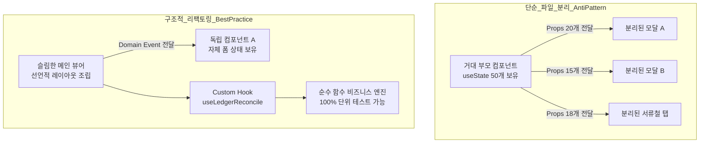
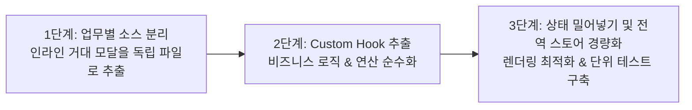
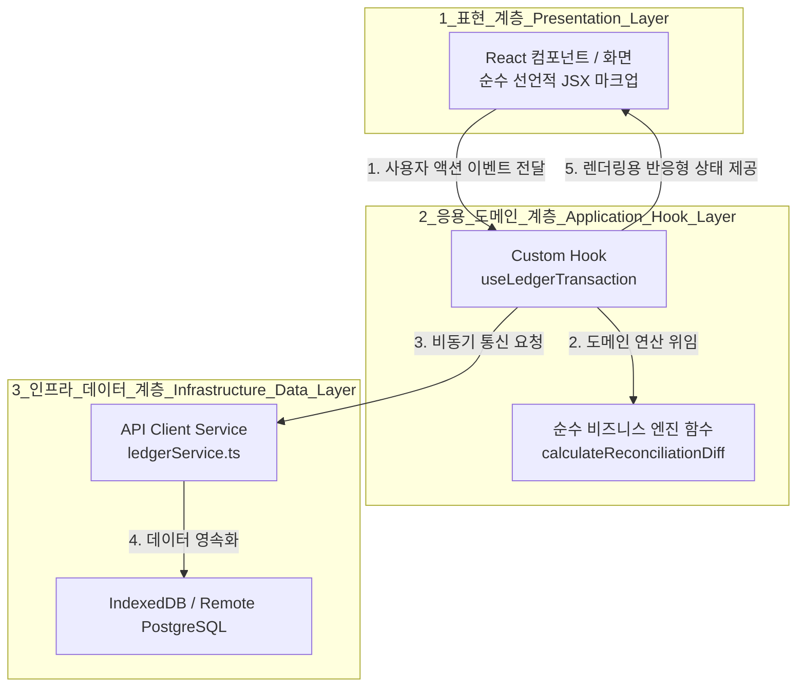
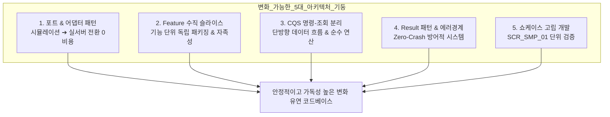

# 02-리팩토링전략가이드.md : 초급 개발자를 위한 React & Node.js 구조적 리팩토링 실전 가이드

> **문서 ID**: `020002`  
> **최초 작성일**: 2026-10-27  
> **대상 독자**: React 및 Node.js 개발 환경이 아직 낯설거나, 거대 단일 컴포넌트(Monolithic Component)를 체계적으로 개선하고자 하는 초급 및 주니어 개발자  
> **핵심 주제**: 단순 파일 분리(File Splitting)를 넘어선 상태·로직·뷰 격리, Custom Hooks 활용, 파생 상태 관리, 회귀 없는 점진적 리팩토링 프레임워크

---

## 1. 리팩토링의 본질과 패러다임 전환

### 1.1 "단순 소스 분리"와 "구조적 리팩토링"의 결정적 차이

많은 초급 개발자가 리팩토링을 시작할 때 코드가 길다는 이유로 **"JSX 덩어리를 잘라 새 파일에 붙여넣기(Cut & Paste)"**하는 방식을 취합니다. 그러나 이 방식은 다음과 같은 치명적인 한계를 가집니다:

1. **거대한 Props 릴레이 (Prop Drilling)**: 상위 컴포넌트에 존재하는 수십 개의 `useState`와 이벤트 핸들러 함수를 하위 컴포넌트로 전달해야 하므로 인터페이스가 극도로 비대해집니다.
2. **높은 결합도 유지**: 파일만 나뉘었을 뿐, 상태의 소유권과 라이프사이클이 여전히 부모 화면에 종속되어 있어 렌더링 최적화나 독립적 재사용이 불가능합니다.
3. **가독성 착시**: 메인 컴포넌트의 줄 수는 줄어들지만, 데이터의 흐름을 추적하기 위해 여러 파일을 오가야 하므로 인지 부하(Cognitive Load)는 오히려 증가합니다.


*다이어그램 설명: 좌측의 단순 파일 분리는 부모 컴포넌트의 거대 상태를 그대로 하위 컴포넌트에 넘겨 결합도가 유지되는 반면, 우측의 구조적 리팩토링은 비즈니스 로직(Custom Hook/순수 함수)과 뷰를 격리하고 자족적인 상태를 컴포넌트 내부로 밀어 넣습니다.*

---

## 2. 초급 개발자를 위한 React 핵심 리팩토링 5대 원칙

### [원칙 1] 컴포넌트 책임 분리: "그리는 놈(View)"과 "계산하는 놈(Logic)" 나누기

- **문제점**: JSX 화면 코드 안에 계산식(`reduce`, `filter`, `sort`), 비동기 API 호출, 이벤트 유효성 검사가 뒤섞여 있으면 화면 구조를 한눈에 파악하기 어렵습니다.
- **해결책**:
  - 화면을 렌더링하는 컴포넌트는 오직 **UI 구조와 스타일링**에만 집중합니다.
  - 상태 조작 및 비즈니스 연산은 **Custom Hook** (`use...`) 또는 컴포넌트 외부의 **순수 함수(Pure Function)**로 분리합니다.

```tsx
// ❌ Before: 계산 로직과 상태가 JSX 화면에 뒤섞인 형태
export const LedgerOverview = () => {
  const [items, setItems] = useState([]);
  // 화면 컴포넌트 내부에서 복잡한 통계 계산 수행
  const totalExpense = items
    .filter(i => i.type === 'EXPENSE' && !i.is_asset_transfer)
    .reduce((acc, cur) => acc + cur.amount, 0);

  return <div>총 지출: {totalExpense.toLocaleString()}원</div>;
};

// 🟢 After: 계산 로직을 순수 함수로 추출 (테스트 가능)
// src/utils/ledgerCalculations.ts
export const calculateTotalExpense = (items: Transaction[]): number => {
  return items
    .filter(i => i.type === 'EXPENSE' && !i.is_asset_transfer)
    .reduce((acc, cur) => acc + cur.amount, 0);
};

// src/components/LedgerOverview.tsx
export const LedgerOverview = ({ items }: { items: Transaction[] }) => {
  const totalExpense = useMemo(() => calculateTotalExpense(items), [items]);
  return <div>총 지출: {totalExpense.toLocaleString()}원</div>;
};
```

---

### [원칙 2] 상태 응집도 (State Co-location): 상태는 필요한 곳에 최대한 가깝게 두기

- **문제점**: 모달이 열려 있을 때만 필요한 폼 입력값(`title`, `amount`, `category`, `tempImage` 등)을 최상위 화면 컴포넌트가 `useState`로 들고 있으면, 타이핑을 칠 때마다 8,000줄짜리 메인 화면 전체가 리렌더링됩니다.
- **해결책**:
  - 해당 모달이나 서브 뷰에서만 사용되는 임시 상태는 **모달 컴포넌트 내부로 완전히 밀어 넣습니다(State Co-location)**.
  - 최상위 화면은 단지 모달의 열림/닫힘(`isOpen`)과 최종 저장 콜백(`onSave(data)`)만 관리합니다.

```tsx
// 🟢 모달 내부에서 자족적으로 상태를 관리하는 모범 구조
interface NewTransactionModalProps {
  isOpen: boolean;
  onClose: () => void;
  onSubmit: (data: NewTransactionInput) => void;
  members: Member[];
}

export const NewTransactionModal = ({ isOpen, onClose, onSubmit, members }: NewTransactionModalProps) => {
  // 모달 내부에서만 쓰이는 폼 상태는 여기서 독립 선언
  const [amount, setAmount] = useState<number>(0);
  const [title, setTitle] = useState<string>('');
  const [selectedCategory, setSelectedCategory] = useState<string>('식비');

  if (!isOpen) return null;

  const handleSubmit = (e: React.FormEvent) => {
    e.preventDefault();
    onSubmit({ amount, title, category: selectedCategory });
    onClose();
  };

  return (
    <div className="fixed inset-0 z-50 ...">
      <form onSubmit={handleSubmit}>
        <input value={title} onChange={(e) => setTitle(e.target.value)} />
        <button type="submit">등록</button>
      </form>
    </div>
  );
};
```

---

### [원칙 3] 파생 상태(Derived State) 안티패턴 제거

- **문제점**: 기존 상태로부터 유도(계산)할 수 있는 값을 불필요하게 새로운 `useState`로 선언하고 `useEffect`로 동기화하려다 무한 루프나 상태 불일치 버그를 유발하는 현상입니다.
- **해결책**:
  - `useEffect`로 상태를 복제하지 마세요.
  - 렌더링 시점에 직접 계산하거나, 비용이 큰 연산일 경우 `useMemo`를 사용하세요.

```tsx
// ❌ Anti-pattern: 상태 복제 및 동기화 useEffect
const [transactions, setTransactions] = useState<Transaction[]>([]);
const [filteredList, setFilteredList] = useState<Transaction[]>([]);

useEffect(() => {
  // 위험: 데이터 갱신 타이밍 차이로 깜빡임이나 렌더링 불일치 발생
  setFilteredList(transactions.filter(t => t.category === selectedCategory));
}, [transactions, selectedCategory]);

// 🟢 Best Practice: 파생 상태 직접 연산 (불변 보장)
const filteredList = useMemo(() => {
  return transactions.filter(t => t.category === selectedCategory);
}, [transactions, selectedCategory]);
```

---

### [원칙 4] 컴포넌트 크기 기준: "한 호흡(150~300줄) 규칙"

- 한 컴포넌트의 길이가 **300줄을 초과**하기 시작하면 컴포넌트가 너무 많은 책임을 지고 있다는 신호입니다.
- 컴포넌트가 다음 질문 중 2개 이상에 해당하면 즉시 쪼개야 합니다:
  1. 이 컴포넌트 안에 2개 이상의 서로 다른 사용자 액션 흐름(예: 장부 검색 + 참여자 초대 + 영수증 업로드)이 존재하는가?
  2. 스크롤을 여러 번 내려야 JSX의 끝을 볼 수 있는가?
  3. `useState`가 10개 이상 선언되어 있는가?

---

### [원칙 5] 방어적 렌더링과 TypeScript 타입 안전성

- JavaScript/TypeScript 초급자가 가장 자주 마주치는 오류는 `TypeError: Cannot read properties of undefined`입니다.
- **해결책**:
  - **옵셔널 체이닝 (`?.`)**과 **널 병합 연산자 (`??`)**를 기본적으로 습관화합니다.
  - 배열 렌더링 시에는 항상 `(items ?? []).map(...)` 형태로 방어 코드를 작성합니다.
  - `any` 타입을 절대 사용하지 않고 구체적인 인터페이스를 명시합니다.

---

## 3. Node.js 백엔드 및 상태 관리 리팩토링 원칙

### 3.1 3계층 아키텍처 (Controller - Service - Repository)
- **Controller**: HTTP 요청(Request) 파라미터 파싱 및 응답(Response) 반환만 담당 (비즈니스 로직 금지).
- **Service**: 도메인 규칙 검증, 계산, 트랜잭션 흐름 제어 (순수 비즈니스 로직).
- **Repository / Store**: 데이터베이스 또는 로컬 스토어 CRUD 쿼리만 담당.

### 3.2 멱등성(Idempotency)과 단일 진실 공급원(SSOT)
- 동일한 요청이 네트워크 지연으로 두 번 들어오더라도 한 번만 처리되도록 `idempotency_key`를 검증합니다.
- 가계부의 수입/지출 데이터는 오직 단일 원장(General Ledger) 테이블에만 기록되며, 다른 요약 뷰는 이를 집계하여 보여줄 뿐 원천 데이터를 이중으로 저장하지 않습니다.

---

## 4. 모아보고(MoaBogo) 3단계 점진적 리팩토링 로드맵


*다이어그램 설명: 1단계에서는 우선 파일별로 코드를 물리적으로 분리하여 안전지대를 확보하고, 2단계에서 로직과 뷰를 분리하며, 3단계에서 상태 결합도를 해소하고 성능을 극대화합니다.*

### [1단계] 업무별 물리적 모달/뷰 컴포넌트 분리 (현재 진행 단계)
- 8,000줄 이상의 메인 화면에서 10개의 독립 모달 레이어를 `src/components/ledger/modals/`로 분리.
- 목적: 컴포넌트 가독성 확보, 파일 크기 50% 이상 감소, 모듈 경계 설정.

### [2단계] 비즈니스 로직의 Custom Hook 추출
- `useLedgerTransactionForm()`: 거래 등록 및 유효성 검사 로직.
- `useReceiptReconciliation()`: 영수증 OCR과 거래 내역 원자 대사 알고리즘.
- `useLedgerMembers()`: 참여자 권한 및 초대 링크 복사 로직.
- 목적: 화면 파일에서 React 훅 선언부를 제거하고 UI 마크업만 남김.

### [3단계] 상태 응집화 및 렌더링 최적화
- 모달 내부 전용 상태의 내부 캡슐화.
- 불필요한 부모 리렌더링 방지를 위해 `React.memo` 및 셀렉터 기반 스토어 분리.

---

## 5. 초급 개발자를 위한 리팩토링 안전 점검 체크리스트

리팩토링을 완료한 후 코드를 커밋하기 전에 반드시 다음 6가지 항목을 자가 점검하세요:

- [ ] **컴파일 검증**: `npm run build` 또는 `compile_applet` 실행 시 0-Error인가?
- [ ] **린트 검증**: 사용하지 않는 import나 선언되지 않은 변수가 없는가?
- [ ] **Props 인터페이스 명시**: 분리된 컴포넌트의 Props에 `any`가 없고 명확한 `interface`가 정의되었는가?
- [ ] **모아보고 3대 원칙 준수**:
  - 거래는 개인/모임 중 단 하나에만 배타적으로 귀속되는가? (`단일 귀속성`)
  - 자산 이동 시 수입/지출에서 제외되고 1:1 페어링되는가? (`TRANSFER 단일 연결`)
  - 정산 및 대납 표시는 메타데이터 태깅으로 분리되었는가? (`태깅 분리`)
- [ ] **방어 코드 적용**: `?.` 및 `??`를 적절히 사용하여 Null/Undefined 참조 에러를 차단했는가?
- [ ] **동작 일치성**: 리팩토링 전과 동일하게 모달이 열리고, 닫히고, 저장되는가?

---

## 7. 백엔드 OOP/DDD 개발자를 위한 프론트엔드 아키텍처 매핑 및 실전 리팩토링 절차

많은 백엔드 개발자들이 프론트엔드(React/TypeScript) 코드를 처음 접할 때 "어디에 비즈니스 로직을 두고 어떻게 객체지향/도메인 원칙을 적용해야 하는가?"에 대해 혼란을 겪습니다. 프론트엔드 역시 객체지향(OOP)과 도메인 주도 설계(DDD)의 핵심 가치(책임 분리, 캡슐화, 단일 책임)를 그대로 계승하며, 함수형 리액티브 패러다임과 조화롭게 동작합니다.

### 7.1 백엔드 개념 ↔ 프론트엔드 개념 1:1 매핑표

| 백엔드 (Spring / Node OOP) | 프론트엔드 (React / TypeScript) | 역할 및 책임 | 실전 적용 예시 |
| :--- | :--- | :--- | :--- |
| **Controller** | **View Component (JSX)** | 사용자의 이벤트(클릭, 입력) 수신 및 최종 결과 렌더링 | `SCR_LED_01.tsx`, `LedgerNewTransactionModal.tsx` |
| **Service (비즈니스 로직)** | **Custom Hook (`use...`) + Pure Engine** | 상태 흐름 제어, 유효성 검사, 도메인 계산식 실행 | `useLedgerTransaction()`, `calculateDutyStats()` |
| **Repository / DAO** | **API Service Client** | 원격 HTTP 호출(Fetch/Axios) 및 로컬 DB(IndexedDB) 캐시 접근 | `services/ledgerApi.ts`, `services/ocrClient.ts` |
| **Entity / Domain Model** | **TypeScript Interface / Class** | 도메인 데이터의 형상과 비즈니스 규칙 정의 | `LedgerTransaction`, `CardStatementIntakeReview` |
| **Value Object (VO)** | **Readonly Type / Zod Schema** | 불변성(Immutability)을 가진 원자적 값 객체 | `type Money = { amount: number; currency: 'KRW' }` |
| **Enum / 상수 풀** | **TypeScript `as const` / Enum** | 하드코딩 방지를 위한 표준 상수/식별자 집합 | `LEDGER_DESIGN_STYLES`, `COVER_COLOR_PRESETS` |
| **Dependency Injection (DI)** | **React Context / Props Injection** | 상위 계층에서 필요한 인스턴스/설정을 하위로 주입 | `ThemeContext`, `LedgerStoreContext` |

---

### 7.2 화면 이벤트와 비즈니스 기능의 3계층 분리 아키텍처

현재 프로토타입 단계에서는 빠른 프로토타이핑을 위해 화면 컴포넌트 내부에서 `setTimeout` 시뮬레이션과 로컬 상태 변경을 직접 수행하고 있습니다. 그러나 **실제 백엔드 API 및 EasyOCR 컨테이너가 연동되면 화면 로직과 비즈니스 코드가 뒤섞여 스파게티가 되는 것을 반드시 방지**해야 합니다.

이를 해결하기 위해 다음 **3계층 아키텍처(Layered Frontend)**를 준수합니다:


*다이어그램 설명: 화면 컴포넌트는 오직 사용자의 이벤트를 Hook에 전달하고 Hook이 가공해 준 상태를 그릴 뿐이며, 실제 API 통신과 도메인 계산은 Hook과 순수 서비스 계층이 전담합니다.*

#### [코드 비교: 화면 이벤트와 비즈니스 로직의 분리]

```tsx
// ❌ 화면 컴포넌트 안에 API 호출과 유효성 검사가 뒤섞인 안티패턴
export const BadLedgerComponent = () => {
  const [data, setData] = useState([]);
  const handleSave = async (item) => {
    // 화면 코드 안에서 비즈니스 검증, HTTP 요청, 에러 처리가 혼재됨
    if (item.amount <= 0) return alert('금액 오류');
    const res = await fetch('/api/ledger', { method: 'POST', body: JSON.stringify(item) });
    const json = await res.json();
    setData(prev => [...prev, json]);
  };
  return <button onClick={handleSave}>저장</button>;
};

// 🟢 3계층으로 분리된 클린 아키텍처
// 1) 인프라 계층: src/services/ledgerService.ts
export const ledgerService = {
  async createTransaction(tx: NewTxInput): Promise<LedgerTransaction> {
    const res = await fetch('/api/ledger', { method: 'POST', body: JSON.stringify(tx) });
    if (!res.ok) throw new Error('트랜잭션 생성 실패');
    return res.json();
  }
};

// 2) 응용/Hook 계층: src/hooks/useLedgerTransaction.ts
export const useLedgerTransaction = (ledgerId: string) => {
  const [loading, setLoading] = useState(false);
  const saveTransaction = async (input: NewTxInput) => {
    // 도메인 가드레일 검증 (비즈니스 규칙)
    validateLedgerTransaction(input);
    setLoading(true);
    try {
      const result = await ledgerService.createTransaction(input);
      return result;
    } finally {
      setLoading(false);
    }
  };
  return { saveTransaction, loading };
};

// 3) 표현 계층 (화면): src/sample/screen/SCR_LED_01.tsx
export const CleanLedgerComponent = () => {
  const { saveTransaction, loading } = useLedgerTransaction(activeLedgerId);
  // 컴포넌트는 단 1줄로 호출하고, 오직 UI 렌더링에만 집중!
  return <button onClick={() => saveTransaction(formData)} disabled={loading}>저장</button>;
};
```

---

### 7.3 토큰 기반 디자인 요소(`Tokens.tsx`)의 단일 코드베이스 확장성 관리

"화면별/기능별로 작은 차이가 발생할 때 공통 컴포넌트(`Tokens.tsx`) 하나로 다 감당할 수 있는가?"에 대한 답은 **"베리언트(Variant) 패턴과 합성(Composition) 구조를 갖추면 단일 코드베이스로 100% 관리 가능하다"**입니다.

초급 개발자가 흔히 저지르는 실수는 화면마다 약간의 차이가 생길 때마다 boolean 플래그(`isLedger`, `isSmallPadding`, `hideIcon`)를 계속 추가하여 컴포넌트가 누더기가 되거나, 복사-붙여넣기로 `ElmInp01_Ledger.tsx` 같은 파편화된 파일을 만드는 것입니다.

이를 방지하는 **3대 디자인 토큰 확장성 원칙**은 다음과 같습니다:

1. **CVA(Class Variance Authority) 스타일의 베리언트 규격화**:
   - `variant` (`solid` | `outline` | `ghost`)
   - `size` (`sm` | `md` | `lg`)
   - `colorScheme` (`indigo` | `emerald` | `rose` | `amber` | `sky`)
   - 공통 요소는 위의 표준 축(Axis) 조합으로 모든 화면 차이를 흡수합니다.

2. **슬롯(Slot) 및 합성(Composition) 패턴 (`children` 적극 활용)**:
   - 버튼이나 입력 필드 내부의 세부 아이콘, 보조 뱃지, 접미사 텍스트를 고정하지 않고 `<Slot>` 또는 `leftAddon`, `rightAddon` Props로 열어둡니다.

```tsx
// 🟢 확장성이 보장된 공통 입력 토큰 설계 예시
interface ElmInpProps {
  label: string;
  value: string;
  onChange: (val: string) => void;
  size?: 'sm' | 'md' | 'lg';
  colorScheme?: 'indigo' | 'emerald' | 'amber';
  leftAddon?: React.ReactNode;   // 화면별 특화 아이콘 주입 가능
  rightAddon?: React.ReactNode;  // 화면별 특화 버튼(예: 복사, 지우기) 주입 가능
  errorText?: string;
}
```

3. **기능 차이는 '컴포넌트 복제'가 아닌 '래퍼(Wrapper)'로 해결**:
   - 예: 금액 입력 전용 콤마 포맷터가 필요한 경우, `ElmInp01`을 복제하지 않고 `ElmInp01`을 감싸는 경량 래퍼 `<ElmMoneyInp />`를 작성합니다.

---

### 7.4 코드 수정 시 실행하는 프론트엔드 실전 리팩토링 4단계 워크플로우

태스크 처리 시 새로운 기능 추가나 코드 수정 요청이 발생하면, 다음 4단계를 루틴화하여 리팩토링을 병행합니다:

```text
[1단계: 요구사항 파악 & 도메인 타입 정의]
  └─ types.ts 에 Interface/Enum 선언 (any 절대 사용 금지, 하드코딩 제거)
       ▼
[2단계: 비즈니스 계산식 & 유효성 검사를 순수 함수로 선작성]
  └─ utils/ 또는 services/ 에 순수 함수 작성 (입력 ➔ 출력 결정론적 보장)
       ▼
[3단계: Custom Hook 추출 & 상태 캡슐화]
  └─ useState 묶음과 이벤트 핸들러를 Hook으로 분리 (화면 코드 다이어트)
       ▼
[4단계: View 컴포넌트 선언적 바인딩 & 0-Error 검증]
  └─ 컴포넌트는 Hook에서 반환된 값만 바인딩 (tsc --noEmit 및 compile_applet 통과)
```

이 절차를 따르면 백엔드에서 Service와 Entity를 먼저 정의하고 Controller를 얇게 유지하는 것과 완벽하게 동일한 수준의 높은 응집도와 낮은 결합도를 프론트엔드에서도 유지할 수 있습니다.

---

## 8. 코드를 안정적이고 가독성 있게 변화 가능(Evolvable)하게 관리하는 5대 고도화 방안

단순히 코드를 깔끔하게 만드는 것을 넘어, **"팀의 규모가 커지고 기능 요구사항이 폭풍처럼 변해도 시스템이 무너지지 않고 유연하게 적응하는 아키텍처"**를 구축하기 위해 다음 5가지 고도화 관리 방안을 권장합니다.


*다이어그램 설명: 5가지 핵심 아키텍처 기둥이 결합되어 실서버 전환 비용을 0으로 만들고, 도메인 기능의 쉬운 추가/삭제, 단방향 상태 흐름, 런타임 무중단 안정성 및 빠른 개발 피드백 루프를 완성합니다.*

---

### [방안 1] 포트와 어댑터(Hexagonal Architecture) 패턴: "실서버 전환 비용 = 코드 1줄"

- **문제점**: 현재 로컬 시뮬레이션(Mock)으로 작성된 로직을 나중에 실제 백엔드 REST API(`fetch`)로 바꿀 때, 화면 컴포넌트나 훅의 코드를 일일이 뜯어고치다 보면 반드시 회귀 버그(Regression)가 발생합니다.
- **해결책**:
  1. 도메인 인터페이스인 **포트(Port)**를 정의합니다: `interface LedgerRepository { getTransactions(): Promise<...>; create(...): Promise<...>; }`
  2. 현재 단계에서는 `MockLedgerRepository` 어댑터를 연결하여 로컬 상태로 시뮬레이션합니다.
  3. 향후 백엔드 API가 완성되면 `HttpLedgerRepository` 어댑터만 새로 작성하고, 진입점 주입 설정 파일에서 어댑터 교체 **단 1줄로 실서버 전환을 완료**합니다. 화면 컴포넌트는 단 한 글자도 수정할 필요가 없습니다.

---

### [방안 2] 계층별(Layer) 수평 분리에서 기능별(Feature-Sliced) 수직 슬라이스로 진화

- **기존 계층별 분리의 한계**:
  `components/`, `hooks/`, `utils/`, `types/` 폴더에 코드를 나누면, "영수증 OCR 대사" 기능 하나를 수정하거나 삭제하기 위해 4~5개 폴더를 뒤져야 합니다. (낮은 응집도, 높은 인지 부하)
- **수직 슬라이스(Vertical Slice) 진화**:
  관련 있는 파일들을 하나의 도메인 기능 폴더로 묶습니다:
  ```
  src/features/receipt-reconciliation/
  ├── components/          # 전용 UI (ReconcileBentoViewer.tsx 등)
  ├── hooks/               # 전용 훅 (useReceiptReconciliation.ts)
  ├── engines/             # 순수 비즈니스 대사 알고리즘 (diffCalculator.ts)
  ├── types.ts             # 전용 타입 정의
  └── index.ts             # 외부로 공개할 Public API만 노출 (캡슐화)
  ```
  - **효과**: 특정 기능이 필요 없어지면 해당 폴더 하나만 지우면 끝납니다. 다른 기능에 부수 효과(Side-Effect)를 전혀 미치지 않습니다.

---

### [방안 3] CQS (Command-Query Separation, 명령-조회 분리) 원칙 확립

- **원칙**:
  - **Query (조회)**: 시스템의 상태를 절대 변경하지 않으며, 오직 계산된 데이터를 반환합니다. (순수 함수, `useMemo`, Selector)
  - **Command (명령)**: 시스템의 상태를 변경하지만, 복잡한 UI 계산값을 직접 반환하지 않고 변경 완료 이벤트만 발생시킵니다.
- **실전 적용**:
  - `calculateLedgerBalance(txList)`: 오직 상태를 읽고 잔액을 계산하는 순수 Query.
  - `dispatchCreateTransaction(newTx)`: 상태를 업데이트하는 Command.
  - 조회와 명령이 한 함수 안에 엉키지 않아 디버깅 시 "어느 지점에서 상태가 오염되었는지" 추적하기가 극도로 쉬워집니다.

---

### [방안 4] Result<T, E> 패턴과 ErrorBoundary를 통한 'Zero-Crash' 거버넌스

- **문제점**: 여기저기 흩어진 `try-catch` 블록과 예측하지 못한 런타임 예외로 인해 화면 전체가 하얗게 죽는(White Screen of Death) 현상 발생.
- **해결책**:
  1. **Result 타입 도입**: 비즈니스 함수가 예외를 무조건 `throw`하지 않고, 성공/실패를 타입으로 반환하도록 규격화합니다.
     ```ts
     type Result<T, E = string> = { success: true; data: T } | { success: false; error: E };
     ```
     호출하는 쪽에서 `if (!result.success) { ... }` 분기를 강제하여 잠재적 버그를 컴파일 타임에 100% 잡아냅니다.
  2. **모듈별 독립 ErrorBoundary 적용**:
     모아당번, 가계부 원장, 서류철 탭 등 핵심 뷰를 개별 `<ErrorBoundary>`로 감싸, 설령 서류철 탭의 차트 연산에 일시적 오류가 나더라도 메인 원장 테이블과 네비게이션은 정상 작동하도록 시스템 복원력을 보장합니다.

---

### [방안 5] 컴포넌트 쇼케이스(`SCR_SMP_01`) 기반의 "고립 개발(Isolated Prototyping)"

- **개발 프로세스 혁신**:
  - 복잡한 로그인 세션, 다중 가계부 선택, 스크롤 깊숙이 위치한 모달을 테스트하기 위해 매번 10번씩 클릭하며 디버깅하는 것은 개발 생산성을 심각하게 떨어뜨립니다.
  - 모아보고의 `SCR_SMP_01_공통컴포넌트쇼케이스`에 신규 모달과 분리된 컴포넌트들을 등록하여, **독립된 샌드박스 상태에서 단독으로 테스트하고 디버깅**합니다.
  - 화면의 복잡한 비즈니스 상태와 완전히 분리된 상태에서 UI와 인터랙션을 검증하므로, 버그가 메인 코드로 유입되는 것을 원천 차단할 수 있습니다.

---

## 9. 작업 이력 (Document History)

| 작업일자 | 이슈ID | 태스크 | 작업자 | 작업내용 | 사용 AI 모델명 | 에이전트 | 참고링크 |
| :---: | :---: | :---: | :---: | :--- | :---: | :---: | :---: |
| 2026-10-27 | #57 | [0022-01] | MoaBogo AI Agent | 초급 개발자를 위한 React & Node.js 구조적 리팩토링 전략 가이드 발행 | Gemini 3.8 Flash | Session Architect | Issue #57 |
| 2026-10-27 | #57 | [0022-01] | MoaBogo AI Agent | 백엔드 OOP/DDD 개발자를 위한 프론트엔드 아키텍처 매핑 및 토큰 확장성 원칙 추가 | Gemini 3.8 Flash | Session Architect | Issue #57 |
| 2026-10-27 | #57 | [0022-01] | MoaBogo AI Agent | 코드를 안정적이고 가독성 있게 변화 가능하게 관리하는 5대 고도화 방안 추가 | Gemini 3.8 Flash | Session Architect | Issue #57 |


