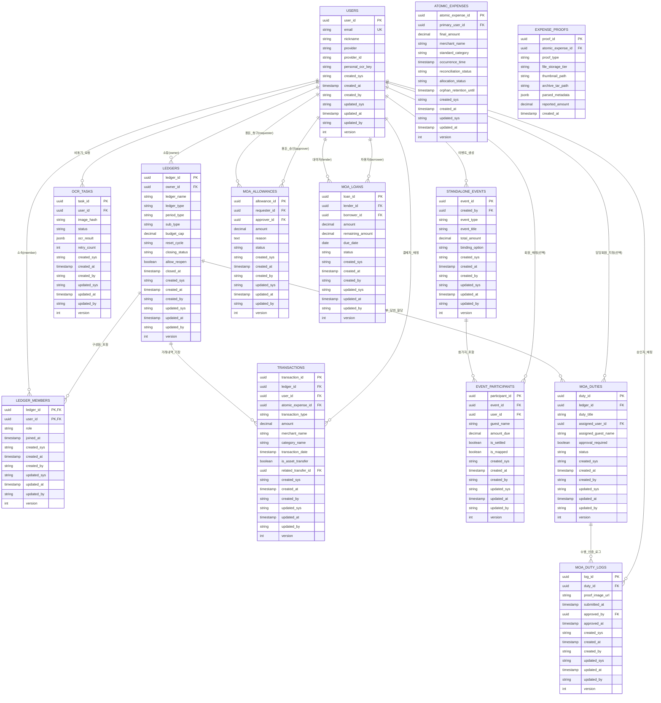

# 모아보고 (MoaBogo) 데이터베이스 및 엔티티 상세설계서

- **문서 ID**: `040001` (`docs/04.데이터/01.데이터설계.md`)
- **버전**: v2.0
- **최종 수정일**: 2026-10-08
- **대상 인프라**: Ubuntu 단일 노드 Docker 컨테이너 (`PostgreSQL 16 Alpine`)
- **전용 스키마**: `aiagent`

---

## 📌 1. 개요 및 설계 원칙

본 문서는 모아보고(MoaBogo)의 1인 다중 가계부, 독립 모임 정산/게임, 모아 3대 확장 라이프(당번/용돈/빌림) 및 2단계 OCR 파이프라인을 지원하는 **11개 정규 도메인 테이블의 논리/물리 데이터 모델링, Mermaid ERD 다이어그램, 테이블 컬럼 정의서 및 데이터 사전**을 규정합니다.

### 핵심 데이터 설계 원칙
1. **소비 지출과 자산/부채 이동의 회계 분리**: `transactions.is_asset_transfer` 플래그를 통해 용돈/빌림/이체 거래가 당월 순수 생활비 예산 통계를 왜곡하지 않도록 데이터 레벨에서 격리합니다.
2. **게스트와 회원의 유연한 포용**: 독립 이벤트 및 모아당번은 정식 가입 회원(`user_id` FK)뿐 아니라 미가입 게스트(`guest_name`)를 수용하며, 회원가입 시 소급 매핑이 가능한 구조로 설계합니다.
3. **7대 필수 감사 컬럼 전수 적용**: 변경 추적성 및 분산 동시성 제어를 위해 전 테이블에 감사 컬럼(`created_sys`, `created_at`, `created_by`, `updated_sys`, `updated_at`, `updated_by`, `version`)을 의무화합니다.
4. **낙관적 락(Optimistic Lock)**: `version` 정수 필드를 통해 오프라인 동기화 시 Stale 충돌을 감지하고 무결성을 방어합니다.

---

## 🗺️ 2. 통합 ERD 다이어그램 (Mermaid)

*다이어그램 설명: 모아보고 핵심 엔티티 관계도입니다. `USERS`는 다중 `LEDGERS`를 소유하거나 `LEDGER_MEMBERS`로 참여하며, 각 가계부마다 `TRANSACTIONS` 및 `MOA_DUTIES`가 종속됩니다. 독립 이벤트(`STANDALONE_EVENTS`) 및 당번은 미가입 게스트를 수용하기 위해 `user_id`를 Nullable로 두고 게스트 식별 컬럼을 병행 지원합니다.*

---

## 📖 3. 데이터 사전 (Data Dictionary)

| 표준 단어 | 논리명 | 물리명 | 데이터 타입 | 설명 / 허용값 |
| :--- | :--- | :--- | :--- | :--- |
| **User ID** | 사용자 식별자 | `user_id` | `UUID` | 시스템 전역 고유 사용자 식별 키 |
| **Ledger ID** | 가계부 식별자 | `ledger_id` | `UUID` | 1인 다중 가계부 고유 키 |
| **Ledger Type** | 가계부 유형 | `ledger_type` | `VARCHAR(20)` | `PERSONAL`(개인), `GROUP`(그룹), `INSTANCE`(일회성) |
| **Period Type** | 장부 기간유형 | `period_type` | `VARCHAR(20)` | `LONG_TERM`(장기 연속형), `SHORT_TERM`(단기 정산형) |
| **Sub Type** | 장부 세부성격 | `sub_type` | `VARCHAR(20)` | `STANDARD`(일반 가계부), `POCKET_MONEY`(용돈기입장) |
| **Budget Cap** | 용돈/예산 한도 | `budget_cap` | `DECIMAL(14,2)` | 용돈기입장 또는 장부의 지정된 예산 상한액 |
| **Reset Cycle** | 예산 리셋주기 | `reset_cycle` | `VARCHAR(20)` | `MONTHLY`(월간), `WEEKLY`(주간), `NONE`(없음/수동) |
| **Closing Status**| 장부 마감상태 | `closing_status` | `VARCHAR(20)` | `OPEN`(진행중), `CLOSED`(마감보관), `SETTLED`(정산완료) |
| **Allow Reopen** | 마감 후 재오픈 | `allow_reopen` | `BOOLEAN` | 방장의 마감 취소 및 재오픈 허용 여부 (기본 true) |
| **Transaction Type** | 거래 유형 | `transaction_type`| `VARCHAR(20)` | `EXPENSE`(지출), `INCOME`(수입), `TRANSFER`(이체) |
| **Is Asset Transfer**| 자산이동 여부 | `is_asset_transfer`| `BOOLEAN` | `true`: 생활비 예산 왜곡 방지용 자산/부채 이동 |
| **Related Transfer** | 1:1 페어링 거래 | `related_transfer_id` | `UUID` | 상대편 이체 거래 ID (1:1 자기참조 페어링) |
| **Task Status** | OCR 작업상태 | `status` | `VARCHAR(20)` | `PENDING`, `PROCESSING`, `COMPLETED`, `FAILED`, `STALE` |
| **Binding Option** | 가계부 연동옵션 | `binding_option` | `VARCHAR(20)` | `ASK_AFTER`(선택), `AUTO_LINK`(자동), `SKIP`(생략) |
| **Duty Status** | 당번 수행상태 | `status` | `VARCHAR(20)` | `ASSIGNED`(할당), `ENDED`(수행제출), `COMPLETED`(승인) |
| **Allowance Status**| 용돈 청구상태 | `status` | `VARCHAR(20)` | `REQUESTED`, `APPROVED`, `PAID`, `REJECTED` |
| **Loan Status** | 대여 상환상태 | `status` | `VARCHAR(20)` | `ACTIVE`, `PARTIAL_PAID`, `FULLY_PAID`, `OVERDUE` |

---

## 📋 4. 11개 테이블 상세 컬럼 정의서

### 4.1 `users` (회원 및 인증 계정)
- **설명**: 소셜 로그인 회원 및 2차 개인 Vision API Key 저장

| 컬럼명 | 논리명 | 데이터 타입 | PK/FK | Null | 기본값 | 비고 / 도메인 규칙 |
| :--- | :--- | :--- | :---: | :---: | :--- | :--- |
| `user_id` | 사용자ID | UUID | PK | N | `uuid_generate_v4()` | 고유 UUID |
| `email` | 이메일 | VARCHAR(255) | - | Y | - | 소셜 로그인 연동 이메일 (Unique) |
| `nickname` | 닉네임 | VARCHAR(100) | - | N | - | 화면 표시용 사용자 이름 |
| `provider` | 인증 제공자 | VARCHAR(20) | - | N | - | `KAKAO`, `TOSS`, `NAVER`, `EMAIL` |
| `provider_id` | 제공자 고유ID | VARCHAR(255) | - | Y | - | OAuth 연동 토큰 식별자 |
| `personal_ocr_key`| 개인 OCR Key | VARCHAR(255) | - | Y | - | 사용자 소유 2차 Vision Key (서버비용 0원) |
| `created_sys` ~ `version` | 7대 감사컬럼 | - | - | N | 표준 기본값 | 생성/수정 추적 및 동시성 제어 |

---

### 4.2 `ledgers` (1인 다중 가계부)
- **설명**: 개인 가계부, 가족 그룹 가계부, 용돈기입장, 단기 인스턴스 모임 가계부 관리

| 컬럼명 | 논리명 | 데이터 타입 | PK/FK | Null | 기본값 | 비고 / 도메인 규칙 |
| :--- | :--- | :--- | :---: | :---: | :--- | :--- |
| `ledger_id` | 가계부ID | UUID | PK | N | `uuid_generate_v4()` | 가계부 고유 식별자 |
| `owner_id` | 소유자ID | UUID | FK | N | - | `users.user_id` 참조 (CASCADE 삭제) |
| `ledger_name` | 가계부 이름 | VARCHAR(100) | - | N | - | 예: '우리집 가계부', '자녀 용돈기입장' |
| `ledger_type` | 가계부 유형 | VARCHAR(20) | - | N | `'PERSONAL'` | `PERSONAL`, `GROUP`, `INSTANCE` |
| `period_type` | 기간 유형 | VARCHAR(20) | - | N | `'LONG_TERM'` | `LONG_TERM`(연속형), `SHORT_TERM`(정산형) |
| `sub_type` | 세부 성격 | VARCHAR(20) | - | N | `'STANDARD'` | `STANDARD`(일반 가계부), `POCKET_MONEY`(용돈기입장) |
| `budget_cap` | 예산/한도 | DECIMAL(14,2)| - | Y | `NULL` | 용돈기입장 한도 또는 월간 예산 상한 |
| `reset_cycle` | 리셋 주기 | VARCHAR(20) | - | N | `'MONTHLY'` | `MONTHLY`, `WEEKLY`, `NONE` |
| `closing_status`| 마감 상태 | VARCHAR(20) | - | N | `'OPEN'` | `OPEN`(진행중), `CLOSED`(마감보관), `SETTLED`(정산완료) |
| `allow_reopen` | 재오픈 허용 | BOOLEAN | - | N | `TRUE` | 방장의 마감 취소 및 재오픈 허용 여부 |
| `closed_at` | 마감 일시 | TIMESTAMPTZ | - | Y | `NULL` | 정산 마감 처리 시각 |
| `created_sys` ~ `version` | 7대 감사컬럼 | - | - | N | 표준 기본값 | 생성/수정 추적 및 동시성 제어 |

---

### 4.3 `ledger_members` (가계부 멤버십 및 RBAC)
- **설명**: 가계부별 참여 멤버 및 역할 권한 (`OWNER`, `MEMBER`, `VIEWER`)

| 컬럼명 | 논리명 | 데이터 타입 | PK/FK | Null | 기본값 | 비고 / 도메인 규칙 |
| :--- | :--- | :--- | :---: | :---: | :--- | :--- |
| `ledger_id` | 가계부ID | UUID | PK, FK| N | - | `ledgers.ledger_id` 참조 |
| `user_id` | 사용자ID | UUID | PK, FK| N | - | `users.user_id` 참조 |
| `role` | 멤버 권한 | VARCHAR(20) | - | N | `'MEMBER'` | `OWNER`(방장), `MEMBER`(작성가능), `VIEWER`(조회전용) |
| `joined_at` | 참여 일시 | TIMESTAMPTZ | - | N | `CURRENT_TIMESTAMP` | 가계부 참여 승인 일시 |
| `created_sys` ~ `version` | 7대 감사컬럼 | - | - | N | 표준 기본값 | 생성/수정 추적 및 동시성 제어 |

---

### 4.4 `transactions` (입출금 및 자산이동 내역)
- **설명**: 수입/지출 내역. `is_asset_transfer: true` 설정 시 생활비 통계에서 원천 분리, 1:1 페어링 보장

| 컬럼명 | 논리명 | 데이터 타입 | PK/FK | Null | 기본값 | 비고 / 도메인 규칙 |
| :--- | :--- | :--- | :---: | :---: | :--- | :--- |
| `transaction_id` | 거래내역ID | UUID | PK | N | `uuid_generate_v4()` | 트랜잭션 고유 키 |
| `ledger_id` | 가계부ID | UUID | FK | N | - | `ledgers.ledger_id` 참조 |
| `user_id` | 결제자ID | UUID | FK | Y | - | `users.user_id` 참조 |
| `transaction_type`| 거래 유형 | VARCHAR(20) | - | N | - | `EXPENSE`(지출), `INCOME`(수입), `TRANSFER`(이체) |
| `amount` | 거래 금액 | DECIMAL(12,2)| - | N | - | 금액 (원) |
| `merchant_name` | 가맹점/거래처 | VARCHAR(150) | - | Y | - | 예: '이마트 양재점', '구민우(용돈)' |
| `category_name` | 카테고리 | VARCHAR(50) | - | Y | - | 식료품, 카페, 자산이동 등 |
| `transaction_date`| 결제 일시 | TIMESTAMPTZ | - | N | - | 실제 지출/수입 발생 시각 |
| `is_asset_transfer`| 자산이동 플래그| BOOLEAN | - | N | `FALSE` | `TRUE` 시 생활비 집계 대상에서 제외 (회계 가드레일) |
| `related_transfer_id`| 1:1 페어링ID | UUID | FK | Y | `NULL` | 상대편 이체 트랜잭션 ID (자기참조 무결성 보장) |
| `created_sys` ~ `version` | 7대 감사컬럼 | - | - | N | 표준 기본값 | 생성/수정 추적 및 동시성 제어 |

---

### 4.5 `ocr_tasks` (OCR 비동기 처리 큐)
- **설명**: EasyOCR 및 개인 Vision Key를 통한 영수증 비동기 파싱 태스크

| 컬럼명 | 논리명 | 데이터 타입 | PK/FK | Null | 기본값 | 비고 / 도메인 규칙 |
| :--- | :--- | :--- | :---: | :---: | :--- | :--- |
| `task_id` | 작업ID | UUID | PK | N | `uuid_generate_v4()` | 태스크 고유 키 |
| `user_id` | 요청자ID | UUID | FK | N | - | `users.user_id` 참조 |
| `image_hash` | 이미지 해시 | VARCHAR(64) | - | N | - | SHA-256 해시 (동일 이미지 멱등성 보장) |
| `status` | 작업 상태 | VARCHAR(20) | - | N | `'PENDING'` | `PENDING`, `PROCESSING`, `COMPLETED`, `FAILED`, `STALE` |
| `ocr_result` | 파싱 결과 | JSONB | - | Y | - | 가맹점, 금액, 품목 배열, 오인식 플래그 |
| `retry_count` | 재시도 횟수 | INT | - | N | `0` | 최대 3회 초과 시 FAILED 전환 |
| `created_sys` ~ `version` | 7대 감사컬럼 | - | - | N | 표준 기본값 | 생성/수정 추적 및 동시성 제어 |

---

### 4.6 `standalone_events` (독립 이벤트 정산 및 게임)
- **설명**: 1/N 정산, 사다리타기, 술래잡기 등 가계부 종속 없이 즉시 실행되는 이벤트

| 컬럼명 | 논리명 | 데이터 타입 | PK/FK | Null | 기본값 | 비고 / 도메인 규칙 |
| :--- | :--- | :--- | :---: | :---: | :--- | :--- |
| `event_id` | 이벤트ID | UUID | PK | N | `uuid_generate_v4()` | 이벤트 고유 키 |
| `created_by` | 개설자ID | UUID | FK | N | - | `users.user_id` 참조 |
| `event_type` | 이벤트 종류 | VARCHAR(50) | - | N | - | `SETTLEMENT_1_N`, `LADDER`, `TAG` |
| `event_title` | 이벤트 제목 | VARCHAR(150) | - | N | - | 예: '주말 글램핑 바베큐 정산' |
| `total_amount` | 총 정산액 | DECIMAL(12,2)| - | N | `0` | 정산 기준 총액 |
| `binding_option` | 가계부 연동옵션| VARCHAR(20) | - | N | `'ASK_AFTER'` | `ASK_AFTER`(선택), `AUTO_LINK`, `SKIP` |
| `created_sys` ~ `version` | 7대 감사컬럼 | - | - | N | 표준 기본값 | 생성/수정 추적 및 동시성 제어 |

---

### 4.7 `event_participants` (이벤트 참가자 및 게스트)
- **설명**: 이벤트 참가자 목록. 정식 회원 및 미가입 게스트 수용

| 컬럼명 | 논리명 | 데이터 타입 | PK/FK | Null | 기본값 | 비고 / 도메인 규칙 |
| :--- | :--- | :--- | :---: | :---: | :--- | :--- |
| `participant_id` | 참가자ID | UUID | PK | N | `uuid_generate_v4()` | 고유 식별자 |
| `event_id` | 이벤트ID | UUID | FK | N | - | `standalone_events.event_id` 참조 (CASCADE) |
| `user_id` | 정식회원ID | UUID | FK | Y | - | 정식 회원일 경우 매핑 (게스트는 NULL) |
| `guest_name` | 게스트 닉네임 | VARCHAR(100) | - | Y | - | 미가입 게스트 식별용 이름 (예: '친구A') |
| `amount_due` | 분담 청구액 | DECIMAL(12,2)| - | N | `0` | 해당 참가자에게 할당된 1/N 금액 |
| `is_settled` | 정산 완료여부 | BOOLEAN | - | N | `FALSE` | 딥링크 송금 완료 시 TRUE |
| `is_mapped` | 회원 매핑여부 | BOOLEAN | - | N | `FALSE` | 추후 회원가입 시 계정 연동 여부 |
| `created_sys` ~ `version` | 7대 감사컬럼 | - | - | N | 표준 기본값 | 생성/수정 추적 및 동시성 제어 |

---

### 4.8 `moa_duties` (모아당번 & 목표 과업 관리)
- **설명**: 집안일/과업 배정 및 미션 관리. 직교 3상태머신(`progress_status`, `settlement_status`, `evaluation_status`) 및 순환·승인·대신수행 정책 지원

| 컬럼명 | 논리명 | 데이터 타입 | PK/FK | Null | 기본값 | 비고 / 도메인 규칙 |
| :--- | :--- | :--- | :---: | :---: | :--- | :--- |
| `duty_id` | 당번ID | UUID | PK | N | `uuid_generate_v4()` | 고유 당번 과업 키 |
| `ledger_id` | 소속 가계부ID | UUID | FK | N | - | `ledgers.ledger_id` 참조 |
| `mission_type` | 미션 성격 | VARCHAR(20) | - | N | `'DUTY'` | `'DUTY'`(순환분담 협력) vs `'GOAL'`(개인성취 공개) |
| `category_id` | 카테고리ID | VARCHAR(50) | - | N | - | 시스템 기본 또는 사용자 정의 카테고리 키 |
| `category_name` | 카테고리명 | VARCHAR(100) | - | N | - | 예: '청소 및 정리', '주방 및 식사' |
| `sub_category` | 세부분류 | VARCHAR(50) | - | N | `'청소'` | 시스템 분류: 청소, 설거지, 분리수거, 회계, 돌봄 등 |
| `duty_title` | 과업명 | VARCHAR(150) | - | N | - | 예: '거실 청소기 및 물걸레 밀기' |
| `duty_description`| 과업 상세/기준 | TEXT | - | Y | - | 완수 상세 기준 및 지침 |
| `rotation_policy` | 순환 정책 | VARCHAR(30) | - | N | `'RANDOM'` | `'RANDOM'`, `'NAME_ASC'`, `'BIRTH_DATE'`, `'AGE_WEIGHTED'` |
| `cycle_config` | 주기 설정 | JSONB | - | N | `'{}'` | `{cycle_type, days_of_week, target_count_per_cycle}` |
| `approval_policy` | 완료승인정책 | VARCHAR(30) | - | N | `'PEER_3_APPROVAL'` | `'ADMIN_APPROVAL'`, `'PEER_3_APPROVAL'`, `'SELF_CONFIRM'`, `'NO_APPROVAL'` |
| `duration_type` | 기간 유형 | VARCHAR(20) | - | N | `'INDEFINITE'` | `'INDEFINITE'`, `'UNTIL_DATE'`, `'TARGET_COUNT'` |
| `completed_count` | 누적 완수횟수 | INT | - | N | `0` | 누적 완수 이력 카운트 |
| `can_substitute` | 대신수행허용 | BOOLEAN | - | N | `TRUE` | 타인에게 위임 및 보상 요청 허용 여부 |
| `current_assigned_participant_id` | 현재 담당참가자ID | UUID/VARCHAR | - | Y | - | 현재 순환 순번 참가자 식별자 |
| `current_assigned_name` | 현재 담당자명 | VARCHAR(100) | - | N | - | 현재 수행자 표시명 |
| `next_due_date` | 다음 예정일 | DATE | - | Y | - | 순환 주기에 따른 차기 예정 일자 |
| `progress_status` | 진행 상태 | VARCHAR(20) | - | N | `'ASSIGNED'` | `PENDING` ➔ `ASSIGNED` ➔ `IN_PROGRESS` ➔ `SUBMITTED` ➔ `COMPLETED` |
| `settlement_status` | 완료/정산 상태| VARCHAR(20) | - | N | `'UNSETTLED'` | `UNSETTLED` ➔ `SETTLED` |
| `evaluation_status` | 평가/검증 상태| VARCHAR(20) | - | N | `'UNVERIFIED'` | `UNVERIFIED` ➔ `AUTO_APPROVED` / `MANUAL_CONFIRMED` |
| `active_substitute_request` | 활성 대신요청 | JSONB | - | Y | - | 대신수행 요청 정보, 보상액, 가계부 지출 자동생성 플래그 |
| `created_sys` ~ `version` | 7대 감사컬럼 | - | - | N | 표준 기본값 | 생성/수정 추적 및 동시성 제어 |

---

### 4.9 `moa_duty_logs` (모아당번 사진 인증 및 피어 승인 로그)
- **설명**: 당번 수행 증빙 사진 및 다자간(3인 이상) 승인 감사 이력

| 컬럼명 | 논리명 | 데이터 타입 | PK/FK | Null | 기본값 | 비고 / 도메인 규칙 |
| :--- | :--- | :--- | :---: | :---: | :--- | :--- |
| `log_id` | 로그ID | UUID | PK | N | `uuid_generate_v4()` | 고유 로그 키 |
| `duty_id` | 당번 과업ID | UUID | FK | N | - | `moa_duties.duty_id` 참조 (CASCADE) |
| `executed_by_name`| 수행자명 | VARCHAR(100) | - | N | - | 실제 과업을 완수한 사람 |
| `is_substitute` | 대신수행여부 | BOOLEAN | - | N | `FALSE` | 원래 담당자가 아닌 대리 수행 여부 |
| `substitute_for_name` | 원 담당자명 | VARCHAR(100) | - | Y | - | 대리 수행 시 원래 순번 담당자 |
| `proof_image_url` | 인증사진 URL | VARCHAR(500) | - | Y | - | 수행 증빙 사진 이미지 경로 |
| `memo` | 수행 메모 | TEXT | - | Y | - | 과업 완료 메모 |
| `submitted_at` | 인증 제출일시 | TIMESTAMPTZ | - | N | `CURRENT_TIMESTAMP` | 수행자가 사진을 제출한 시각 |
| `evaluation_status`| 검증 상태 | VARCHAR(20) | - | N | `'UNVERIFIED'` | `UNVERIFIED` ➔ `AUTO_APPROVED` / `MANUAL_CONFIRMED` |
| `approvals_count` | 현재 승인수 | INT | - | N | `0` | 현재까지 접수된 승인자 수 |
| `approvals_required`| 필요 승인수 | INT | - | N | `1` | 정책별 필요 승인 임계치 (예: 3) |
| `approved_by_list`| 승인자 목록 | JSONB/ARRAY | - | Y | `'[]'` | 승인 완료한 구성원 목록 |
| `created_sys` ~ `version` | 7대 감사컬럼 | - | - | N | 표준 기본값 | 생성/수정 추적 및 동시성 제어 |

---

### 4.10 `moa_allowances` (모아용돈 청구 및 송금)
- **설명**: 자녀 용돈 청구 및 부모 송금 연동. 지급 시 그룹 가계부 내부 이동 트랜잭션 자동 발행

| 컬럼명 | 논리명 | 데이터 타입 | PK/FK | Null | 기본값 | 비고 / 도메인 규칙 |
| :--- | :--- | :--- | :---: | :---: | :--- | :--- |
| `allowance_id` | 용돈청구ID | UUID | PK | N | `uuid_generate_v4()` | 고유 청구 키 |
| `requester_id` | 청구자ID | UUID | FK | N | - | `users.user_id` (자녀/피지급자) |
| `approver_id` | 승인자ID | UUID | FK | Y | - | `users.user_id` (부모/호스트) |
| `amount` | 청구 금액 | DECIMAL(12,2)| - | N | - | 청구 금액 (원) |
| `reason` | 청구 사유 | TEXT | - | Y | - | 예: '수학 문제집 구매 및 독서실 3일권' |
| `status` | 진행 상태 | VARCHAR(20) | - | N | `'REQUESTED'` | `REQUESTED`, `APPROVED`, `PAID`, `REJECTED` |
| `created_sys` ~ `version` | 7대 감사컬럼 | - | - | N | 표준 기본값 | 생성/수정 추적 및 동시성 제어 |

---

### 4.11 `moa_loans` (모아빌림 사적 대여/차용)
- **설명**: 개인 간 사적 대여금 및 분할 상환 관리. 자산/채권 이동으로 분류하여 소비 지출 통계 보호

| 컬럼명 | 논리명 | 데이터 타입 | PK/FK | Null | 기본값 | 비고 / 도메인 규칙 |
| :--- | :--- | :--- | :---: | :---: | :--- | :--- |
| `loan_id` | 대여ID | UUID | PK | N | `uuid_generate_v4()` | 고유 대여 키 |
| `lender_id` | 대여자(채권자)| UUID | FK | N | - | `users.user_id` (빌려준 사람) |
| `borrower_id` | 차용자(채무자)| UUID | FK | N | - | `users.user_id` (빌린 사람) |
| `amount` | 대여 원금 | DECIMAL(12,2)| - | N | - | 총 대여 금액 |
| `remaining_amount`| 잔여 상환액 | DECIMAL(12,2)| - | N | - | 상환 후 남은 잔액 |
| `due_date` | 변제 예정일 | DATE | - | N | - | 최종 변제 약정 일자 |
| `status` | 상환 상태 | VARCHAR(20) | - | N | `'ACTIVE'` | `ACTIVE`, `PARTIAL_PAID`, `FULLY_PAID`, `OVERDUE` |
| `created_sys` ~ `version` | 7대 감사컬럼 | - | - | N | 표준 기본값 | 생성/수정 추적 및 동시성 제어 |

---

### 4.12 `atomic_expenses` (전역 원자 지출 불변 원장)
- **설명**: 시스템 전역에서 발생하는 유일한 금융 결제 사건(SSOT). 장부는 이를 참조/할당(Ledger Allocation)하며, 장부 삭제 시에도 불변 보존

| 컬럼명 | 논리명 | 데이터 타입 | PK/FK | Null | 기본값 | 비고 / 도메인 규칙 |
| :--- | :--- | :--- | :---: | :---: | :--- | :--- |
| `atomic_expense_id` | 원자지출ID | UUID | PK | N | `uuid_generate_v4()` | 전역 고유 금융 사건 식별자 |
| `primary_user_id` | 본인식별자 | UUID | FK | N | - | `users.user_id` (결제 당사자) |
| `final_amount` | 확정 결제금액 | DECIMAL(12,2)| - | N | - | 카드사 명세서 대사 수렴 최종 금액 |
| `merchant_name` | 표준 가맹점명 | VARCHAR(100)| - | N | - | 정규화된 상호명 (예: '스타벅스') |
| `standard_category`| 표준 카테고리 | VARCHAR(50) | - | N | `'ETC'` | 식비, 교통, 주거, 교육, 쇼핑 등 |
| `occurrence_time` | 결제 발생일시 | TIMESTAMP | - | N | - | 실제 카드 승인/영수증 일시 |
| `reconciliation_status`| 대사 상태 | VARCHAR(20) | - | N | `'PENDING'` | `PENDING`(가승인), `CONFIRMED`(명세서확정), `DISPUTED` |
| `allocation_status` | 장부 귀속 상태 | VARCHAR(20) | - | N | `'ALLOCATED'` | `ALLOCATED`(장부할당), `UNALLOCATED`(미귀속/미아보존) |
| `orphan_retention_until`| 미아보존만료일 | TIMESTAMP | - | Y | - | UNALLOCATED 전환 후 TTL(기본 90일) 만료 시점 |
| `created_sys` ~ `version` | 7대 감사컬럼 | - | - | N | 표준 기본값 | 생성/수정 추적 및 동시성 제어 |

---

### 4.13 `expense_proofs` (N개 멀티 증빙 체인)
- **설명**: 원자 지출 1건에 N개 매핑되는 증빙 자료 체인 (수기, 영수증 OCR, 승인 문자, 카드명세서 라인 등)

| 컬럼명 | 논리명 | 데이터 타입 | PK/FK | Null | 기본값 | 비고 / 도메인 규칙 |
| :--- | :--- | :--- | :---: | :---: | :--- | :--- |
| `proof_id` | 증빙 식별자 | UUID | PK | N | `uuid_generate_v4()` | 고유 증빙 키 |
| `atomic_expense_id`| 원자지출ID | UUID | FK | N | - | `atomic_expenses.atomic_expense_id` |
| `proof_type` | 증빙 유형 | VARCHAR(30) | - | N | - | `MANUAL`, `RECEIPT_OCR`, `SMS_NOTIFICATION`, `STATEMENT_LINE` |
| `file_storage_tier`| 스토리지 티어 | VARCHAR(20) | - | N | `'ACTIVE'` | `ACTIVE`(30일내 원본/썸네일), `ARCHIVED`(월별tarball압축) |
| `thumbnail_path` | 썸네일 경로 | VARCHAR(255)| - | Y | - | 경량 WebP 썸네일 파일 경로 (상시 서빙) |
| `archive_tar_path` | 압축파일 경로 | VARCHAR(255)| - | Y | - | 보관기 압축 tarball 경로 (`proofs_2026_09.tar.gz`) |
| `parsed_metadata` | 파싱 메타데이터 | JSONB | - | Y | - | 영수증 세부 메뉴, 승인번호, 카드사 청구할인액 등 |
| `reported_amount` | 증빙 표기금액 | DECIMAL(12,2)| - | N | - | 해당 증빙에서 추출/기재된 금액 |
| `created_at` | 증빙 등록일시 | TIMESTAMP | - | N | `CURRENT_TIMESTAMP` | 시스템 등록 시점 |

---

### 4.14 `retention_policies` (미아 데이터 및 스토리지 수명주기 정책)
- **설명**: 홈서버 무비용 운영 및 디스크/메모리 보호를 위한 데이터 수명주기 및 온디맨드 스트림 캐시 환경설정

| 컬럼명 | 논리명 | 데이터 타입 | PK/FK | Null | 기본값 | 비고 / 도메인 규칙 |
| :--- | :--- | :--- | :---: | :---: | :--- | :--- |
| `policy_id` | 정책 식별자 | UUID | PK | N | `uuid_generate_v4()` | 고유 정책 키 |
| `user_id` | 사용자 식별자 | UUID | FK | N | - | `users.user_id` |
| `orphan_ttl_days` | 미아데이터 유예일수| INT | - | N | `90` | UNALLOCATED 보존 일수 (기본 90일 후 GC) |
| `archive_tier_days`| 원본 압축 전환일수| INT | - | N | `30` | 30일 경과 시 tarball 압축 아카이빙 |
| `auto_purge_orphan`| 자동 GC 활성화 | BOOLEAN | - | N | `TRUE` | 스케줄러를 통한 만료 미아데이터 자동 정리 여부 |
| `stream_cache_purge_policy`| 스트림 캐시 파기정책| VARCHAR(20) | - | N | `'INSTANT'` | 온디맨드 해제본 캐싱 수명 (`INSTANT`: 닫힘 즉시 파기, `1_DAY`: 1일 임시 캐시, `30_DAYS`: 30일 보관) |

---

## ⚡ 5. 인덱스(Index) 설계 및 조회 최적화 전략

1. **거래 내역 기간별 조회 최적화**:
   - `CREATE INDEX idx_transactions_ledger_date ON transactions(ledger_id, transaction_date DESC);`
   - 가계부 대시보드 및 리스트에서 가장 빈번한 '특정 가계부의 최근 거래' 조회를 커버합니다.
2. **원자 지출 및 멀티 증빙 조회 최적화**:
   - `CREATE INDEX idx_atomic_expenses_user_time ON atomic_expenses(primary_user_id, occurrence_time DESC);`
   - `CREATE INDEX idx_expense_proofs_atomic ON expense_proofs(atomic_expense_id);`
   - `CREATE INDEX idx_atomic_expenses_unallocated ON atomic_expenses(allocation_status, orphan_retention_until);`
3. **소속 가계부 빠른 탐색**:
   - `CREATE INDEX idx_ledger_members_user ON ledger_members(user_id);`
   - 사용자 로그인 직후 소속된 모든 다중 가계부 목록을 1ms 내에 반환합니다.
4. **비동기 OCR 큐 상태 조회**:
   - `CREATE INDEX idx_ocr_tasks_user_status ON ocr_tasks(user_id, status);`
   - 클라이언트의 실시간 폴링 및 미완료 작업 탐색 속도를 극대화합니다.
5. **당번 및 용돈 활성 작업 조회**:
   - `CREATE INDEX idx_moa_duties_ledger_status ON moa_duties(ledger_id, status);`
   - `CREATE INDEX idx_moa_allowances_requester ON moa_allowances(requester_id, status);`
   - `CREATE INDEX idx_moa_loans_user_status ON moa_loans(lender_id, borrower_id, status);`

---

## 🔒 6. 동시성 제어 및 낙관적 락(Optimistic Concurrency Control)

- **원칙**: 오프라인 PWA 환경 및 다중 사용자 동시 편집 환경에서 데이터 손실(Lost Update)을 방지하기 위해 **낙관적 락**을 적용합니다.
- **수행 방식**:
   - 엔티티 수정 시: `UPDATE transactions SET amount = 15000, version = version + 1 WHERE transaction_id = '...' AND version = 1;`
   - 갱신된 행 수가 0인 경우 `OptimisticLockException`을 발생시키고 클라이언트에 `STALE_CONFLICT_DETECTED` 에러를 반환하여 최신 데이터를 재조회하도록 유도합니다.

---

## 8. 지출원장 단방향 참조 및 통장수집·일간집계 스키마

### 8.1 지출원장(expense_records) vs 장부귀속(ledger_expense_items) 단방향 분리
- **`expense_records` (원장 SSOT)**: `ledger_id`를 보유하지 않음. 실세계의 금융 결제 사실만을 기록.
  - `expense_id (PK)`, `spent_at`, `amount`, `merchant_name`, `category`, `payment_method`, `source_type (STATEMENT/RECEIPT/MANUAL)`, `metadata (JSONB)`
- **`ledger_expense_items` (장부 귀속 엔티티)**:
  - `item_id (PK)`, `ledger_id (FK)`, `expense_record_id (FK -> expense_records.expense_id)`, `allocated_amount`, `tag_names (text[])`, `memo`, `assigned_member_id`
- **효과**: 원장 불변성 확보 및 다중 장부 단방향 참조.

### 8.2 통장 거래내역 수집 및 미등록 계좌 자동적재
- **`bank_statement_imports`**: 통장 첨부 배치(`import_id`, `bank_code`, `account_no_masked`, `collected_period_start`, `collected_period_end`, `is_unregistered_account`, `raw_file_name`)
- 미등록 계좌 발견 시 `is_unregistered_account = true`로 마킹 후 `user_accounts`로 자동 프로비저닝.

### 8.3 일간 집계 및 체크섬 캐시 스키마
- **`ledger_daily_aggregations`**:
  - `ledger_id`, `aggregation_date`, `total_expense`, `total_income`, `tx_count`, `checksum_hash`, `is_dirty (재집계 대상 플래그)`
- 과거 거래 변동 시 해당 일자의 `is_dirty = true`로 마킹되어 실시간 연산 부하 없이 온디맨드 재계산 수행.

---

## 9. 작업 이력 (History)

| 작업일자 | 이슈ID | 태스크 | 작업자 | 작업내용 | 사용 AI 모델명 | 에이전트 | 참고링크 |
| :---: | :---: | :---: | :---: | :--- | :---: | :---: | :---: |
| 2026-10-07 | 0001 | DOCS-INIT | jkoogit | 데이터베이스 기본 설계 및 접속 환경 정의 | - | - | docs/04.데이터/ |
| 2026-10-07 | 0002 | TASK-AUDIT | AI Studio Agent | 7대 필수 감사 컬럼 상세 스펙, 테이블 명세 요약 및 인프라 정책 현행화 | models/gemini-3.8-flash | AI Studio | docs/README-docs.md |
| 2026-10-08 | 0002 | DATA-DESIGN | AI Studio Agent | 11개 전 도메인 테이블 컬럼 정의서, 데이터 사전, 인덱스 전략 및 통합 Mermaid ERD 다이어그램 완성 | models/gemini-3.8-flash | AI Studio | docs/04.데이터/02-erd-schema.sql |
| 2026-10-13 | 0008 | TASK-LED-ACT-01 | AI Studio Agent | ledgers 및 transactions 회계 속성(period_type, sub_type, budget_cap, related_transfer_id) 확장 | models/gemini-3.8-flash | AI Studio | docs/04.데이터/01.데이터설계.md |
| 2026-10-13 | 0008 | TASK-LED-ACT-02 | AI Studio Agent | atomic_expenses(SSOT), expense_proofs(멀티증빙), retention_policies(미아데이터 TTL/GC) 엔티티 명세 반영 | models/gemini-3.8-flash | AI Studio | docs/04.데이터/01.데이터설계.md |
| 2026-10-13 | 0009 | TASK-LED-SCR-01 | AI Studio Agent | expense_records 단방향 참조, 통장 미등록계좌 자동적재 및 일간집계(Daily Aggregation) 체크섬 스키마 반영 | models/gemini-3.8-flash | AI Studio | docs/04.데이터/01.데이터설계.md |

