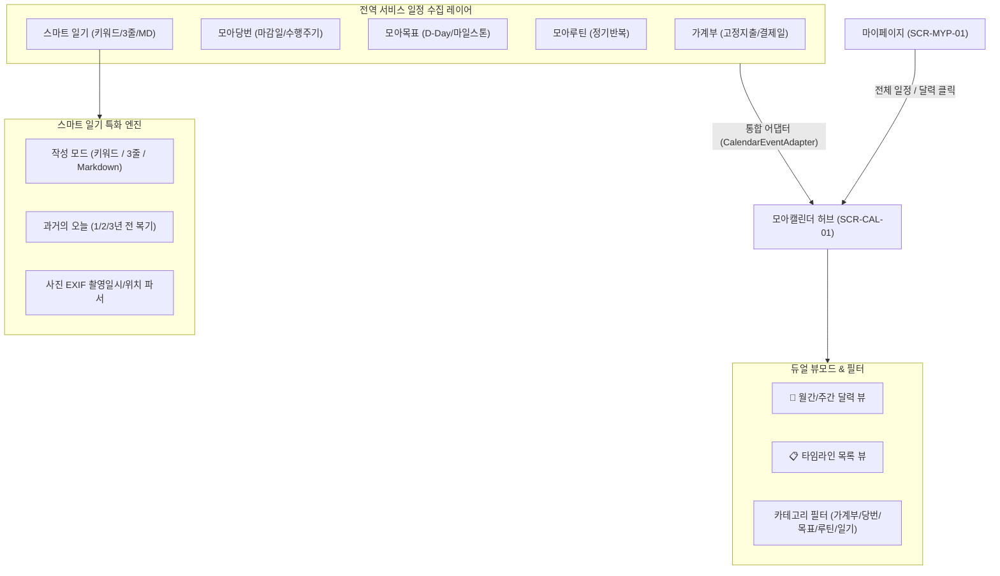

# [BKL-CAL-01] 모아캘린더: 전역 일정관리 허브 및 스마트 라이프 다이어리(일기) 연동 스펙

> **문서 상태**: 계획 (`PLANNED`)  
> **등록 세션**: `[0044]`  
> **최초 등록일**: 2026-11-22  
> **관련 도메인**: 마이페이지 (`SCR-MYP-01`), 모아캘린더 (`SCR-CAL-01`), 모아당번 (`SCR-DUT-01/02`), 모아목표 (`SCR-GOL-01/02`), 모아루틴 (`SCR-ROU-01`), 가계부 (`SCR-LED-01`)

---

## 1. 도입 취지 및 배경 (Why)

- **현황 및 문제점**:
  - 현재 모아보고(MoaBogo)는 **가계부(지출/수입/카드결제일)**, **모아당번(과업 마감일/수행 주기)**, **모아목표(마일스톤 기한/D-Day)**, **모아루틴(정기 반복일)** 등 일정과 관련된 데이터가 각 서비스 화면별로 분산되어 있음.
  - 사용자가 "이번 주 내가 해야 할 일"이나 "오늘 마감되는 금융/생활 일정"을 종합적으로 파악하려면 여러 화면을 일일이 순회해야 하는 탐색 비용이 발생함.
  - 또한 일상의 기록(할일 계획 및 일기)은 가계부 기장이나 당번 수행과 밀접한 맥락을 지니고 있음에도, 이를 유기적으로 담아낼 수 있는 중앙 캘린더 허브가 부재함.
- **도입 필요성**:
  - **마이페이지 중심 전역 일정관리 허브**: 모든 서비스의 일정을 카테고리 필터로 통합 조회하고, 즉시 해당 화면으로 이동하거나 간편 팝업으로 상세를 열람하는 통합 뷰포트 제공.
  - **스마트 라이프 다이어리(일기) 결합**:
    - 가벼운 **키워드 일기** 및 **3줄 일기** 모드로 작성 장벽을 획기적으로 낮춤.
    - 토글, 표, 이미지 실시간 저장이 가능한 **Markdown 확장 에디터** 지원.
    - 전년, 2년 전, 3년 전의 오늘 작성된 기록을 나란히 복기하는 **'과거의 오늘(On This Day)'** 회고 엔진 제공.
    - 스마트폰 사진(EXIF 메타데이터), 통화/문서 연동 기술 검토를 통해 일상 기록의 자동화를 점진적으로 구현.

---

## 2. 개요 및 요구사항 (Overview & Requirements)

### 2.1 전역 캘린더 및 일정관리 허브 요구사항

| 기능 영역 | 핵심 요구사항 | 비고 |
| :--- | :--- | :--- |
| **마이페이지 일정 연동** | • 마이페이지(`SCR_MYP_01`) 내 미니 캘린더 및 '전체 일정 보기' 위젯 제공<br>• 일정 클릭 시 상세 모달 팝업 또는 해당 서비스 화면(`SCR_DUT_02`, `SCR_GOL_02` 등) 딥링크 이동 | 전역 서비스 뷰포트 통합 |
| **카테고리 필터링** | • `[전체] \| [가계부] \| [당번] \| [목표] \| [루틴] \| [개인할일] \| [일기]` 멀티 선택 칩 바<br>• 카테고리별 고유 테마 색상(Dot/배지)으로 월간 달력에 일정 밀도 시각화 | 관심사별 독립/통합 조회 |
| **듀얼 뷰모드 & 검색** | • **달력 뷰(월간/주간)** 및 **목록 뷰(타임라인/아젠다 리스트)** 1-Click 토글 지원<br>• 일정 명칭, 태그, 참여자, 일기 본문 키워드 통합 검색 엔진 구축 | 반응형 모바일 UX 강화 |

### 2.2 스마트 라이프 다이어리(일기) 요구사항

| 기능 영역 | 핵심 요구사항 | 기술 검토 및 세부 명세 |
| :--- | :--- | :--- |
| **작성 모드 다양화** | • **키워드 일기**: 감정 이모지 1개 + 핵심 해시태그 3~5개로 10초 만에 기록<br>• **3줄 일기**: ① 오늘의 사건, ② 나의 생각/감정, ③ 내일의 다짐 (정형 템플릿)<br>• **자유 서술 모드**: 확장 Markdown 에디터 기반 자유 일기 | 작성 피로도 극복 |
| **마크다운(MD) 에디터 확장** | • 토글(접힘/펼침 접이식 섹션 `details`), 표(Table), 인라인 체크리스트 지원<br>• 이미지 드래그앤드롭/붙여넣기 시 로컬 IndexedDB 실시간 자동 저장<br>• 실시간 분할/전환 미리보기 지원 | ElmMkdViewer 컴포넌트 재사용 |
| **과거의 오늘 회고 (On This Day)** | • 당일 일기 작성/조회 시, **1년 전, 2년 전, 3년 전 같은 날짜**에 작성된 일기 및 가계부 소비 내역을 하단 카드에 나란히 노출<br>• "N년 전 오늘 나는 무엇을 하고 있었을까?" 일상 복기 및 게이미피케이션 스트릭 연동 | 감성적 사용자 락인 효과 |
| **스마트폰 자료 수집 연동 (기술 검토)** | • **사진 EXIF 메타데이터**: 브라우저 File API 및 `exif-js` 활용, 사진 업로드 시 촬영일시, GPS 촬영 장소명 자동 파싱하여 일기 초안 추천<br>• **통화/문서 수집 한계 및 대안**: 웹 브라우저(샌드박스 보안)에서는 Call Log/SMS 직접 접근 불가 ➔ PWA 설치형 또는 Capacitor 네이티브 플러그인(`@capacitor-community/contacts` 등) 기반 점진적 확장 검토 | 하이브리드 확장성 대비 |

---

## 3. 아키텍처 및 상세 설계 (Technical Architecture)

### 3.1 서비스 데이터 흐름 및 뷰모드 아키텍처



### 3.2 데이터 스키마 구상 (DDL)

```sql
-- 1. 전역 개인 일정 및 할일 테이블
CREATE TABLE IF NOT EXISTS member_calendar_events (
    event_id VARCHAR(64) PRIMARY KEY,
    user_id VARCHAR(64) NOT NULL,
    source_type VARCHAR(32) NOT NULL, -- 'LEDGER', 'DUTY', 'GOAL', 'ROUTINE', 'PERSONAL_TODO', 'DIARY'
    source_id VARCHAR(64),            -- 원본 과업/지출/목표 ID (단방향 딥링크용)
    title VARCHAR(128) NOT NULL,
    start_date DATE NOT NULL,
    start_time TIME,
    end_date DATE,
    end_time TIME,
    is_all_day BOOLEAN DEFAULT TRUE,
    category_color VARCHAR(16) DEFAULT '#4F46E5',
    is_completed BOOLEAN DEFAULT FALSE,
    created_at TIMESTAMP DEFAULT CURRENT_TIMESTAMP
);

-- 2. 스마트 라이프 다이어리(일기) 테이블
CREATE TABLE IF NOT EXISTS member_diaries (
    diary_id VARCHAR(64) PRIMARY KEY,
    user_id VARCHAR(64) NOT NULL,
    diary_date DATE NOT NULL,          -- 작성 대상 일자 (과거 날짜 보완 가능)
    diary_mode VARCHAR(20) NOT NULL,   -- 'KEYWORD', 'THREE_LINE', 'MARKDOWN'
    weather_emoji VARCHAR(8),
    mood_emoji VARCHAR(8),
    keyword_tags TEXT,                 -- JSON Array: ["#운동", "#가족모임", "#개발"]
    three_line_summary TEXT,           -- JSON Object: { event: "...", thought: "...", tomorrow: "..." }
    content_markdown TEXT,             -- 풀 마크다운 본문 (토글, 표 지원)
    attached_images TEXT,              -- JSON Array: [{ url: "...", exif_date: "...", location: "..." }]
    created_at TIMESTAMP DEFAULT CURRENT_TIMESTAMP,
    updated_at TIMESTAMP DEFAULT CURRENT_TIMESTAMP,
    CONSTRAINT uq_user_diary_date UNIQUE (user_id, diary_date)
);

CREATE INDEX idx_calendar_user_date ON member_calendar_events (user_id, start_date);
CREATE INDEX idx_diary_user_date ON member_diaries (user_id, diary_date);
```

---

## 4. 단계별 작업 가이드 (Implementation Guide)

### Phase 1: 마이페이지 전역 캘린더 허브 & 카테고리 필터링 (`SCR-CAL-01`)
- `SCR_CAL_01_모아캘린더.tsx` 화면 신설.
- 가계부(`ledgerStore`), 모아당번(`dutyStore`), 모아목표(`goalStore`)의 일정을 수집하는 `CalendarEventAdapter` 유틸 함수 구현.
- 월간 달력 및 타임라인 목록 듀얼 뷰모드, 카테고리 필터 칩 바 구현.
- 일정 클릭 시 원본 상세 화면 이동 및 간편 팝업 제공.

### Phase 2: 스마트 라이프 다이어리 3대 모드 & Markdown 확장 에디터
- 다이어리 전용 팝업/화면 컴포넌트 신설.
- `키워드 일기` (태그 칩) 및 `3줄 일기` (정형 3단 폼) 모드 지원.
- `ElmMkdViewer`를 확장한 실시간 마크다운 에디터 탑재 (토글 `details`, 표, 이미지 로컬 IndexedDB 저장).

### Phase 3: '과거의 오늘(On This Day)' 복기 엔진 & 사진 EXIF 메타데이터 연동
- 일기 조회 시 $N$년 전 동일 날짜의 일기 및 가계부 소비 내역을 하단 캐러셀로 자동 쿼리/표시.
- 모바일 사진 첨부 시 브라우저단 EXIF 파싱을 통한 촬영일시/장소 자동 추천 기능 검증.
- PWA/Capacitor 환경에서의 확장 기술 스파이크(Spike) 수행.

---

## 5. 검증 절차 및 인수 기준 (Acceptance Criteria)

- [ ] 마이페이지에서 캘린더 허브로 원활하게 진입할 수 있어야 한다.
- [ ] 가계부 결제일, 당번 마감일, 목표 D-Day가 캘린더 및 목록 뷰에 누락 없이 수집·표시되어야 한다.
- [ ] 카테고리 필터 토글 시 해당 범주의 일정만 즉각 필터링되어야 한다.
- [ ] 키워드 일기, 3줄 일기, 마크다운 일기 모드 간 전환이 부드럽고 데이터 손실이 없어야 한다.
- [ ] 과거 날짜에 일기가 존재하는 경우, '과거의 오늘' 섹션에 1~3년 전 기록이 정확히 렌더링되어야 한다.
- [ ] 모바일 360px 환경에서 달력 그리드와 일기 작성 에디터가 깨짐 없이 반응형으로 동작해야 한다.
