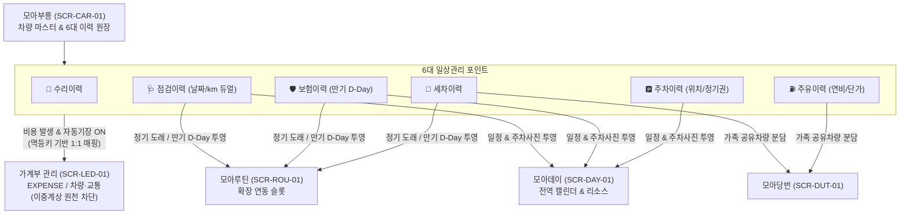

# [BKL-CAR-01] 모아부릉(MoaVroom): 자동차 6대 일상관리 이력 원장 및 가계부·루틴 연동 스펙

> **문서 상태**: 계획 (`PLANNED` — 세션 `[0046-01]`에서 별도 도메인 백로그로 공식 분기 등록)  
> **등록 세션**: `[0046]` (`[0046-01]`)  
> **최초 등록일**: 2026-11-23  
> **신규 화면 ID (예약)**: `SCR-CAR-01` (모아부릉: 내 차 통합관리 허브) / `SCR-CAR-02` (차량 등록·멀티차량 설정 상세, 필요 시 분리)  
> **관련 도메인**: 모아부릉 (`SCR-CAR-01`), 가계부 관리 (`SCR-LED-01`), 모아루틴 (`SCR-ROU-01`), 모아데이 (`SCR-DAY-01`), 모아당번 (`SCR-DUT-01`), 모아목표 (`SCR-GOL-01`)  

---

## 1. 도입 취지 및 배경 (Why)

### 1.1 도메인 적합성 진단: 왜 '모아루틴'이 아니라 독립 도메인 '모아부릉'인가?
- **모아루틴(`SCR-ROU-01`)과의 본질적 차이**:
  - `모아루틴`은 최소 월 1회 이상 반복적으로 수행되는 **'이행/준수(Compliance), 스트릭 달성, 정기 배치 집행'**에 최적화된 서비스입니다(약복용 매일, 세금계산서 매월, 급여·카드 정산 매월 등).
  - 반면 자동차 관리는 **'차량 자산(Vehicle Asset)을 기준으로 누적되는 이력성(Logbook) 관리 서비스'**입니다. 차량 등록부터 1인/가족 다중 차량(2대 이상) 전환, 누적 주행거리(Odometer) 트래킹, 주유 단가·실연비(km/L) 계산, 고장 수리 및 부품 보증 이력, 월간/연간 총유지비(TCO) 집계 등 **가계부(`SCR-LED-01`)와 대등한 독립 도메인 축**을 가집니다.
- **관심사 분리(SoC) 및 단계적 접근 전략**:
  - 6대 자동차 이력을 `모아루틴` 내부에 억지로 편입할 경우 루틴 화면의 인지 부하가 급증하고 멀티 차량·연비·정비 이력 확장 시 대규모 분리 리팩토링이 불가피합니다.
  - 따라서 **가계부처럼 별도 독립 도메인(`모아부릉 / SCR-CAR-01`)**으로 명확히 분리 설계하되, 1차 구축은 **일상관리 수준(6대 관리포인트 + 다중 차량 기본 등록/관리)**에 집중하고 전문 정비·OBD 연동 등 고도화 영역은 2차 확장으로 단계화합니다.

### 1.2 타 서비스와의 교차 연관성 (Cross-Domain Relationship Matrix)

| 관리 포인트 | 발생 성격 | 모아부릉 (`SCR-CAR-01`) 핵심 역할 | 타 서비스 연동 관계 |
| :--- | :---: | :--- | :--- |
| **1. 수리이력** | 비정기 / 이벤트성 | 고장 증상, 교환 부품, 정비소, 공임/부품비, 정비명세서 사진, 보증기간 | **가계부(`SCR-LED-01`)**: 차량유지비 지출(`EXPENSE`) 1:1 연동 |
| **2. 점검이력** | **정기 / 주행거리** | 엔진오일·필터·타이어·종합검사 교체일, 누적 km, 다음 도래 시점(날짜/km) | **모아루틴(`SCR-ROU-01`)**: 교체/검사 임박 D-Day 투영<br>**모아데이(`SCR-DAY-01`)**: 정비·검사 예약 일정 투영 |
| **3. 주유이력** | 반정기 / 반복소비 | 유종, 주유량(L/kWh), 단가, 총액, 누적 주행거리, **실연비(km/L)** 자동 산출 | **가계부(`SCR-LED-01`)**: 주유비 지출 자동 기장<br>**빠른등록(`SCR-QCK-01`)**: 주유 영수증 OCR 연동 |
| **4. 세차이력** | 반정기 / 습관 | 세차 방식(손/자동/출장), 장소, 비용, 전/후 사진, 경과일 표시 | **모아루틴**: 정기 세차 리마인더<br>**모아당번(`SCR-DUT-01`)**: 가족 공유차량 세차 분담 |
| **5. 보험이력** | **연간 정기 / 계약** | 보험사, 만기 D-Day, 보장 요약, 연납/분납 보험료, 보험증권 PDF/이미지 | **모아루틴**: 만기 30일 전 다이렉트 비교·갱신 D-Day<br>**모아목표(`SCR-GOL-01`)**: 연간 보험료/자동차세 목돈 적립 |
| **6. 주차이력** | 일상 / 위치·정기권 | 주차 위치(층/기둥) 사진·메모, 입/출차 시간, 일회성 주차비, 정기주차권 갱신일 | **모아데이**: 당일 위치 사진 리소스 연계<br>**모아루틴**: 월 정기주차권 갱신 알림<br>**가계부**: 주차비 지출 연동 |

---

## 2. 개요 및 요구사항 (Overview & Requirements)

### 2.1 기능 요구사항 (1차 일상관리 MVP 범위)
1. **차량 등록 및 다중 차량(Multi-Vehicle) 관리**:
   - 차량 등록: 차량 별칭(예: `아빠 쏘렌토`, `출퇴근 레이`), 차량번호(마스킹 옵션), 제조사/모델명, 연식, 유종(휘발유/경유/LPG/하이브리드/전기), 현재 누적 주행거리(km), 소유 구분(개인/가족공유), 대표 차량 지정.
   - 다중 차량 스위처: 가계부 책꽂이 스위처처럼 상단에서 보유 차량을 원클릭 전환하며 차량별 독립 이력·연비·유지비 조회.
   - 가족 가계부(`GROUP`)와 차량 공유 연동 옵션 (가족 구성원이 함께 주유/세차/주차 위치 기록).
2. **6대 일상관리 포인트 CRUD**:
   - **수리이력**: 정비소명, 수리 항목(타이어/브레이크/판금/소모품 등), 비용, 누적 주행거리, 영수증/명세서 이미지 첨부, 메모.
   - **점검이력**: 소모품/법정검사 프리셋(엔진오일, 에어컨필터, 브레이크패드, 타이어 위치교환, 자동차 종합검사) + **날짜 주기(개월) & 주행거리 주기(km) 듀얼 기준** 자동 잔여량 계산.
   - **주유이력**: 주유소명, 주유 금액, 단가(원/L 또는 원/kWh), 주유량 자동 계산, 직전 주행거리 대비 **구간 연비(km/L)** 자동 산출.
   - **세차이력**: 세차 유형(셀프/자동/손세차/디테일링), 장소, 비용, 인증 사진 및 마지막 세차 경과일(`D+N일`).
   - **보험이력**: 보험사, 상품 구분(자동차보험/운전자보험), 보험 기간(시작일~만기일), 만기 D-Day FSM, 연간 보험료, 긴급출동 전화번호 원터치 다이얼/복사, 증권 첨부.
   - **주차이력**: 주차장명, 위치 메모(예: `B3층 C-14 기둥`), 위치 사진 1초 등록, 입차/출차 시간 및 요금, 정기주차권 여부 및 월 갱신일.
3. **가계부 이중계상 차단 연동 (금전관리 3대 원칙 준수)**:
   - 비용이 발생하는 이력(주유·수리·점검·세차·보험·주차) 등록 시 `[가계부 자동 기장]` 토글 제공.
   - 연동 ON 시 지정된 가계부(개인 또는 가족 가계부)에 `EXPENSE` (카테고리: `차량/교통`) 1건만 멱등 생성(`ref_vehicle_log_id` 매핑)하여 이중 합산 원천 차단.
   - 반대로 차량 유지비 전용 통장으로 자금을 적립·이체할 경우는 순수 지출이 아닌 `TRANSFER(is_asset_transfer = true)`로 엄격 구분.

### 2.2 비기능적 요구사항 (Non-Functional Requirements)
- **360px 모바일 뷰포트 최적화**: 주차 직후·주유 직후 한 손으로 3초 내 입력 가능한 44px 터치 타겟, `ElmBsh01` 고정 3분할 바텀시트, `whitespace-nowrap` 및 `flex-wrap` 준수.
- **민감정보(PII) 마스킹**: 차량번호, 보험증권번호, 차대번호(VIN)는 리스트 뷰에서 기본 마스킹 처리하고 상세/복사 시 명시적 토글로 확인.
- **오프라인 우선(Offline-First)**: 지하주차장(네트워크 음영 지역)에서 주차 위치 사진·층수 메모를 작성해도 IndexedDB에 즉시 저장 후 지상으로 나오면 자동 동기화.

---

## 3. 기획 및 사용자 시나리오 (User Scenario)

### 시나리오 A: 지하주차장 1초 주차 메모 (오프라인 대응)
1. 사용자가 대형마트 지하 4층에 주차한 뒤 `모아부릉` 상단 퀵버튼 `[🅿️ 주차 기록]` 탭.
2. 기둥 번호(`B4-G12`) 사진 촬영 및 한줄 입력 ➔ 오프라인 상태라도 로컬 저장 완료.
3. 귀가 시 `모아부릉` 상단 고정 카드에서 **"현재 주차 위치: B4-G12 (2시간 15분 경과)"**와 사진을 즉시 확인하고, 출차 시 주차비 `3,000원` 입력 ➔ 가계부 자동 기장 완료.

### 시나리오 B: 주유 후 연비 자동 산출 + 가계부 동시 기장
1. 주유소에서 `70,000원` 주유 후 영수증 촬영(또는 금액/단가 입력) + 계기판 주행거리(`48,520km`) 입력.
2. 직전 주유 기록(`48,010km`)과 자동 비교하여 **구간 주행 `510km` / 실연비 `12.1 km/L`** 즉시 표시.
3. `가계부 자동 기장` ON 상태이므로 `우리집 가계부` 차량/교통 지출로 중복 없이 1건 반영.

### 시나리오 C: 엔진오일 교체 & 보험 만기 D-Day ➔ 모아루틴/모아데이 자동 알림
1. 엔진오일 교체 주기(`10,000km` 또는 `6개월`) 설정 후 주유 입력으로 누적 주행거리가 잔여 `500km` 이내 도달.
2. 소모품 상태머신(`VehicleMaintenanceFSM`)이 `IMMINENT`로 전이되며, **`모아루틴(SCR-ROU-01)`** 및 **`모아데이(SCR-DAY-01)`**에 "엔진오일 교체 임박 (잔여 480km)" 알림 자동 노출.
3. 자동차보험 만기 30일 전에는 만기 D-Day 뱃지와 함께 작년 보험료 대비 비교 체크리스트 안내.

---

## 4. 아키텍처 및 상세 설계 (Technical Architecture)

### 4.1 도메인 경계 및 이벤트 연동 흐름



### 4.2 데이터 모델 설계 (PostgreSQL DDL 초안)

```sql
-- 1. 차량 마스터 테이블 (멀티 차량 지원)
CREATE TABLE IF NOT EXISTS vehicles (
    vehicle_id VARCHAR(64) PRIMARY KEY,
    owner_user_id VARCHAR(64) NOT NULL,
    shared_ledger_id VARCHAR(64), -- 가족 공유 가계부 연동 시 선택 매핑
    nickname VARCHAR(60) NOT NULL, -- 예: "우리집 쏘렌토"
    plate_number VARCHAR(20) NOT NULL, -- 뷰 렌더링 시 마스킹 처리
    manufacturer VARCHAR(40),
    model_name VARCHAR(60) NOT NULL,
    model_year SMALLINT,
    fuel_type VARCHAR(20) NOT NULL, -- 'GASOLINE', 'DIESEL', 'HYBRID', 'EV', 'LPG'
    current_odometer_km INTEGER NOT NULL DEFAULT 0,
    is_primary BOOLEAN NOT NULL DEFAULT false,
    is_active BOOLEAN NOT NULL DEFAULT true,
    created_at TIMESTAMP WITH TIME ZONE DEFAULT CURRENT_TIMESTAMP,
    updated_at TIMESTAMP WITH TIME ZONE DEFAULT CURRENT_TIMESTAMP
);

-- 2. 차량 6대 통합 이력 원장 테이블
CREATE TABLE IF NOT EXISTS vehicle_logs (
    log_id VARCHAR(64) PRIMARY KEY,
    vehicle_id VARCHAR(64) NOT NULL REFERENCES vehicles(vehicle_id) ON DELETE CASCADE,
    user_id VARCHAR(64) NOT NULL,
    log_type VARCHAR(20) NOT NULL, -- 'REPAIR', 'INSPECTION', 'FUEL', 'WASH', 'INSURANCE', 'PARKING'
    occurred_at TIMESTAMP WITH TIME ZONE NOT NULL,
    odometer_km INTEGER,
    amount NUMERIC(15, 2) NOT NULL DEFAULT 0,
    vendor_name VARCHAR(100), -- 정비소, 주유소, 세차장, 보험사, 주차장명
    summary VARCHAR(200) NOT NULL,
    detail_memo TEXT,
    meta_jsonb JSONB NOT NULL DEFAULT '{}',
    -- 유형별 meta_jsonb 예시:
    -- FUEL: {"unit_price": 1680, "volume": 41.66, "is_full_tank": true, "calc_efficiency": 12.1}
    -- INSURANCE: {"policy_start": "2026-04-01", "policy_end": "2027-04-01", "emergency_tel": "1588-xxxx"}
    -- PARKING: {"floor_zone": "B4-G12", "is_monthly_pass": false, "exit_at": "..."}
    attachment_urls JSONB NOT NULL DEFAULT '[]',
    linked_expense_id VARCHAR(64), -- SCR-LED-01 atomic_expenses 1:1 FK (이중계상 차단)
    idempotency_key VARCHAR(128) UNIQUE,
    created_at TIMESTAMP WITH TIME ZONE DEFAULT CURRENT_TIMESTAMP
);

-- 3. 차량 소모품/보험/정기점검 주기 규칙 테이블 (날짜 + 주행거리 듀얼 트리거)
CREATE TABLE IF NOT EXISTS vehicle_maintenance_rules (
    rule_id VARCHAR(64) PRIMARY KEY,
    vehicle_id VARCHAR(64) NOT NULL REFERENCES vehicles(vehicle_id) ON DELETE CASCADE,
    rule_type VARCHAR(30) NOT NULL, -- 'ENGINE_OIL', 'AIR_FILTER', 'TIRE_ROTATION', 'LEGAL_INSPECTION', 'INSURANCE_RENEWAL', 'PARKING_PASS'
    title VARCHAR(80) NOT NULL,
    interval_months SMALLINT, -- 날짜 주기 (예: 6개월, 12개월, 24개월)
    interval_km INTEGER,      -- 주행거리 주기 (예: 10000km)
    last_done_date DATE,
    last_done_odometer_km INTEGER,
    next_due_date DATE,
    next_due_odometer_km INTEGER,
    sync_to_routine BOOLEAN NOT NULL DEFAULT true,
    is_active BOOLEAN NOT NULL DEFAULT true,
    updated_at TIMESTAMP WITH TIME ZONE DEFAULT CURRENT_TIMESTAMP
);
```

### 4.3 소모품·보험 긴급도 상태머신 (`VehicleMaintenanceFSM`)
날짜 잔여일(`daysLeft`)과 주행거리 잔여량(`kmLeft`) 중 **더 임박한 조건**을 기준으로 5단계 전이:
- `SAFE`: 잔여 31일 이상 AND 잔여 1,500km 이상
- `CHECK_SOON`: 잔여 15~30일 OR 잔여 800~1,499km
- `IMMINENT`: 잔여 4~14일 OR 잔여 300~799km (`모아루틴` 경고 노출)
- `URGENT`: 잔여 0~3일 OR 잔여 1~299km (상단 긴급 배너 고정)
- `OVERDUE`: 기한 또는 주행거리 초과 (`D+N` / `+N km` 초과 강조)

---

## 5. 화면 설계 및 단계별 작업 가이드 (UI/UX & Implementation Guide)

### 5.1 화면 정보 구조 (`SCR_CAR_01_모아부릉.tsx`)
1. **상단 차량 스위처 & KPI 요약 헤더**:
   - 다중 차량 선택 드롭다운/칩 (`쏘렌토 12가 ****` / `레이 34나 ****` + `[+ 차량 등록]`).
   - 선택 차량의 **현재 누적 주행거리(km) 원터치 수정**, **당월 차량유지비(TCO)**, **최근 평균 연비(km/L)**, **현재 주차 위치 퀵배지** 표시.
2. **긴급 D-Day & 소모품 알림 스트립 (가로 슬라이더, 휠 패스스루 적용)**:
   - 보험 만기 D-Day, 엔진오일 잔여 km, 종합검사 만료일, 마지막 세차 경과일 컴팩트 카드.
3. **6대 관리포인트 필터 탭 & 원터치 퀵등록 바**:
   - 탭: `[전체]` `[⛽ 주유]` `[🩺 점검]` `[🔧 수리]` `[🧼 세차]` `[🛡️ 보험]` `[🅿️ 주차]`.
   - 각 탭 선택 시 해당 카테고리 전용 인사이트 미니바(예: 주유 탭 = 월간 주유비/평균 단가/연비 추이, 보험 탭 = 만기 D-Day/긴급출동 번호).
4. **이력 타임라인 리스트 & 상세/등록 `ElmBsh01` 고정 3분할 바텀시트**:
   - 차량 등록/편집 모달 (`CarRegisterModal.tsx`): 다중 차량 추가·대표차량 지정·공유 가계부 매핑.
   - 6대 이력 퀵등록 모달 (`CarLogCreateModal.tsx`): 유형별 동적 필드 + `[가계부 자동 기장]` 스위치 + 영수증/주차사진 첨부.
5. **FSD 모듈 구조 (SRP 400~500줄 상한 준수)**:
   - `src/sample/screen/SCR_CAR_01_모아부릉.tsx`
   - `src/sample/screen/car/types.ts`
   - `src/sample/screen/car/carMockData.ts`
   - `src/sample/screen/car/useMoaCar.ts`
   - `src/sample/screen/car/CarRegisterModal.tsx`
   - `src/sample/screen/car/CarLogCreateModal.tsx`
   - `src/sample/screen/car/CarMaintenanceStrip.tsx`

### 5.2 단계별 구현 로드맵
- **Phase 1 (일상관리 화면설계·컨텐츠 구축 — 프론트엔드 동결 전 차기 세션 배정)**:
  - 차량 등록/다중 차량 스위처 + 6대 관리포인트 CRUD + 연비/TCO 계산 + 가계부 이중계상 차단 토글 + `SCR-ROU-01`/`SCR-DAY-01` 연동 포인트 + 화면 코드리뷰(`docs/08.리뷰/`).
- **Phase 2 (백엔드 원장 연동 — `BKL-DATA-01` 이후)**:
  - PostgreSQL `vehicles`, `vehicle_logs`, `vehicle_maintenance_rules` 마이그레이션 및 오프라인 주차메모 IndexedDB 동기화.
- **Phase 3 (전문 자동차관리 고도화 — 후속 확장)**:
  - 주유 영수증·정비명세서 EasyOCR 자동 파싱, 유가 비교/전기차 충전 로밍 이력, 차량 감가상각 및 매각 리포트 PDF 출력, OBD-II 주행거리 자동 동기화 검토.

---

## 6. 검증 절차 및 인수 기준 (Acceptance Criteria)

1. [ ] 2대 이상의 차량을 등록하고 스위처로 전환할 때 각 차량의 주행거리, 6대 이력, 연비, 유지비가 독립적으로 필터링되는가?
2. [ ] 주유 이력 입력 시 직전 주행거리와 현재 주행거리를 비교해 실연비(km/L)가 자동 계산되고, 소모품 잔여 km가 즉시 갱신되는가?
3. [ ] 6대 이력 중 비용 발생 건의 `[가계부 자동 기장]` 토글 ON 시 가계부 원장에 `EXPENSE` 1건만 멱등 연결되어 이중계상이 발생하지 않는가?
4. [ ] 점검이력(날짜/km 듀얼)과 보험 만기 D-Day가 `VehicleMaintenanceFSM`에 따라 정확히 등급화되고 `모아루틴` 연동 대상로 식별되는가?
5. [ ] 360px 모바일 뷰포트에서 주차 위치 사진 등록, 6대 필터 탭, `ElmBsh01` 3분할 모달이 줄바꿈 깨짐·휠 트랩 없이 동작하는가?
