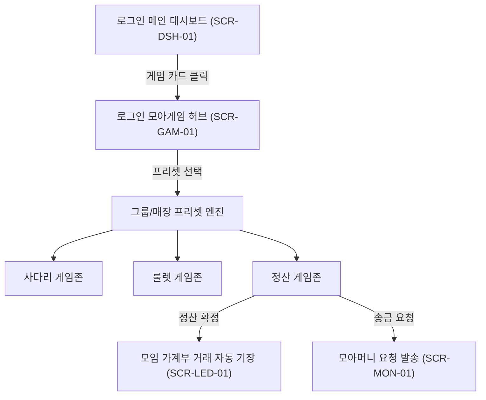

# [BKL-GAM-04] 로그인 회원 전용 통합 게임/정산 허브 및 사용자·매장 프리셋 관리 플랫폼 구축

> **문서 상태**: 완료 (`DONE` - 세션 0041 1차 프리셋 바인딩, 세션 0042 2차 모아게임 허브 화면 신설 및 네비게이션 연동 완결)  
> **등록 세션**: `[0037]` (세션 0041 1차 구현, 세션 0042 2차 화면 구축 및 연동 완결)  
> **최초 등록일**: 2026-11-15  
> **관련 도메인**: 게임·정산 허브 (`SCR-GAM-01`), 로그인 메인 대시보드 (`SCR-DSH-01`), 가계부·당번·목표 연계  

---

## 1. 도입 취지 및 배경 (Why)
- **현황 및 문제점**:
  - 현재 정산, 사다리, 룰렛, 매장선택, 방공유 기능이 비로그인 게스트 홈(`SCR-GNT-01`)에 일괄 포함되어 있어, 로그인 회원의 연속적인 데이터(가계부 지출 귀속, 당번 연동, 참가자 그룹 프리셋)와 단절되어 있음.
  - 비로그인 화면에 임시 적용되었던 매장선택 및 실시간 게임공유 기능은 본래 회원 간 협업 및 데이터 영속화를 위한 로그인 전용 기능으로, 비로그인 임시 세션과 로그인 영속 세션 간의 명확한 권한 및 도메인 분리가 시급함.
- **도입 필요성**:
  - 로그인 사용자를 위한 독립적인 게임/정산 허브 화면(`SCR-GAM-01`)을 신설하고 대시보드에서 원클릭으로 진입할 수 있도록 하여 컨텐츠 주목도와 활용도를 극대화.
  - 가계부 모임원, 당번 그룹, 목표 동행원을 불러와 한 번에 게임 참가자로 등록하는 '그룹별 사용자 프리셋' 및 '자주 가는 단골 매장 프리셋'을 제공하여 로그인만의 독보적 차별 가치를 완성함.

---

## 2. 개요 및 요구사항 (Overview & Requirements)

### 2.1 기능적 요구사항 (Functional Requirements)
1. **로그인 게임 허브 화면 (`SCR-GAM-01`) 신설**:
   - 게임·정산 퀵런처(사다리, 룰렛, 정산)를 화면 전면에 배치하여 컨텐츠 주목도 강화.
   - 메인 대시보드(`SCR-DSH-01`)에 게임 요약 카드를 배치하고 허브 화면으로의 원클릭 딥링크 제공.
2. **비로그인 / 로그인 권한 및 기능 분리**:
   - **비로그인 (`SCR-GNT-01`)**: 로컬 임시 세션 기반 단발성 플레이(게스트 닉네임, 임시 결과 복사).
   - **로그인 (`SCR-GAM-01`)**: 회원 프로필 연동, 게임 결과의 모임 가계부(`type='GROUP'`) 1:1 귀속 및 정산 송금 딥링크 마감.
3. **단골 매장 및 컨텐츠 프리셋 관리 고도화**:
   - 가계부, 당번, 목표 모임원 데이터를 그룹별로 선택하여 사다리/룰렛 참가자로 자동 세팅하는 프리셋 관리.
   - 단골 매장 리스트(위치, 메뉴, 기본 가격대) 관리 및 게임 테마 자동 매핑.
4. **기존 컴포넌트 재사용 가드레일**:
   - 기존 `LadderGameZone`, `RouletteGameZone`, `SettlementGameZone`을 100% 재활용하되, `authContext` 기반 상위 래퍼에서 권한별 액션(저장, 공유, 가계부 전송)을 분기 제어.

### 2.2 비기능적 요구사항 (Non-Functional Requirements)
- **응답성**: 최소 360px(갤럭시 S26)부터 태블릿/PC까지 반응형 그리드 완벽 지원.
- **데이터 정합성**: 게임 정산 결과 생성 시 모아보고 금전관리 3대 원칙(단일 귀속성, TRANSFER 분리) 자동 준수.

---

## 3. 아키텍처 및 상세 설계 (Technical Architecture)

### 3.1 라우팅 및 상태 전이도


### 3.2 데이터 스키마 (프리셋 DDL 구상)
```sql
CREATE TABLE IF NOT EXISTS member_game_presets (
    preset_id VARCHAR(64) PRIMARY KEY,
    user_id VARCHAR(64) NOT NULL,
    group_type VARCHAR(32) NOT NULL, -- 'LEDGER', 'DUTY', 'GOAL', 'CUSTOM'
    target_group_id VARCHAR(64),
    preset_name VARCHAR(100) NOT NULL,
    participant_names JSONB NOT NULL DEFAULT '[]',
    default_game_type VARCHAR(32) DEFAULT 'LADDER',
    favorite_store_id VARCHAR(64),
    created_at TIMESTAMP WITH TIME ZONE DEFAULT CURRENT_TIMESTAMP,
    updated_at TIMESTAMP WITH TIME ZONE DEFAULT CURRENT_TIMESTAMP
);
```

---

## 4. 단계별 작업 가이드 (Implementation Guide)
- **Phase 1**: `SCR_GAM_01_모아게임허브.tsx` 화면 스켈레톤 및 라우트 등록 (`App.tsx`).
- **Phase 2**: 게임존 공통 컴포넌트(`LadderGameZone`, `RouletteGameZone`, `SettlementGameZone`)의 `authContext` 분기 처리.
- **Phase 3**: 대시보드(`SCR_DSH_01`) 게임 카드 및 딥링크 네비게이션 연동.
- **Phase 4**: 그룹 프리셋 저장 및 가계부 지출 영속화 API 연계.

---

## 5. 검증 절차 및 인수 기준 (Acceptance Criteria)
1. [ ] 대시보드에서 게임 카드 클릭 시 `SCR-GAM-01`로 자연스럽게 이동하는가?
2. [ ] 로그인 사용자가 가계부 모임원을 게임 참가자로 원클릭 불러올 수 있는가?
3. [ ] 비로그인 게스트와 로그인 회원의 기능 권한(가계부 자동 기장, 프리셋 저장)이 명확히 분기되는가?
4. [ ] 360px 모바일 화면에서 퀵런처 및 결과 복사 영역이 줄바꿈 깨짐 없이 렌더링되는가?
