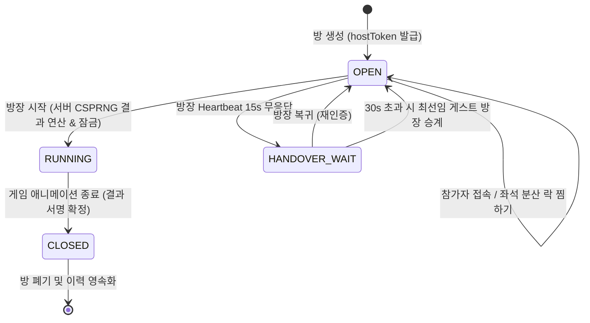

# [백로그] BKL-LAD-03: 사다리·룰렛 게임공유 백엔드 보안 강화 (RDBMS 세션, 분산 락, CSPRNG 결과 권위 검증)

- **백로그 ID**: `BKL-LAD-03`
- **우선순위**: P1 (Should Have)
- **도메인/영역**: 백엔드 / 실시간 통신 / 보안
- **발견 및 등록 세션**: 세션 `0031`
- **상태**: 등록 완료 (`BACKLOG_READY`)
- **담당 아키텍트**: MoaBogo Backend & Security Architecture Team

---

## 1. 백로그 도입 취지 및 배경 (Why)

세션 0030 및 0031을 통해 사다리타기와 룰렛 게임을 다자간에 실시간으로 공유하고 진행할 수 있는 하이브리드 실시간 동기화 엔진(BroadcastChannel + SSE Remote Relay)이 구현되었습니다. 또한 `[0031-02]` 태스크를 통해 인메모리 Express 계층에서 128비트 난수 토큰(`hostToken`)과 `sessionStorage` 격리를 적용하여 `host=1` 파라미터 조작 공격을 선제 차단하였습니다.

그러나 현재 구현은 **단일 Node.js 프로세스 인메모리(RAM) 상태**에 의존하고 있어 다음과 같은 잠재적 기술 한계와 보안 리스크가 존재합니다:
1. **서버 재기동 시 세션 증발**: Node.js 서버 컨테이너가 재시작되면 활성 룸 정보와 방장 토큰이 모두 소멸되어 진행 중이던 게임이 파기됨.
2. **수평 확장(Scale-out) 불가**: 다중 인스턴스(다중 컨테이너) 환경 배포 시, 인메모리 `GAME_ROOMS` 맵이 공유되지 않아 사용자가 서로 다른 인스턴스에 접속할 경우 동기화 불능.
3. **결과 생성의 클라이언트 편향**: 사다리 가로줄 매트릭스 및 룰렛 회전 각도가 방장 클라이언트 브라우저에서 계산된 후 전송되므로, 악의적인 클라이언트가 패킷을 변조해 본인에게 유리한 결과를 전파할 위험이 상존함.
4. **마이크로초 동시성(Race Condition) 한계**: 초고속 동시 접속 시 JavaScript 싱글 스레드 이벤트 루프를 타더라도 원자적 좌석 락(Lock)을 영속적으로 보장하기 어려움.

따라서 본 백로그는 **PostgreSQL 16 영속 원장과 Redis 분산 락(Redlock), 그리고 암호학적 난수(CSPRNG) 기반 서버 권위 결과 생성 엔진**을 구축하여 모아보고 게임공유 서비스를 프로덕션 수준의 고신뢰 금융/정산급 보안 인프라로 격상시키는 것을 목표로 합니다.

---

## 2. 개요 및 요구사항 (Overview & Requirements)

### 2.1 핵심 목표
1. **RDBMS 영속 세션 및 오너십 바인딩**:
   - `game_rooms` 테이블을 PostgreSQL에 신설하여 방 생성자의 회원 식별자(`user_id` 또는 영구 게스트 고유키)와 1:1 바인딩.
2. **Redis Redlock 기반 마이크로초 원자적 자리 점유**:
   - `CLAIM_SEAT` 요청 시 `lock:game_room:{roomId}:seat:{memberId}` 분산 락을 획득한 단 1명의 요청만 승인하고 TTL을 자동 부여.
3. **서버 권위(Server-Authoritative) 결과 생성 및 서명(HMAC)**:
   - 클라이언트에서 난수를 생성하지 않고, 방장이 게임 시작 버튼을 누르면 서버가 Linux CSPRNG(`/dev/urandom`)로 시드 및 사다리 가로줄/룰렛 당첨자를 직접 계산.
   - 서버가 서명한 HMAC 토큰을 결과와 함께 브로드캐스트하여 클라이언트가 위변조할 수 없도록 강제.
4. **방장 이탈 자동 승계 FSM (Heartbeat Auto-Handover)**:
   - 방장 SSE 스트림 연결이 30초 이상 끊어지면, 룸 내 가장 먼저 접속한 차순위 게스트에게 방장 권한을 자동 승계하고 새 `hostToken`을 안전하게 재발급.

---

## 3. 기획 및 사용자 시나리오 (User Scenario)

### 시나리오 A: 방장 이탈 시 부드러운 방장 승계
1. 모임 가계부 멤버 5명이 사다리 게임 방에 접속해 자리를 찜함.
2. 방장 스마트폰이 배터리 방전 또는 지하철 터널 진입으로 30초간 통신 두절됨.
3. 방이 멈추거나 폭파되지 않고, 서버는 차순위 접속자(참가자 2번)에게 "👑 방장이 이탈하여 권한이 자동으로 승계되었습니다" 배너를 표시하고 새 방장 토큰을 부여.
4. 참가자 2번이 시작 버튼을 눌러 게임이 정상 완결됨.

### 시나리오 B: 자리 찜하기 동시 경합 방어
1. 두 명의 참가자가 마지막 남은 명당 좌석(예: 3번 자리)을 거의 동일한 순간(수 밀리초 차이)에 동시 클릭.
2. 백엔드 분산 락이 0.1ms 차이로 먼저 도착한 요청에 락을 부여하고, 뒤처진 요청에는 즉시 `409 Conflict (SEAT_ALREADY_CLAIMED)` 반환.
3. 늦게 누른 참가자의 화면에는 "이미 동료가 선점한 자리입니다" 알림이 뜨고 UI는 즉시 원복됨.

---

## 4. 아키텍처 및 상세 설계 (Technical Architecture)

### 4.1 데이터베이스 스키마 설계 (`docs/04.데이터/02-erd-schema.sql` 연계)
```sql
-- 1. 게임 방 테이블
CREATE TABLE IF NOT EXISTS game_rooms (
  room_id VARCHAR(32) PRIMARY KEY, -- e.g. 'LAD-7K9M2P'
  game_type VARCHAR(16) NOT NULL, -- 'LADDER' | 'ROULETTE' | 'SETTLEMENT'
  host_user_id VARCHAR(64) NULL, -- 로그인 사용자 ID
  host_token_hash VARCHAR(128) NOT NULL, -- SHA-256 해시 저장
  status VARCHAR(16) NOT NULL DEFAULT 'OPEN', -- 'OPEN' | 'RUNNING' | 'CLOSED' | 'EXPIRED'
  ladder_seed BIGINT NULL,
  created_at TIMESTAMP WITH TIME ZONE DEFAULT NOW(),
  expires_at TIMESTAMP WITH TIME ZONE NOT NULL,
  closed_at TIMESTAMP WITH TIME ZONE NULL
);

-- 2. 게임 참여자 및 좌석 점유 테이블
CREATE TABLE IF NOT EXISTS game_participants (
  participant_id VARCHAR(64) PRIMARY KEY,
  room_id VARCHAR(32) NOT NULL REFERENCES game_rooms(room_id) ON DELETE CASCADE,
  seat_index INT NOT NULL,
  member_name VARCHAR(64) NOT NULL,
  avatar_emoji VARCHAR(32) NOT NULL,
  claimed_by_tab_id VARCHAR(64) NULL,
  claimed_at TIMESTAMP WITH TIME ZONE NULL,
  CONSTRAINT uk_room_seat UNIQUE (room_id, seat_index)
);
```

### 4.2 상태 머신(FSM) 전이 규칙


---

## 5. 단계별 작업 가이드 (Implementation Guide)

### Phase 1: DB 마이그레이션 및 ORM 바인딩
1. `docs/04.데이터/02-erd-schema.sql`에 `game_rooms`, `game_participants` DDL 반영.
2. Drizzle ORM 또는 pg Pool 쿼리 작성 (`createRoom`, `claimSeatWithLock`, `closeRoom`).

### Phase 2: Redis Redlock 분산 락 구축
1. Docker Compose 환경에 Redis 컨테이너 추가 (`moabogo-redis:7-alpine`).
2. `ioredis` 및 `redlock` 패키지를 설치하고 자리 점유 API에 락 래퍼 적용.

### Phase 3: 서버 권위 CSPRNG 결과 생성 엔진
1. `server.ts`에 `computeAuthoritativeLadder` 함수 구현 (Node.js `crypto.randomInt` 사용).
2. 결과를 생성할 때 서버의 Secret Key로 HMAC 서명(`crypto.createHmac('sha256', SECRET)`)을 첨부.
3. 프론트엔드는 수신한 서명과 매트릭스를 기반으로 시각적 궤적만 렌더링.

### Phase 4: 방장 승계(Heartbeat FSM) 구현
1. SSE 스트림에서 매 10초마다 클라이언트 Heartbeat 갱신.
2. 방장 미응답 시 30초 카운트다운 후 차순위 탭에 `HOST_PROMOTED` SSE 이벤트 발송.

---

## 6. 검증 절차 및 인수 기준 (Acceptance Criteria)

- [ ] **인수 기준 1 (영속성)**: Node.js 서버 컨테이너를 재시작(`docker restart moabogo-app`)해도 PostgreSQL에 저장된 기존 방 상태와 토큰이 정상 유지되는가?
- [ ] **인수 기준 2 (동시성 락)**: Apache Bench 또는 k6 부하 도구로 동일 좌석에 대해 100회 동시 `CLAIM_SEAT` 요청 시 정확히 1건만 200 OK 되고 99건은 409 Conflict로 방어되는가?
- [ ] **인수 기준 3 (결과 무결성)**: 클라이언트가 임의의 당첨자 번호를 본문으로 담아 POST 요청을 날려도 서버가 자체 생성한 CSPRNG 결과로 강제 덮어쓰고 서명하는가?
- [ ] **인수 기준 4 (방장 승계)**: 방장 브라우저 창을 강제 종료 후 30초 대기 시 룸 내 첫 번째 게스트에게 방장 권한이 승계되고 조작 슬라이더가 정상 활성화되는가?
