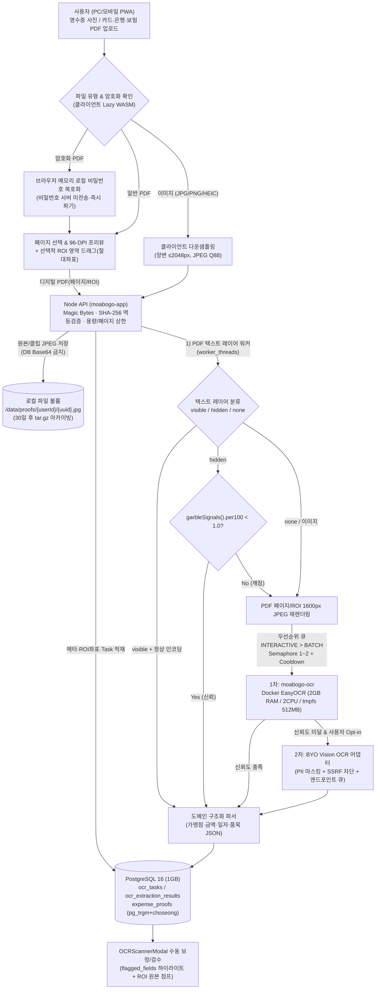

# [백로그] BKL-OCR-03: PDFit·PDFgpu 기반 PDF OCR 및 증빙처리 백엔드 고도화 스펙

- **백로그 ID**: `BKL-OCR-03` (세션 `0009` 최초 등록 ➔ 세션 `0052` 원본 저장소 분석 기반 스펙 전면 확장)
- **우선순위**: P1 (Should Have — 2차계획 5순위 백엔드 착수 시 통합 보완)
- **도메인/영역**: 백엔드 / 인프라 / OCR·PDF 파이프라인 / 보안
- **상태**: 스펙 확정 (`BACKLOG_READY`)
- **연계 문서**:
  - `docs/02.아키텍처/01-architecture-spec.md` (우분투 단일 노드 2GB RAM EasyOCR OOM 격리 및 30일 tarball 아카이빙)
  - `docs/00.인프라/02.Docker/01.Docker정책.md` (`moabogo-ocr` 2GB/2CPU, `tmpfs` 512MB, `moabogo-postgres` 1GB)
  - `docs/02.아키텍처/05-라이프도메인_서비스독립성_플러그인_및_보안설계서.md` (`securityGuards.ts` PII 보호 가드레일)
  - `docs/04.데이터/init_schema.sql` (`aiagent.ocr_tasks`, `aiagent.ocr_extraction_results`, `aiagent.expense_proofs`)
- **참고 분석 소스**:
  - YouTube 소개 영상: `PDFit : 대규모 PDF관리시스템 소개` (뉴런데브 / `https://youtu.be/OD-sAI642_s`)
  - 원본 저장소 1 (시스템/OCR/검색): `https://github.com/hikaMaeng/PDFit`
  - 원본 저장소 2 (고성능 PDF 뷰어 코어): `https://github.com/hikaMaeng/PDFgpu`

---

## 1. 백로그 도입 취지 및 배경 (Why)

모아보고(MoaBogo)는 가계부(`SCR-LED-01`), 모아루틴(`SCR-ROU-01`), 모아부릉(`SCR-CAR-01`) 전 도메인에서 다양한 금융·의료·차량 증빙 문서를 처리합니다:
- **디지털 PDF 비중이 높은 문서**: 카드 이용대금명세서 PDF, 은행 거래내역서 PDF, 전자세금계산서 PDF, 자동차보험증권·정비명세서 PDF
- **이미지·스캔 비중이 높은 문서**: 종이 영수증 사진, 약봉지·처방전 사진, 알뜰폰 번호이동 화면 캡처, 현장 점검표 스캔본

기존 `BKL-OCR-03` 설계는 "모든 증빙 이미지를 `moabogo-ocr`(Docker EasyOCR, 2GB RAM / 2.0 CPU 상한) 컨테이너로 전송해 세마포어 1~2로 처리"하는 이미지 단일 경로에 집중되어 있어, **다페이지 PDF(카드명세서 10p, 보험약관 50p) 처리, 디지털 텍스트 레이어 재활용, 영역 지정(ROI) 국소 OCR, 증빙 전문 검색 및 금융 PII 보안 통제**에 대한 구체적 백엔드 계약이 비어 있었습니다.

이에 저사양 단일 노드 Docker 환경에서 대규모 PDF를 고성능으로 처리하는 오픈소스 **`hikaMaeng/PDFit`** 및 **`hikaMaeng/PDFgpu`**의 실제 소스코드를 분석하여, 모아보고 백엔드 착수(`2차계획 5순위`, `[0054~]`) 시 그대로 적용·보완할 수 있는 아키텍처·데이터·보안 청사진을 본 백로그 문서로 정립합니다.

---

## 2. 원본 저장소(`PDFit` · `PDFgpu`) 핵심 기술 및 소스코드 분석

### 2.1 `hikaMaeng/PDFit` 서버 OCR · 워커 · 검색 소스 분석

원본 저장소의 `packages/pdfit/src/server/ocr/`, `packages/pdfit/docs/content-search.md`, `apps/pdfit/docker/Dockerfile`, `docker-compose.yml`을 직접 분석한 결과, 모아보고 백엔드에 즉시 이식 가능한 핵심 설계 패턴 6가지를 확인했습니다.

| 모듈 / 경로 | 실제 구현 메커니즘 | 모아보고 시사점 |
| :--- | :--- | :--- |
| **`ocr/pdfPageTextTask.worker.ts`** | Node `worker_threads` 전용 워커에서 `pdfjs-dist/legacy/build/pdf.mjs`를 1회 지연 로드. 페이지별 텍스트 아이템과 좌표(`x, top, baseline, width, height, hasEOL`)를 읽으며, 선택적 `rect: { x, y, width, height }`(PDF 포인트, 좌상단 원점) 지정 시 해당 영역 내 중심점을 가진 텍스트만 필터링. | 다페이지 금융 PDF를 메인 API 이벤트루프를 막지 않고 워커에서 즉시 텍스트 추출 가능. 영역(ROI) 단위 부분 파싱 계약으로 그대로 활용 가능. |
| **`ocr/textLayerQuality.ts`** | PDF 텍스트 레이어를 `'visible'`(디지털)·`'hidden'`(스캔 위 렌더링 모드 3 투명 OCR 층)·`'none'`(순수 이미지)으로 3분류. `garbleSignals(text).per100`으로 한글·영문 깨짐 점수를 정량 계산:<br>`(spacedLatin + 2·han + 2·jamo + 2·dya + odd) * 100 / nonSpaceChars`<br>(`HIDDEN_LAYER_GARBLE_LIMIT = 1.0`). 디지털(`visible`) 레이어는 항상 신뢰하여 렌더링 비용 0원, `hidden` 중 `per100 >= 1.0`만 OCR로 폴백. | 국내 영수증/스캔 PDF에 흔한 "저품질 내장 OCR 텍스트 층"이나 폰트 깨짐(한자 치환·단독 자모·`"댜"` 오인식·영문 쪼개짐)을 정량적으로 자동 감지해 재-OCR 여부를 결정하는 핵심 가드레일. |
| **`ocr/ocrService.ts`** | • **고해상도 재렌더링 원칙**: 화면 캡처 썸네일을 OCR하지 않고, 원본 PDF에서 해당 페이지(`width: 1600, quality: 85`) 또는 클립 영역(`width: 1600, quality: 90`, 최대 4× 배율)을 재래스터화해 OCR 모델에 투입.<br>• **우선순위 분리**: 사용자 요청(`INTERACTIVE_TASK_PRIORITY`)이 백그라운드 일괄 스캔(`DEFAULT_TASK_PRIORITY`)보다 항상 선점.<br>• **캐시 버저닝**: `PAGE_CACHE_VERSION = 'v2'` 및 파일 크기·수정시각 일치 검증으로 규칙 변경/파일 수정 시 자동 무효화. | 모바일에서 흐릿한 화면 캡처 대신 원본 PDF ROI를 1600px JPEG로 재렌더링하면 금액·승인번호 인식률 대폭 상승. 또한 `OCRScannerModal` 실시간 요청이 배치 작업 뒤에 밀리지 않도록 우선순위 큐 도입 필수. |
| **`ocr/visionOcr.ts`** | OpenAI 호환 `/v1/chat/completions` Vision API 어댑터(`temperature: 0`, `AbortSignal.timeout`, 전사 전용 시스템 프롬프트, `cleanOcrOutput` 코드펜스 제거). `createVisionOcrQueue`로 **엔드포인트별 동시성 상한(`ocrConcurrency`, 기본 1)과 우선순위 큐**를 통합 관리. | 모아보고의 2차 사용자 개인 Key Fallback(`USER_KEY_OCR`)을 특정 벤더(OpenAI/Gemini/로컬 Ollama VLM)에 종속시키지 않고 단일 어댑터 + 엔드포인트별 동시성 큐로 통합 구현 가능. |
| **클립(Visual Bookmark) 스토리지 분리** | 뷰어→서버 전송 시에만 Base64를 사용하고, **PostgreSQL에는 절대 Base64를 저장하지 않음**. 서버가 Quality 90 JPEG로 변환해 파일 볼륨(`/app/data/bookmarks/<id>/capture.jpg`)에 저장하고 DB에는 절대 PDF 좌표·메모·OCR 텍스트만 기록. | 모아보고의 30일 경과 원본 `proofs_YYYY_MM.tar.gz` 아카이빙 정책 및 PG16 1GB RAM 제약과 100% 일치하는 필수 원칙. |
| **`content-search.md` & `Dockerfile`** | PostgreSQL 단일 엔진에 `pg_trgm`, `title_choseong`(초성 컬럼), `pg_catalog.simple` + NFC 기반 GIN 인덱스, `textsearch_ko`(MeCab-ko), `pgvector` 통합. 검색 시 **활성 탭만 요청**하고 탭 이탈 시 `AbortController`로 이전 쿼리 즉시 중단. 스토리지(NAS/SMB) 행(Hang) 방지를 위해 목록·검색 API는 **DB-Only 응답** 강제, `PDFIT_TASK_CONCURRENCY=2`, `COOLDOWN_MS`, `UV_THREADPOOL_SIZE=32` 적용. | 우분투 단일 노드에서 별도 Elasticsearch 없이 PG16만으로 가맹점·품목·OCR 원문·초성 검색 구현 가능. 단, PG 1GB 상한을 고려해 확장 모듈은 단계적 도입 필요. |

### 2.2 `hikaMaeng/PDFgpu` 고성능 웹 PDF 뷰어 코어 분석

원본 저장소의 `packages/pdfgpu/docs/architecture.md`, `constraints.md`, `README.md`를 직접 분석한 핵심 구조와 제약사항입니다.

- **3계층 파이프라인**:
  1. **Provider Layer (`engine/`, `providers/`)**: `PdfRasterProvider` 계약(`open`, `renderPreview`, `renderTile`, `dispose`)으로 **In-Memory PDFium WASM ↔ HTTP Web API ↔ WebSocket JSON-RPC**를 뷰어 변경 없이 교체 가능.
  2. **Scheduler Layer (`scheduler/`)**: 96-DPI 프리뷰 즉시 표시 ➔ 스크롤 200ms 안정 시 가시 영역 144~384 DPI 디테일 타일 요청 ➔ 500ms 정지 시 앞뒤 프리캐시. 캐시는 **프리뷰 64 MiB + 디테일 타일 128 MiB** 바이트 예산 LRU로 상한 통제.
  3. **Viewer Layer (`viewer/`)**: 문서 전체 캔버스를 만들지 않고 **viewport 크기 단일 캔버스 + 경량 페이지 셸(`data-testid="pdfgpu-page-shell"`)**만 유지, WebGPU(또는 Canvas 2D 폴백)로 합성. `viewer/interaction.ts` 순수 reducer로 프레임워크 비종속 설계.
- **릴리스 계약 & 실무 제약사항 (`constraints.md` 확인)**:
  - In-Memory 공급자는 `@embedpdf/pdfium@2.15.1`(Chromium PDFium WASM)을 고정 버전 계약(`release-contracts/pdfgpu/v0.1.0.json`)으로 사용.
  - **메모리 주의**: Web Worker 풀(데스크톱 기본 4개)의 각 워커가 **문서 전체 사본 + 독립 PDFium 힙**을 보유하므로 브라우저 메모리가 `poolSize`에 선형 비례함 (모바일 저사양 기기에서 4워커 사용 시 탭 OOM 위험).
  - **Vite 빌드 제약**: 워커가 PDFium을 `import()`로 지연 로드하므로 Vite 설정에 `worker: { format: 'es' }` 필요.
  - **기능 경계**: `@pdfgpu/core@0.1.0`은 순수 프로그레시브 래스터 뷰어에 집중하며, **텍스트 선택·전문 검색·주석은 코어 외부 범위**이며 일부 설정/브라우저에서 WebGPU 미지원 시 `unsupported` 상태 노출 가능.

---

## 3. 모아보고 적용 영역 및 도입 판정표

| 기술 축 | 도입 판정 | 적용 대상 도메인/화면 | 구체적 채택 기준 및 보완 방향 |
| :--- | :---: | :--- | :--- |
| **1. 디지털 텍스트 레이어 우선 추출 + `garbleSignals` 품질 검증** | **적극 채택 (P0)** | `SCR-LED-01`(카드·은행 PDF 명세서), `SCR-ROU-01`(전자세금계산서), `SCR-CAR-01`(보험증권) | 디지털 PDF는 `pdfjs-dist` 워커(또는 클라이언트 WASM)로 0.1초 내 텍스트 추출. `hidden` 레이어는 `garbleSignals().per100 >= 1.0`일 때만 이미지 OCR로 폴백. |
| **2. 영역 클립(ROI 절대좌표) 국소 OCR + DB/바이너리 분리** | **적극 채택 (P0)** | `OCRScannerModal`, 약봉지 복약표, 다품목 영수증, 정비명세서 | 사용자가 드래그 지정한 영역만 PDF 절대 좌표(`roi_coords`)로 저장하고 1600px JPEG(Q85~90)로 재래스터화해 OCR 실행. DB에 Base64 저장 금지, 30일 후 `tar.gz` 아카이빙과 일원화. |
| **3. 우선순위 동시성 큐 + 워커 쿨다운 + DB-Only 조회 격리** | **적극 채택 (P0)** | `moabogo-ocr` 워커, `aiagent.ocr_tasks` 스케줄러 | 실시간 단일 영수증(`INTERACTIVE`) > 일괄 명세서(`BATCH`) 우선순위 부여. 세마포어 1~2 + `COOLDOWN_MS` + `tmpfs` 512MB로 우분투 노트북 OOM/발열 방어. |
| **4. OpenAI 호환 BYO Vision OCR 어댑터 (`visionOcr.ts` 패턴)** | **부분 채택 (P1)** | `SCR-SET-01` 개인 OCR Key 설정, `OCRScannerModal` 2차 Fallback | 1차 Docker EasyOCR 실패/신뢰도 미달 시에만 호출. OpenAI/Gemini/로컬 Ollama VLM을 단일 어댑터로 지원하되 **SSRF 차단 + PII 마스킹 + 명시적 Opt-in** 필수 결합. |
| **5. 브라우저 PDF 프리뷰/페이지 선택 (`PDFgpu` 패턴 참조)** | **조건부 채택 (P1)** | 증빙 상세 라이트박스, 다페이지 PDF 업로드 모달 | `@pdfgpu/core@0.1.0` 직접 의존 전 `pdfjs-dist` vs `@embedpdf/pdfium` 번들·모바일 메모리 벤치마크 선행. 모바일은 `poolSize=1`, 캐시 32~48 MiB, Canvas 2D 폴백 강제 및 **Lazy Import** 필수. |
| **6. PostgreSQL `pg_trgm` + 초성 컬럼 기반 증빙 통합 검색** | **부분 채택 (P1)** | `SCR-LED-01` 지출/증빙 검색, `SCR-DAY-01` 통합 검색 | `pg_trgm` GIN + `choseong` 정규화 컬럼만 1차 도입. `MeCab-ko`(`textsearch_ko`)와 `pgvector` 임베딩 검색은 PG16 1GB 메모리 여유 검증 후 2차로 이연(기존 `init_schema.sql` 8번 임베딩 테이블과 추후 연계). |
| **7. 올인원 단일 컨테이너(PG+Node 합본) 및 NAS 감시 구조** | **비채택** | 해당 없음 | 모아보고의 3컨테이너 격리(`moabogo-postgres` / `moabogo-app` / `moabogo-ocr`)가 OCR OOM 시 DB 생존성 보장에 훨씬 유리하므로 현 정책(`01.Docker정책.md`) 유지. |

---

## 4. 적용 시 장단점 및 운영 유의사항

### 4.1 장점 (Pros)
1. **서버 리소스 절감 (2GB RAM 노트북 최적화)**: 금융/보험 디지털 PDF의 70~90%가 EasyOCR 컨테이너를 거치지 않고 텍스트 레이어로 즉시 처리되어 CPU/RAM 피크 부하 급감.
2. **숫자·금액 정확도 비약적 향상**: 텍스트 레이어 직접 추출은 OCR 특유의 숫자 오인식(`0/O`, `1/l`, 천단위 쉼표 누락)을 원천 차단하고, 스캔본도 ROI 1600px 재렌더링 + `garbleSignals` 필터로 오인식 최소화.
3. **Cloudflare Tunnel 524 타임아웃 및 오프라인 대응**: 다페이지 PDF를 클라이언트에서 선별·분할하거나 서버에서 `task_id` 즉시 반환 후 비동기 처리하여 100초 터널 타임아웃 완전 방어.
4. **감사·대사 UX 고도화**: `roi_coords`(절대 PDF 좌표)를 `expense_proofs`와 함께 영속화하면 추후 가계부 내역 클릭 시 원본 명세서의 정확한 결제 라인으로 즉시 하이라이트 점프 가능.

### 4.2 단점 및 리스크 (Cons)
1. **클라이언트 번들 비대화 위험**: PDFium WASM(3~6MB) 또는 `pdfjs-dist` 워커가 메인 번들에 섞이면 모바일 PWA 첫 진입 속도 저하.
2. **모바일 메모리 한계 및 WebGPU 파편화**: PDFium 워커당 문서 사본 복제 구조(`constraints.md`) 때문에 고해상도 50p PDF를 모바일 4워커로 열면 브라우저 탭 강제 종료 가능.
3. **암호화 금융 PDF 복호화 UX 부담**: 국내 카드사·은행 명세서 PDF는 생년월일(6자리)/사업자번호 비밀번호가 걸려 있어, 복호화 비밀번호 입력 모달과 메모리 즉시 파기 처리가 추가되어야 함.
4. **한글 폰트 미임베딩 PDF(Mojibake) 예외**: 일부 구형 공공기관/세금계산서 PDF는 `visible` 텍스트 레이어임에도 커스텀 인코딩으로 깨진 문자열이 나올 수 있음.

### 4.3 구현·운영 시 핵심 유의사항
- **동적 지연 로딩(Code Splitting)**: Vite `manualChunks`로 PDF 뷰어/파서를 분리해 사용자가 PDF 첨부/조회를 눌렀을 때만 로드.
- **`visible` 레이어에도 최소 건전성 검사 추가**: PDFit은 `hidden` 레이어에만 `garbleSignals`를 적용하지만, 모아보고는 국내 구형 PDF의 깨진 CJK 인코딩을 방어하기 위해 `visible` 레이어에서도 `U+FFFD`(대체문자)·비정상 제어문자 비율이 높으면 자동으로 래스터 OCR 폴백.
- **이미지/래스터 상한 고정**: 서버 `tmpfs`(512MB) 보호를 위해 페이지/클립 JPEG 상한을 **장변 1,600~2,048px, Quality 85~90, 파일당 5MB 이하, PDF 페이지 상한 30p(초과 시 페이지 범위 선택)**로 강제.
- **PG16 인덱스 부하 계측**: `pg_trgm` GIN 인덱스 추가 전 실제 데이터셋으로 `EXPLAIN (ANALYZE, BUFFERS)` 실행하여 1GB 메모리 예산 내 동작 검증.

---

## 5. 아키텍처 개선 설계 (AS-IS vs TO-BE)

### 5.1 TO-BE 하이브리드 PDF·OCR 증빙 파이프라인



### 5.2 기존 DB 스키마(`docs/04.데이터/init_schema.sql`) 백엔드 확장 DDL 초안

기존 `aiagent.ocr_tasks`(158행), `aiagent.ocr_extraction_results`(182행), `aiagent.expense_proofs`(536행) 구조를 유지하면서 PDF 하이브리드 추출·ROI 좌표·우선순위·캐시 버전·검색 인덱스를 최소 침습으로 확장합니다.

```sql
-- 1. aiagent.ocr_tasks 확장: PDF 페이지/ROI/우선순위/소스 출처/캐시버전
ALTER TABLE aiagent.ocr_tasks
  ADD COLUMN IF NOT EXISTS source_mime_type        VARCHAR(80)  NOT NULL DEFAULT 'image/jpeg',
  ADD COLUMN IF NOT EXISTS page_index              INT          NULL,          -- 0-based (이미지 단일건은 NULL)
  ADD COLUMN IF NOT EXISTS page_count              INT          NULL,
  ADD COLUMN IF NOT EXISTS roi_coords_json         JSONB        NULL,          -- { "x": 12, "y": 40, "width": 320, "height": 180, "pageWidth": 595, "pageHeight": 842 }
  ADD COLUMN IF NOT EXISTS priority_score          SMALLINT     NOT NULL DEFAULT 10, -- 100: INTERACTIVE, 10: BATCH
  ADD COLUMN IF NOT EXISTS extraction_source_code  VARCHAR(30)  NULL,          -- 'TEXT_LAYER_VISIBLE' | 'TEXT_LAYER_HIDDEN' | 'EASYOCR_LOCAL' | 'BYO_VISION_API'
  ADD COLUMN IF NOT EXISTS garble_score            NUMERIC(6,2) NULL,          -- textLayerQuality per100 계측값
  ADD COLUMN IF NOT EXISTS cache_rule_version      VARCHAR(16)  NOT NULL DEFAULT 'v1';

-- 우선순위 + 대기열 조회 최적화 인덱스
CREATE INDEX IF NOT EXISTS idx_ocr_tasks_queue_poll
  ON aiagent.ocr_tasks (status_code, priority_score DESC, created_at ASC)
  WHERE deleted_yn = FALSE AND status_code IN ('PENDING', 'PROCESSING');

-- 동일 파일+페이지+ROI+규칙버전 멱등 캐시 조회
CREATE INDEX IF NOT EXISTS idx_ocr_tasks_idempotent_cache
  ON aiagent.ocr_tasks (owner_user_id, source_image_hash, COALESCE(page_index, -1), cache_rule_version)
  WHERE deleted_yn = FALSE AND status_code = 'COMPLETED';

-- 2. aiagent.ocr_extraction_results 확장: 검색용 초성/정규화 및 PG16 pg_trgm 인덱스
CREATE EXTENSION IF NOT EXISTS pg_trgm;

ALTER TABLE aiagent.ocr_extraction_results
  ADD COLUMN IF NOT EXISTS searchable_text_nfc     TEXT         NULL,          -- PII 마스킹 완료된 NFC 정규화 전문 (최대 64,000자 제한)
  ADD COLUMN IF NOT EXISTS searchable_choseong     TEXT         NULL;          -- 가맹점·핵심키워드 초성 검색용

CREATE INDEX IF NOT EXISTS idx_ocr_results_text_trgm
  ON aiagent.ocr_extraction_results USING GIN (searchable_text_nfc gin_trgm_ops)
  WHERE deleted_yn = FALSE;

-- 3. aiagent.expense_proofs 확장: 원본 PDF 영역 클립 점프용 좌표 및 클립 썸네일 참조
ALTER TABLE aiagent.expense_proofs
  ADD COLUMN IF NOT EXISTS source_page_index       INT          NULL,
  ADD COLUMN IF NOT EXISTS roi_coords_json         JSONB        NULL,
  ADD COLUMN IF NOT EXISTS clip_thumbnail_file_id  UUID         NULL;
```

---

## 6. 보안 관련 이슈 및 필수 가드레일

모아보고는 일반 전자책(PDFit)이 아니라 **카드명세서·통장거래내역·처방전(의료 PII)·사업자/주민번호·자동차보험증권**을 다루므로 아래 6대 보안 통제를 백엔드 구현 시 필수 강제합니다.

| 번호 | 보안 위협 | 공격/사고 시나리오 | 필수 방어 가드레일 |
| :---: | :--- | :--- | :--- |
| **S1** | **암호화 금융 PDF 비밀번호 노출** | 주민번호 앞 6자리/생년월일 암호가 걸린 카드·은행 PDF를 서버로 전송하면 액세스 로그·네트워크 캡처·임시 파일에 민감 비밀번호 잔류 | **브라우저 로컬 복호화 원칙**: 비밀번호 입력과 복호화는 클라이언트 WASM 메모리에서만 수행하고 서버 API로 비밀번호를 절대 전송하지 않음. 복호화 완료 직후 문자열 참조 즉시 해제. |
| **S2** | **BYO 외부 AI(VLM) 전송 시 금융·의료 PII 유출** | 2차 Fallback으로 OpenAI/외부 API 호출 시 주민등록번호·계좌번호·카드번호·처방전 환자명/병명이 외부 서버에 전송·학습 위험 | 1) 기본값은 100% 로컬 처리(텍스트 레이어 + Docker EasyOCR).<br>2) 2차 외부 API 호출은 사용자 명시적 Opt-in + ROI 크롭(필요 영역만 절단) + `securityGuards.ts` 기반 민감정보 마스킹 후 전송.<br>3) `ocr_tasks.purge_source_after_ocr_yn = true` 옵션 제공(처방전/신분성 문서 즉시 파기). |
| **S3** | **SSRF (BYO AI Base URL 내부망 침투)** | 사용자가 개인 AI 엔드포인트(`baseUrl`)에 `http://postgres:5432`, `http://127.0.0.1:8000`, `http://169.254.169.254` 등을 입력해 Docker 내부망(`moabogo-net`) 또는 호스트 스캔 | 1) HTTPS(443) 프로토콜 기본 강제.<br>2) 요청 직전 DNS 리졸브 수행 후 루프백(`127.0.0.0/8`, `::1`), 사설 IP(RFC1918), 링크로컬(`169.254.0.0/16`), Docker 브릿지 대역 원천 차단 및 리다이렉트 추적(`redirect: 'error'`) 금지.<br>3) 로컬 Ollama 연동은 일반 사용자 입력이 아닌 `SYSTEM_ADMIN` 서버 화이트리스트 환경변수로만 허용. |
| **S4** | **악성 PDF · 파서 취약점 · Decompression Bomb (DoS)** | 내장 JavaScript가 포함된 PDF, 10KB로 압축된 5GB 스트림(PDF 폭탄), 2,000페이지 대용량 PDF로 우분투 노드 OOM 및 서비스 마비 | 1) 업로드 계층에서 확장자가 아닌 **Magic Bytes(`%PDF-`, JPEG/PNG/WebP 시그니처)** 검증.<br>2) 용량 상한(PDF 15MB, 이미지 10MB), 페이지 수 상한(30p), 워커당 실행 타임아웃(페이지당 5초 / 전체 30초) 강제.<br>3) PDF 파서에서 JavaScript 실행·외부 링크 자동 로드·XFA 폼 실행 전면 비활성화. |
| **S5** | **경로 순회(Path Traversal) & 타 테넌트 증빙 무단 열람** | 원본 파일명(`../../etc/passwd`) 기반 저장 또는 예측 가능한 숫자 ID로 타 사용자의 영수증/처방전 다운로드 | 1) 스토리지 경로는 서버 생성 UUIDv7만 사용(`/data/proofs/{ownerUserId}/{fileUuid}.jpg`), 원본 파일명은 DB 메타데이터에만 이스케이프 저장.<br>2) 모든 증빙/클립 조회·다운로드 API에 `owner_user_id` 또는 소속 `ledger_members` RBAC 인가 검증 필수. |
| **S6** | **OCR 결과 XSS 및 저장소 오염** | PDF 텍스트 레이어나 이미지 속 악성 `<script>`·마크다운 링크가 프론트엔드에 주입되거나 `localStorage`에 평문 PII 적재 | 1) 프론트엔드 모든 OCR 결과·스니펫은 React 기본 텍스트 바인딩만 허용(raw HTML 주입 금지).<br>2) `redacted_raw_text`는 서버 저장 전 주민번호/카드번호(16자리 중 중간 8자리)/계좌번호 자동 마스킹 후 적재.<br>3) DB Base64 바이너리 저장 전면 금지. |

---

## 7. 백엔드 구현 시 단계별 작업 가이드 (Implementation Roadmap)

> **착수 시점**: `2차계획 5순위` (`[0054~]` 백엔드 인프라 구동 및 API 개발) 단계에서 `BKL-DATA-01`과 병행/연계 추진

### Phase 1: DB 스키마 확장 및 디지털 PDF 텍스트 추출 워커 (P0)
1. `docs/04.데이터/init_schema.sql` 및 마이그레이션 스크립트에 섹션 5.2 DDL 반영 (`ocr_tasks`, `ocr_extraction_results`, `expense_proofs`).
2. Node `worker_threads` 기반 `pdfPageTextTask.worker.ts` 구현 (`pdfjs-dist` 기반 페이지·ROI 텍스트 추출).
3. `textLayerQuality.ts` 이식 및 국내 금융/의료 문서(한글+숫자+특수문자+`visible` 인코딩 깨짐) 기준 캘리브레이션 테스트셋 작성.

### Phase 2: 우선순위 큐 · Docker EasyOCR(2GB/2CPU) · 스토리지 분리 연동 (P0)
1. `ocrService.ts` 구현: `INTERACTIVE`(100) vs `BATCH`(10) 우선순위 큐, 세마포어 1~2, `COOLDOWN_MS`, 3분 Stuck Task 보상 재시도(최대 3회) 및 `cache_rule_version` 멱등 캐시.
2. `moabogo-ocr` FastAPI 컨테이너(`docker/ocr/`) 구축: `--memory="2g" --cpus="2.0"`, `tmpfs /tmp:rw,size=512m`, `OMP_NUM_THREADS=2`.
3. 클립/원본 파일 볼륨 저장소(`/data/proofs/...`) + 30일 경과 `proofs_YYYY_MM.tar.gz` 아카이빙 & 온디맨드 스트림 해제 파이프라인 연결.

### Phase 3: 클라이언트 PDF 프리뷰·로컬 복호화·ROI 클립 UI 연동 (P1)
1. Vite `manualChunks` + `worker: { format: 'es' }` 기반 Lazy PDF 뷰어 PoC (`@embedpdf/pdfium` vs `pdfjs-dist` 모바일 360px 메모리/번들 벤치마크 후 최종 확정).
2. `OCRScannerModal` 및 증빙 상세 모달 확장:
   - PDF 파일 드롭존 지원(`accept="image/*,application/pdf"`)
   - 암호화 PDF 로컬 비밀번호 해제 모달
   - 페이지 선택 + 드래그 영역 클립(ROI 절대좌표 전달) + `[원본 증빙 위치 보기]` 하이라이트 점프

### Phase 4: BYO Vision OCR 보안 어댑터 & PG16 통합 검색 (P1)
1. `visionOcr.ts` 패턴 기반 OpenAI 호환 2차 Fallback 어댑터 구현 (SSRF IP 필터링 + PII 마스킹 + 엔드포인트별 동시성 큐 + Opt-in 동의).
2. `pg_trgm` GIN + 초성 컬럼 기반 가맹점·품목·OCR 원문 통합 검색 API 및 프론트 `AbortController` 탭 전환 취소 적용.

---

## 8. 검증 절차 및 인수 기준 (Acceptance Criteria)

- [ ] **인수 기준 1 (디지털 PDF Zero-OCR 추출)**: 디지털 텍스트 레이어가 포함된 카드 이용대금명세서 PDF 업로드 시 `moabogo-ocr` 컨테이너 호출 0건으로 500ms 이내 텍스트 추출 및 파싱이 완료되는가?
- [ ] **인수 기준 2 (저품질 숨김 레이어 자동 폴백)**: 깨진 숨김 OCR 레이어(`garble_score >= 1.0`) 또는 스캔 PDF 업로드 시 자동으로 ROI/페이지 1600px JPEG 재렌더링 후 EasyOCR 파이프라인으로 전환되는가?
- [ ] **인수 기준 3 (2GB OOM 격리 및 우선순위 큐)**: 10페이지 배치 PDF 처리 중 실시간 영수증 1건(`INTERACTIVE`)을 업로드했을 때 즉시 선점 처리되며, `moabogo-ocr` 컨테이너 메모리가 2GB 상한을 초과해도 `moabogo-postgres`와 `moabogo-app`이 무중단 유지되는가?
- [ ] **인수 기준 4 (보안 6대 가드레일)**:
  - 암호화 PDF 비밀번호가 서버 네트워크 페이로드/로그에 0건 노출되는가?
  - BYO AI URL에 `http://127.0.0.1:5432` / `http://postgres:5432` 입력 시 SSRF 필터가 즉시 `400/403` 차단하는가?
  - 비정상 확장자 위장 파일(Magic Bytes 불일치) 및 30페이지 초과 PDF가 파서 진입 전 차단되는가?
  - 타 사용자의 `proof_id` / `file_id` 조회 시 `403 Forbidden`으로 격리되는가?
- [ ] **인수 기준 5 (DB 바이너리 분리 & 멱등성)**: `ocr_tasks` / `expense_proofs` 테이블에 Base64 이미지가 0바이트 저장되며, 동일 파일+페이지+ROI 재업로드 시 `source_image_hash` 캐시로 즉시 멱등 응답하는가?

---

## 9. 작업 이력 (History)

| 작업일자 | 세션ID | 작업자 | 작업내용 | 참고링크 |
| :---: | :---: | :---: | :--- | :--- |
| 2026-10-13 | 0009 | AI Studio Agent | `BKL-OCR-03` 초기 백로그 등록 (EasyOCR 2GB OOM 격리) | `docs/01.프로젝트/02-backlog-spec.md` |
| 2026-11-25 | 0052 | AI Studio Agent | `hikaMaeng/PDFit`·`hikaMaeng/PDFgpu` 원본 저장소 및 소개 영상 코드레벨 분석 반영, 하이브리드 PDF/OCR·ROI·보안·DDL 백로그 상세 스펙 수립 | `docs/06.백로그/BKL-OCR-03_PDFit_PDFgpu_기반_PDF_OCR_및_증빙처리_백엔드_고도화_스펙.md` |
