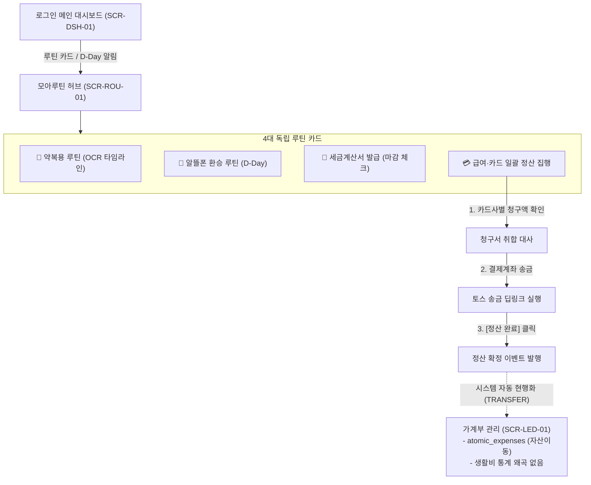

# [BKL-ROU-01] 모아루틴: 4대 라이프케어·금융재무 루틴 구축 및 가계부 자산이동 연동 스펙

> **문서 상태**: 진행중 (`IN_PROGRESS` — v2.0 유형별 상세정의 확정)  
> **등록 세션**: `[0043]` (고도화 설계: `[0046]`)  
> **최초 등록일**: 2026-11-22  
> **관련 도메인**: 모아루틴 (`SCR-ROU-01`), 가계부 관리 (`SCR-LED-01`), 모아머니 (`SCR-MON-01`), 모아목표 (`SCR-GOL-01`), 대시보드 (`SCR-DSH-01`)  
> **상세 기획·설계·화면설계서**: `docs/01.프로젝트/03-모아루틴_유형별_상세정의_기획_설계_화면설계서.md`  

---

## 1. 도입 취지 및 배경 (Why)

- **현황 및 문제점**:
  - 현재 모아보고는 **가계부(Ledger)**, **모아당번(Duty)**, **모아목표(Goal)**의 3대 라이프 도메인을 중심으로 구축되어 있음.
  - 그러나 실생활에서 개인이 반복적으로 마주하는 **주기적/반복적 행동 패턴(복약, 정기 청구서 마감, 알뜰폰 약정 만료, 급여일 카드 대금 정산)**은 종착점이 있는 '목표'나 타인과 분담하는 '당번'의 개념과 일치하지 않아 기존 화면에 담기 어려움.
  - 특히 급여일에 카드사별 명세서를 확인하고 각 결제 계좌로 분배 송금하는 **'월간 카드값 정산 집행'** 업무를 가계부 화면(`SCR_LED_01`) 내에 무리하게 포함시킬 경우, 이미 294KB에 달하는 가계부 화면이 지나치게 비대해지고 일상 기장 UX와 월간 배치 집행 UX가 뒤섞여 심각한 인지 부하를 초래함.
- **도입 필요성**:
  - 개인의 일상·금융·건강 사이클을 독립적으로 관리하는 **'모아루틴(`SCR-ROU-01`)'** 서비스를 신설하여 관심사를 완벽히 분리.
  - 특히 급여·카드 정산 업무를 독립된 워크플로우로 집행하고, 완료된 결과는 시스템이 **가계부 자산이동(`TRANSFER`)으로 자동 현행화**하도록 설계하여 가계부 경량화와 실질적 업무 효율을 동시 달성.

---

## 2. 개요 및 요구사항 (Overview & Requirements)

### 2.1 4대 핵심 루틴 라인업 정의

| 카테고리 | 루틴 과제명 | 주기 / 특성 | 핵심 요구사항 및 가치 |
| :--- | :--- | :---: | :--- |
| **1. 헬스케어** | **약복용 루틴** | 매일 1~3회<br>(식전/식후, N일간) | • 처방전 및 약봉투 사진 OCR 촬영 ➔ 복용 타임라인(아침/점심/저녁) 자동 생성<br>• 복용 푸시 알림 및 체크, 잔여 알약 수량 카운트다운 관리 |
| **2. 라이프케어** | **알뜰폰 환승 루틴** | 6~7개월 장주기<br>(프로모션 만료) | • 프로모션 할인 종료 D-Day 카운트다운<br>• 위약금 없는 최적 번호이동 시점 알림 및 맞춤 요금제 환승 체크 |
| **3. 비즈니스** | **개인사업자 세금계산서 발급** | 매월 1~10일<br>(월간 의무 마감) | • 매월 10일 전자세금계산서 의무 발급 집중 리마인더 (가산세 방어)<br>• 1단계: 거래처별 발급 체크리스트 / 2단계: 국세청 홈택스 발급 자동화 연계 |
| **4. 금융재무** | **급여·카드 일괄 정산 집행** | 매월 급여일~결제일<br>(월간 자금 집행) | • 카드사별 청구 금액 취합 요약 뷰<br>• 결제계좌별 토스 송금 딥링크 1-Click 집행<br>• **[정산 완료] 시 가계부 자산이동(`TRANSFER`) 자동 기장 현행화** |
| *(연계)* | *독서 루틴 (PDF 연계)* | *매일 N분 / 권 완독* | *개발 중인 PDF 관리 서비스와 연계하여 일일 독서 습관(루틴)과 완독 마일스톤(목표) 하이브리드 연동 (PDF 구축 시 착수)* |

### 2.2 비기능적 요구사항 (Non-Functional Requirements)
- **금전관리 3대 원칙 준수**: 급여 정산으로 인한 계좌 간 송금은 순수 수입/지출 통계에서 배제(`is_asset_transfer = true`, `related_transfer_id` 페어링).
- **관심사 분리 (SoC)**: 가계부는 '기록/조회/통계'에 집중, 루틴은 '정기 알림/체크/배치 집행'에 집중.
- **모바일 반응형 최적화**: 360px 뷰포트에서 카드형 대시보드 레이아웃 및 원터치 딥링크 지원.

---

## 3. 아키텍처 및 상세 설계 (Technical Architecture)

### 3.1 서비스 전이 및 가계부 자동 현행화 흐름


### 3.2 데이터 스키마 구상 (DDL)

```sql
-- 1. 루틴 정의 테이블
CREATE TABLE IF NOT EXISTS member_routines (
    routine_id VARCHAR(64) PRIMARY KEY,
    user_id VARCHAR(64) NOT NULL,
    category VARCHAR(32) NOT NULL, -- 'HEALTH_MEDICINE', 'LIFE_PHONE', 'BIZ_TAX', 'FINANCE_CARD_SETTLE'
    title VARCHAR(100) NOT NULL,
    cycle_type VARCHAR(32) NOT NULL, -- 'DAILY_MULTIPLE', 'MONTHLY_DATE', 'PERIODIC_MONTHS'
    cycle_config JSONB NOT NULL DEFAULT '{}', -- 주기 상세 (예: {"times": ["08:30", "13:00", "19:00"]} 또는 {"day": 25})
    d_day_target_date DATE,
    is_active BOOLEAN NOT NULL DEFAULT true,
    created_at TIMESTAMP WITH TIME ZONE DEFAULT CURRENT_TIMESTAMP,
    updated_at TIMESTAMP WITH TIME ZONE DEFAULT CURRENT_TIMESTAMP
);

-- 2. 급여 카드정산 집행 로그 테이블
CREATE TABLE IF NOT EXISTS routine_card_settlements (
    settlement_id VARCHAR(64) PRIMARY KEY,
    routine_id VARCHAR(64) REFERENCES member_routines(routine_id),
    user_id VARCHAR(64) NOT NULL,
    settlement_year_month VARCHAR(7) NOT NULL, -- '2026-11'
    source_account_id VARCHAR(64) NOT NULL, -- 급여 계좌
    card_statements JSONB NOT NULL DEFAULT '[]', -- [{"card_name": "신한", "target_account": "110-xxx", "amount": 1200000, "status": "COMPLETED"}]
    total_amount NUMERIC(15, 2) NOT NULL,
    is_transferred_to_ledger BOOLEAN NOT NULL DEFAULT false,
    executed_at TIMESTAMP WITH TIME ZONE,
    created_at TIMESTAMP WITH TIME ZONE DEFAULT CURRENT_TIMESTAMP
);
```

---

## 4. 단계별 작업 가이드 (Implementation Guide)

- **Step 1 (기존 미완 화면 정돈)**:
  - `SCR-DUT-01/02` (모아당번) 및 `SCR-GOL-01` (모아목표 관리) 화면리뷰 완결.
- **Step 2 (모아루틴 프로토타입 화면 구축 및 UX 점검)**:
  - `SCR_ROU_01_모아루틴.tsx` 신설 및 라우팅 등록 (`/routine`).
  - 4대 루틴 카드 배치:
    - 💊 약복용 타임라인 및 복용 체크 토글
    - 📱 알뜰폰 환승 D-Day 뱃지
    - 📑 세금계산서 발급 체크리스트
    - 💳 급여·카드 일괄 정산 집행 카드 (토스 딥링크 버튼 + 가계부 자동 반영 모의 토글)
  - 화면리뷰 문서 발행 및 사용자 피드백 수렴.
- **Step 3 (개발 전 전 화면 통합 코드리뷰)**:
  - 18개 전체 화면 FSD 구조 정돈 및 TypeScript 0-Error 완결.
- **Step 4 (백엔드 및 외부 연계 구축)**:
  - EasyOCR 연계 (영수증 + 처방전/약봉투), 홈택스 API 검토, PDF 연동.

---

## 5. 검증 절차 및 인수 기준 (Acceptance Criteria)

1. [ ] 모아루틴 화면(`SCR-ROU-01`)에서 급여·카드 정산을 진행했을 때 가계부 화면으로 불필요하게 튕기지 않고 독립 집행이 가능한가?
2. [ ] 정산 완료 시 가계부 데이터에 자산이동(`is_asset_transfer = true`)으로 자동 현행화되어 수입/지출 통계를 왜곡하지 않는가?
3. [ ] 약복용 루틴에서 시간대별 복용 여부 체크 및 잔여량 차감이 인터랙티브하게 동작하는가?
4. [ ] 알뜰폰 및 세금계산서 마감 D-Day 알림이 360px 모바일 화면에서 깨짐 없이 렌더링되는가?
