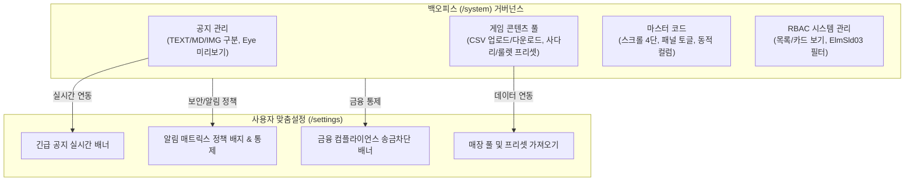

# [0040] 세션 회고: 시스템설정서비스(/system, /settings) 전면 화면리뷰 및 UI/UX 디자인 고도화 완결

- **세션 번호**: `0040`
- **세션명**: 시스템설정서비스(/system, /settings) 전면 화면리뷰 및 UI/UX 디자인 고도화
- **진행 일자**: 2026-11-19
- **참여 에이전트**: MoaBogo Session Architect & Core Harness Specialist Team
- **세션 완료 상태**: 완료 (`DONE`)
- **종결 이슈**: GitHub Issue [#103](https://github.com/jkoogit/moabogo/issues/103) (Closed)
- **머지 PR**: GitHub PR [#104](https://github.com/jkoogit/moabogo/pull/104) (Merged to `dev`, `stg`, `main`)

---

## 1. 세션 마일스톤 및 핵심 과제 달성도 평가

| 마일스톤 및 핵심 과제 | 목표 내용 | 달성도 | 비고 |
| :--- | :--- | :---: | :--- |
| **시스템설정 백오피스(/system) 8대 거버넌스 전면 화면리뷰** | 모바일/태블릿/데스크톱 전 뷰포트 반응형 레이아웃 및 다크모드 가독성 전수 점검 | 100% | 360px 모바일 가로 스크롤 방어 |
| **사용자 맞춤설정(/settings)과의 정책 및 데이터 실시간 가드레일 연동** | 긴급 공지 상단 배너, 알림 매트릭스 비활성화 시 설정 체크박스 disabled 가드레일 배지, 금융 통제 송금차단 안내 배너 실시간 연동 | 100% | 관리자 정책과 사용자 설정 동기화 |
| **공지 관리 UI/UX 최적화 (요청 1~5)** | 버튼명 단축('등록'), 상태구분 표준화('게시중'/'게시'), 명칭 표준화(TEXT/MD/IMG, 이동버튼), 아이콘 전용 미리보기 팝업 모달, 하단 중복 공장초기화 바 삭제 | 100% | 피드백 전수 반영 및 툴바 최적화 |
| **공지 명칭 간소화 및 요소 단위 줄바꿈 최적화** | 상단 탭 메뉴명('공지') 및 섹션 헤더 제목('공지') 간소화, `이동버튼: [버튼명]`과 타겟 배지 요소 단위 줄바꿈 최적화로 텍스트 분절 원천 차단 | 100% | 너비 충분 시 1줄 유지, 협소 시 요소 단위 개행 |
| **게임 콘텐츠 풀 고도화 (요청 6)** | 사다리 매장/메뉴 샘플, 사다리 프리셋 샘플, 룰렛 프리셋 샘플 3종 CSV 다운로드 및 일괄 업로드 지원, 메뉴 아이콘 3종 모드(이모지/업로드/URL) 지원 | 100% | Data URL 변환 및 외부 URL 적용 |
| **사다리 & 룰렛 프리셋 관리 체계 구축** | 사다리 참가자수(2~20명), 당첨자수, 매장 연동, 역할 칩 관리 및 룰렛 항목 건수/가중치(weight) 설정 모달 완비 | 100% | 비로그인 기본 적용 및 로그인 개인설정 복사 지원 |
| **마스터코드 편의성 강화 (요청 7)** | 좌측 그룹목록 스크롤 높이 조절(3/5/10/20건), 그룹 패널 접기/펼치기 토글, 상세코드 동적 컬럼 표출(우선순위, 사용자항목1~3 값 존재 시만), 인라인 우선순위 증감 화살표 지원 | 100% | 상세코드 작업 영역 극대화 |
| **RBAC 시스템관리 보기모드 & 필터 (요청 8)** | 메뉴/화면/사용자 탭 목록(Table) vs 카드(Grid) 뷰모드 전환, `ElmSld03` 슬라이드 휠 필터 칩 연동 및 복합 검색 지원 | 100% | 관리자 생산성 대폭 증대 |

---

## 2. 주요 아키텍처 및 구현 성과

### 2.1 공지사항 UI/UX 전면 개편
- **버튼명 및 명칭 표준화**: `신규 공지 등록` ➔ `등록`, `송출중`/`송출` ➔ `게시중`/`게시`, `모드` ➔ `구분`, `TEXT`, `MD`, `IMG`, `이동버튼`으로 일원화.
- **아이콘 단독 미리보기 버튼 & 팝업 모달 (`previewNotice`)**: 버튼 텍스트를 제거하여 툴바 너비를 확보하고, 클릭 시 사용자 화면에 노출될 실제 팝업 모달을 띄워 마크다운(`ElmMkdViewer`), 이미지 배너, 이동버튼 인터랙션 시뮬레이션을 완벽 검증.
- **요소 단위 줄바꿈 정책 적용**: `이동버튼: [버튼명]`과 `[서비스내 화면]`, URL을 각각 독립된 `whitespace-nowrap shrink-0` 요소로 감싸 텍스트 단어 단위 줄바꿈을 원천 차단하고, 화면 너비에 따라 한 줄 표시 또는 요소 단위 줄바꿈이 매끄럽게 작동하도록 구현.
- **하단 중복 초기화 바 삭제**: 전역 헤더의 초기화 기능과 중복되던 하단 공장초기화 바를 삭제하여 깔끔한 화면 구성 확보.

### 2.2 기초 게임 콘텐츠 풀 및 프리셋 관리 고도화
- **CSV 엑셀 일괄 업로드 및 3종 샘플 다운로드**: 사다리 매장/메뉴 샘플, 사다리 프리셋 샘플, 룰렛 프리셋 샘플을 다운로드하고 일괄 업로드할 수 있는 통합 툴바 제공.
- **메뉴 대표 아이콘 3종 모드**:
  1. `기본 이모지`: 16종 대표 이모지 팔레트 원클릭 선택.
  2. `파일 업로드`: 로컬 이미지 파일 업로드 시 Data URL로 즉시 인코딩 및 미리보기.
  3. `URL 등록`: 외부 이미지 웹 링크 등록 후 실시간 썸네일 검증.
- **사다리 게임 규칙 프리셋 관리**: 참가자수(2~20명), 당첨자수, 매장 연동 매핑, 당첨/면제 역할 칩 관리 모달 완비.
- **룰렛 프리셋 관리**: 세부 항목 건수, 항목명, 가중치(weight) 설정 및 전체 가중치 합계 실시간 계산 모달 완비.
- **비로그인 및 로그인 정책 연계**: 시스템 기초 설정을 비로그인 기본값으로 적용하고 로그인 사용자는 개인설정으로 복사/수정 가능하도록 데이터 풀 분리 (`systemStorePool.ts`, `systemGovernancePool.ts`).

### 2.3 마스터코드 및 RBAC 생산성 강화
- **마스터코드**:
  - 좌측 그룹목록 스크롤 높이 설정 (3건: `max-h-36`, 5건: `max-h-56`, 10건: `max-h-96`, 20건: `max-h-[700px]`).
  - 좌측 패널 접기/펼치기 토글 (`PanelLeftClose`/`PanelLeftOpen`) 지원.
  - 상세코드 동적 컬럼 표출: `우선순위`, `사용자항목 1~3` 중 실제 값이 존재하는 경우에만 선별 렌더링하여 여백 낭비 차단.
  - 상세코드 인라인 우선순위 증감 화살표 버튼 (`handleUpdateCodePriority`) 제공.
- **RBAC 시스템 관리**:
  - 메뉴, 화면, 사용자 3대 관리 서브탭에서 목록(Table)과 카드(Grid) 보기 모드 전환 지원.
  - `ElmSld03` 슬라이드 휠 필터 칩 배치 및 입력필드 복합 검색 지원.

---

## 3. 품질 및 검증 결과

| 검증 항목 | 도구/명령 | 검증 결과 | 상태 |
| :--- | :--- | :--- | :---: |
| **정적 타입 검사** | `pnpm.cmd run lint` (`tsc --noEmit`) | **0-Error** 무결점 통과 | ✅ PASS |
| **프로덕션 번들링** | `pnpm.cmd run build` (`vite build`) | **2.05s** 빌드 완료 | ✅ PASS |
| **오픈 이슈 종결** | `node agentwork/gh-cli.cjs close-issue --issue 103` | 이슈 [#103](https://github.com/jkoogit/moabogo/issues/103) 완료 종결 | ✅ PASS |
| **PR 생성 및 머지** | `node agentwork/gh-cli.cjs create-pr / merge-pr` | PR [#104](https://github.com/jkoogit/moabogo/pull/104) dev 머지 완결 | ✅ PASS |
| **3개 브랜치 동기화** | `node agentwork/gh-cli.cjs sync-branches` | `dev`, `stg`, `main` SHA 100% 일치 (`cce974c...`) | ✅ PASS |

---

## 4. 교훈 및 향후 과제

1. **상위 렌더링 연산과 JSX IIFE 격리의 중요성**:
   - 대규모 화면 컴포넌트(`SCR_SYS_01`)에서 JSX 내부 복잡한 IIFE 인라인 필터링 대신, 컴포넌트 최상단에서 사전 계산된 메모이즈드/필터드 배열(`filteredMenus`, `filteredScreens`, `filteredUsers`)을 선언하여 전달하는 것이 문법적 오류를 방지하고 유지보수성을 극대화함을 재확인함.
2. **반응형 텍스트 줄바꿈 가드레일**:
   - 한국어 복합 라벨(`이동버튼: [버튼명]`)의 경우 공백으로 인한 텍스트 단위 줄바꿈을 방지하기 위해 요소 단위 `whitespace-nowrap shrink-0` 래핑과 `flex-wrap gap-x-2 gap-y-1`의 조합이 모바일 및 다양한 뷰포트에서 최상의 시각적 안정성을 제공함을 검증함.
3. **다음 세션 권장 과제**:
   - 시스템설정에서 확장된 사다리 및 룰렛 프리셋이 게스트 홈 게임 화면(`SCR_GNT_01`) 및 사용자 맞춤 게임 화면에 원클릭으로 주입되는 프리셋 선택 드로어(Drawer) 또는 퀵 모달 UI 완성도 점검.
