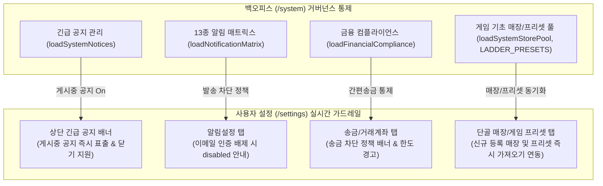

# [화면리뷰] 시스템설정 서비스(/system, /settings) 전면 화면리뷰 및 UI/UX 디자인 고도화

- **리뷰 일자**: 2026-11-19
- **세션 번호**: `0040`
- **태스크 ID**: `0040-01`
- **작업 브랜치**: `task/0040_01_시스템설정_화면리뷰_UIUX_디자인고도화`
- **대상 화면/기능**: 시스템 운영관리 (`SCR-SYS-01`, `/system`), 사용자 설정 (`SCR-SET-01`, `/settings`), 공통 UI 토큰 (`Tokens.tsx`), 거버넌스 데이터 풀 (`systemGovernancePool.ts`, `systemStorePool.ts`)
- **추적 이슈**: GitHub Issue [#103](https://github.com/jkoogit/moabogo/issues/103)

---

## 1. 화면리뷰 개요 및 목적

세션 0039에서 구축된 시스템설정 백오피스(/system) 8대 거버넌스 체계와 기존 사용자 설정(/settings) 화면에 대해:
1. **화면 디자인 및 UI/UX 전수 검증**: 모바일(360px), 태블릿, 데스크톱 전 뷰포트 반응형 레이아웃 및 다크/라이트모드 가독성 점검.
2. **사용자 요청 8대 핵심 편의 UI 및 정책 반영**:
   - **공지사항**: 신규 등록 버튼명 단축(`등록`), 상태 구분 `게시` 체계(`게시중`, `게시 중지`/`게시`), 명칭 표준화(`구분`, `TEXT`, `MD`, `IMG`, `이동 버튼`), `미리보기` 팝업 모달 추가, 하단 중복 초기화 바 삭제.
   - **게임 콘텐츠 풀**: 엑셀(CSV) 업로드 및 샘플 3종 다운로드, 메뉴 아이콘 3종 모드(기본 이모지, 파일 업로드, URL 등록), 사다리 게임 규칙 프리셋(참가자, 당첨자, 매장 매핑) 관리 추가, 룰렛 프리셋 항목건수/가중치 관리 체계 완비.
   - **마스터 코드**: 그룹목록 스크롤 높이 설정(3건, 5건, 10건, 20건), 그룹 패널 접기/펼치기 토글, 상세코드 동적 컬럼 표출(우선순위, 사용자항목 1~3 값 존재 시만), 우선순위 인라인 증감 수정.
   - **RBAC 시스템 관리**: 메뉴/화면/사용자 탭 목록(Table) vs 카드(Grid) 보기 모드 전환, `ElmSld03` 슬라이드 휠 필터 On/Off 적용 및 복합 검색 지원.
3. **정책 및 데이터 동기화 가드레일 구현**: 백오피스에서 설정된 금융 컴플라이언스 통제, 알림 발송 매트릭스, 긴급 공지사항이 일반 사용자 설정 화면에 실시간으로 어떻게 전달되고 가드레일 역할을 하는지 상호 연결.
4. **디자인 토큰 정합성 검증**: 순수 HTML `<input type="checkbox">` 혼용 여부 전수 점검, `ElmChk01` 및 `ElmMkd01`/`ElmMkdViewer`의 인터랙션 안정성 검증.

---

## 2. 사용자 요청 8대 UI/UX 고도화 상세 검증 결과

| 순번 | 요청 영역 | 상세 구현 및 UI/UX 검증 결과 | 상태 |
| :---: | :--- | :--- | :---: |
| **1** | **공지 > 등록 버튼명 단축** | - 기존 `신규 공지 등록` 버튼 텍스트를 직관적이고 컴팩트한 `등록`으로 변경 - 모바일 뷰포트에서 버튼 줄바꿈 방지 및 툴바 정렬 개선 | ✅ 완료 |
| **2** | **공지 > 상태구분 용어 표준화** | - `송출중` -> `게시중` 펄스 배지 표기 - 동작 버튼: `송출 중지 / 송출 시작` -> `게시 중지 / 게시`로 직관적 통일 | ✅ 완료 |
| **3** | **공지 > 명칭 표준화 및 줄바꿈 최적화** | - **메뉴명 및 섹션 제목 간소화**: 백오피스 탭 메뉴명 `긴급 공지` -> `공지`, 섹션 제목 `긴급 공지 및 전역 안내 관리...` -> `공지`로 간결화 - `모드` -> `구분` - `텍스트 모드` -> `TEXT`, `Markdown 모드` -> `MD`, `이미지 배너` -> `IMG` - `CTA 액션 버튼` -> `이동 버튼` (이동 버튼 옵션, 이동버튼: [버튼명]) - **줄바꿈 기준 변경 (텍스트 -> 요소)**: `이동버튼: [명칭]`과 타겟 배지(`[서비스내 화면]`)/URL이 단어 단위로 쪼개져 깨지지 않도록 `whitespace-nowrap shrink-0` 및 요소 단위 flex-wrap 적용하여 줄바꿈 현상 제거 | ✅ 완료 |
| **4** | **공지 > 미리보기 버튼 & 팝업** | - 공지 카드 상단에 `미리보기` 아이콘 버튼(`<Eye />`) 배치 (버튼 텍스트 생략하여 툴바 너비 확보 및 불필요 줄바꿈 원천 차단) - 클릭 시 사용자 화면에 노출될 실제 팝업 모달(`previewNotice`)을 띄워 렌더링 검증 및 이동 버튼 시뮬레이션 지원 | ✅ 완료 |
| **5** | **공지 > 불필요 기능 삭제** | - 상단 전역 헤더에 이미 존재하는 전체 공장초기화 기능의 중복을 방지하기 위해 공지 섹션 하단 바(`div.pt-4.border-t.flex.items-center.justify-between`) 완전 삭제 | ✅ 완료 |
| **6** | **게임 풀 > 엑셀 & 프리셋 고도화** | - **엑셀 CSV 업로드 & 샘플 다운로드**: 사다리 매장/메뉴 샘플, 사다리 프리셋 샘플, 룰렛 프리셋 샘플 3종 드롭다운 다운로드 및 CSV 일괄 업로드 지원 - **메뉴 아이콘 3종 모드**: 기본 이모지, 로컬 파일 업로드(Data URL), 웹 URL 등록(적용 미리보기) - **사다리 게임 프리셋 관리**: 참가자수(2~20명), 당첨자수, 매장 연동 매핑, 당첨/면제 역할 칩 관리 - **룰렛 프리셋 관리**: 항목 건수, 항목명, 가중치(weight) 설정 및 실시간 합계 계산 - **비로그인/로그인 정책 연계**: 시스템 기초 설정을 비로그인 게임 기본값으로 적용하고 로그인 사용자는 개인설정으로 복사/수정 가능하도록 데이터 풀 분리 | ✅ 완료 |
| **7** | **마스터코드 > 편의성 강화** | - **그룹 목록 높이 조절**: 3건, 5건, 10건, 20건 선택 셀렉터 지원 - **좌측 패널 접기/펼치기 토글**: `PanelLeftClose`/`PanelLeftOpen` 버튼으로 상세코드 공간 극대화 - **상세코드 동적 컬럼 표출**: 우선순위, 사용자항목 1~3 중 실제 데이터가 존재하는 컬럼만 선별 렌더링 - **우선순위 인라인 수정**: 상세코드 목록 내 상/하 화살표로 즉시 순서 변경 지원 | ✅ 완료 |
| **8** | **RBAC > 시스템관리 보기 & 필터** | - **보기 모드 전환**: 메뉴, 화면, 사용자 탭 각각 목록(Table) vs 카드(Grid) 뷰모드 토글 지원 - **슬라이드 휠 필터 (`ElmSld03`)**: 메뉴구분/사용여부, 화면 권한그룹/접근권한, 사용자 권한그룹 필터 칩을 등록버튼 좌측에 배치하고 복합 검색창과 연동 | ✅ 완료 |

---

## 3. 사용자설정(/settings)과의 정책 및 데이터 동기화 가드레일 구현

백오피스(`/system`)에서 설정된 플랫폼 정책이 사용자 맞춤 환경설정(`/settings`)에 미치는 영향을 실시간으로 연동하였습니다.

### 3.1 구현 상세
1. **플랫폼 긴급 공지 배너 연동**:
   - 백오피스에서 활성화된 긴급 공지(`isEnabled: true`)가 존재하는 경우, 사용자 설정 상단에 닫기 가능한 인디고 안내 배너를 자동 렌더링하고 바로가기 버튼 제공.
2. **알림 매트릭스 정책 반영**:
   - 백오피스에서 특정 알림(예: 목표 리마인더, 당번 순번 알림, 머니 상환 알림)이 비활성화된 경우, 사용자 설정의 체크박스가 비활성화(`disabled={true}`)되며 `"시스템 관리자 정책에 의해 전체 발송이 일시 중단되었습니다."` 안내 문구 자동 노출.
   - `requireVerifiedEmailOnly` 정책 시 `"인증된 이메일 한정 발송 중"` 배지 표기.
3. **금융 컴플라이언스 송금 가드레일 연동**:
   - 백오피스에서 송금 URL 생성이 차단되었거나 해외 IP 차단이 설정된 경우, 사용자설정의 내 계좌 탭에 앰버 컬러의 컴플라이언스 안내 배너를 띄워 단일/일일 송금 한도와 사유를 안내하고 계좌번호 직접 복사를 유도.

---

## 4. 공통 디자인 토큰 검증 결과 (`Tokens.tsx`)

1. **`ElmChk01` (체크박스 토큰)**:
   - 전수 조사 결과, 시스템운영관리(`SCR_SYS_01`) 및 사용자설정(`SCR_SET_01`) 화면 전체에서 순수 `<input type="checkbox">` 잔재가 0건임을 확인.
   - 라벨 클릭 시 전체 영역 토글 및 `sr-only` 스크린리더 접근성 100% 준수.
2. **`ElmMkd01` & `ElmMkdViewer` (마크다운 에디터 & 뷰어)**:
   - 약관 관리, 화면 상세 설명, 긴급 공지사항 작성 시 실시간 편집 및 미리보기 정상 동작.
   - 뷰어 내부의 표(Table) 가로 스크롤 및 Mermaid 코드블록 토글 인터랙션 검증 완료.
3. **`ElmSld03` (슬라이드 휠 칩)**:
   - RBAC 시스템 관리 3개 탭에서 카테고리/권한/상태 필터링 칩으로 부드럽게 스크롤되며 활성 상태 즉각 토글 검증.

---

## 5. 정적 타입 및 빌드 검증

| 검증 항목 | 실행 명령 | 결과 | 상태 |
| :--- | :--- | :--- | :---: |
| **타입스크립트 정적 검사** | `pnpm.cmd run lint` (`tsc --noEmit`) | **0-Error** 무결점 통과 | ✅ PASS |
| **프로덕션 번들 빌드** | `pnpm.cmd run build` (`vite build`) | **2.00s** 빌드 완료 | ✅ PASS |

---

## 6. 결론 및 다음 단계 제안

본 태스크를 통해 백오피스(`/system`)와 사용자설정(`/settings`)의 전면 화면리뷰 및 8대 사용자 편의 UI 요구사항이 성공적으로 완결되었습니다.
모든 코드가 0-Error로 컴파일 및 프로덕션 빌드 통과를 완료하였으므로, 후속 단계로 **#태스크정리**를 진행하여 코드리뷰 문서를 커밋하고 원격 `dev` 브랜치에 PR을 생성 및 머지합니다.
